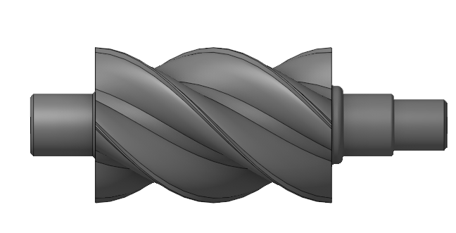
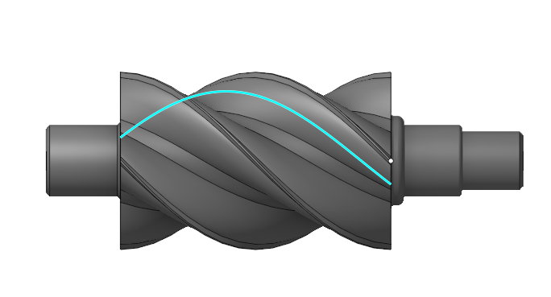
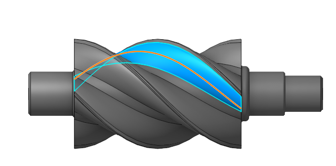
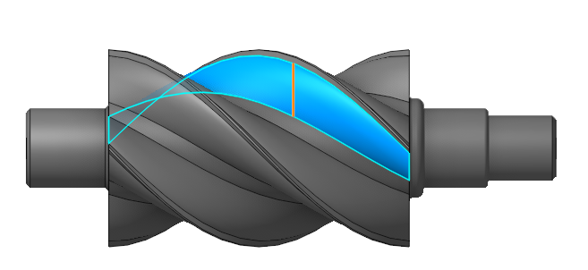
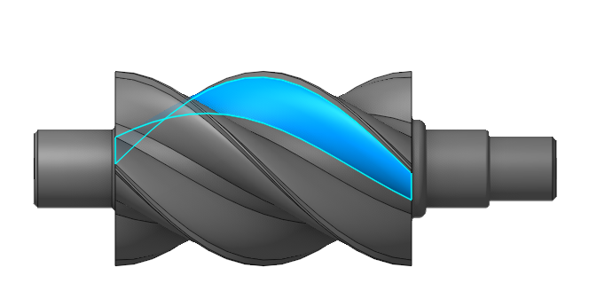
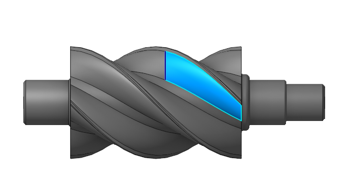
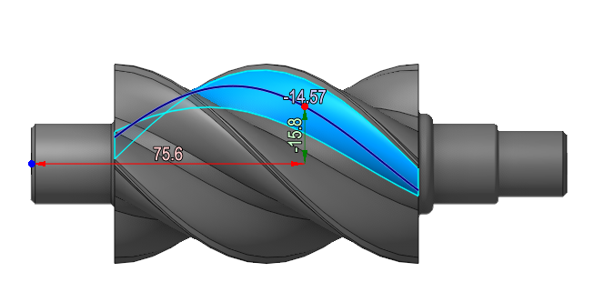
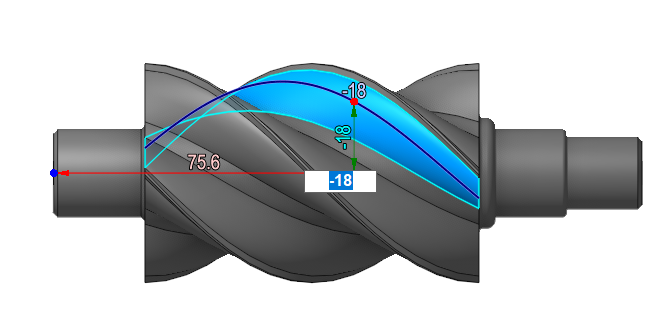

# アイソライン（等高線）の抽出

 

## 適用分野:

アイソラインの抽出ツールは、サーフェスからアイソライン（等高線）を抽出します。このツールは、<strong>モデル</strong>タブで面を選択すると有効になります。編集パネルでは、スプラインの作成、アイソラインの方向変更、または面の分割を行うことができます。スプラインを正確な位置に配置するには、<strong>測定</strong><strong>ツール</strong>を使用してください。

-  アイソラインからスプラインを作成します。

 

-  アイソラインの方向を変更します。.

 

-  1つの面を2つの面に分割します。分割後に共通の面（分割されない面）を保持するかどうかを選択できます。

 

- スプラインを正確に定義するには、<strong>測定ツール</strong>を使用します。点をパーツ上の任意の位置へ移動して、目的の位置に固定できます。終点を固定した後は、スプラインの位置を調整できます。

.

 
