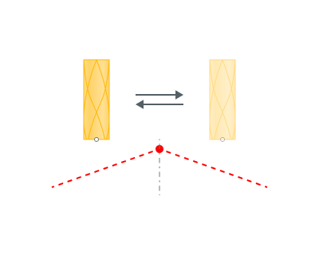
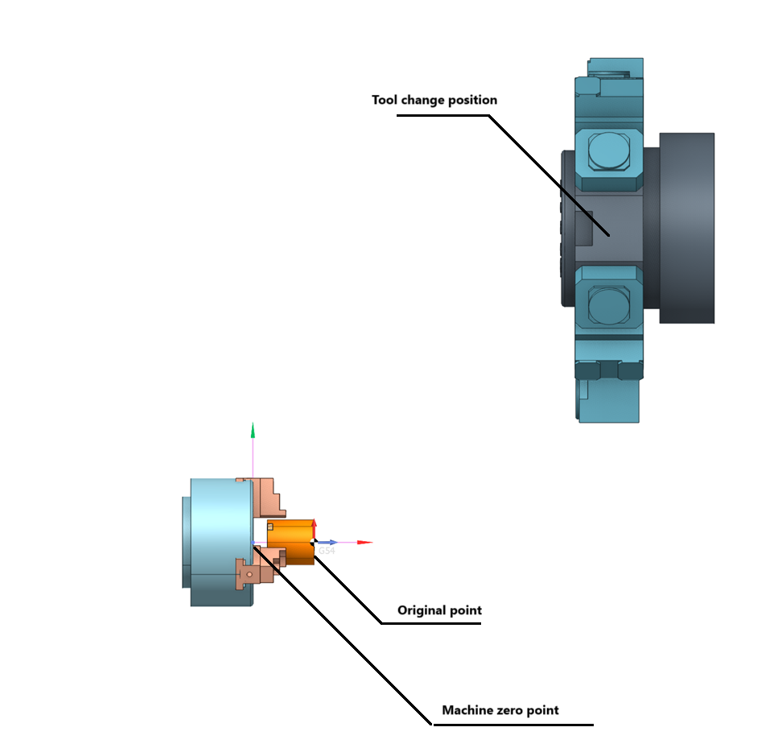
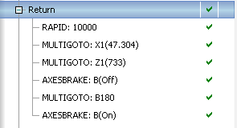
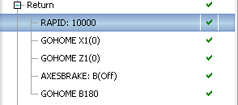
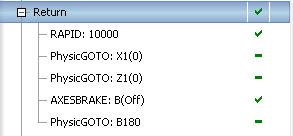
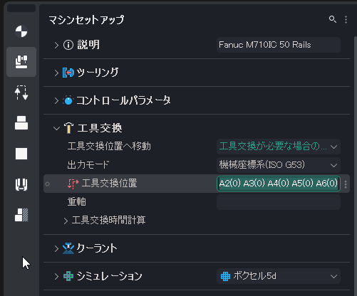

# 工具交換の位置



## 適用分野：

工具交換の位置は、工具交換が実行される機械上の位置です。CAMシステムでは、ジョブリスト全体の デフォルトの工具交換の位置を指定でき、必要に応じて個々のオペレーションでこの設定を上書きすることも可能です。 工具交換の位置の定義は必須ではありません。工具交換の位置を定義しない場合、シミュレーションモードでは工具交換はシミュレーションされません。 この設定は通常、工具交換中に機械や部品を損傷する危険性がない場合に、従来の3軸フライス加工に使用されます。ただし、5軸ミーリングやMill-Turn機などの複雑な機械では、安全かつ効率的な加工のために有効な工具交換位置の指定が重要です。

工具交換の位置は、機械座標系(G53)における機械座標の集合(例えば上図のX1(0) Y1(0) Z1(0)...)として定義されます。これらの座標は物理的な座標であり、ワーク座標系における工具先端の座標ではありません。つまり、複合旋盤の場合、その座標はタレットヘッドの中心点の座標となります。



実際の作業では、次のオプションのリストから工具交換位置を選択できます。

1. 前のオペレーションから -工具交換の位置は、前のオペレーションから継承されます。

2. マシンから - 工具交換の位置は、機械ノードで指定された位置から継承されます。

3. カスタム- この項目を選択すると、工具交換の位置変更ダイアログが表示されます。

工具交換の位置ダイアログは、工具交換位置の定義と、対話式モードでの実際のオペレーションにおける工具交換の動作の定義に使用します。ここで設定できます。

1. モード（割り当て方法） （衝突回避、最短、ルートから、前のオペレーションから、カスタム）

2. 工具交換の位置の使用

- 自動 (工具交換の位置に移動)このオプションを選択すると、隣接する2つのオペレーションで異なる工具番号の工具が使われる場合にのみ、工具交換位置が使用されます。隣接する2つのオペレーションで同じ工具が使われる場合、工具交換用のNCコードは生成されず、2つ目のオペレーションは単に 前のオペレーションの最終ポイントから加工を開始 します。これはデフォルトの動作になります。
- 常に使用 このオプションを選択すると、工具は無条件に加工が終了した時にに工具交換位置に移動します。
- 使用しない 加工終了時に工具が工具交換位置に行きません。

3. 工具交換出力モード

- 工具先端の座標 CAMシステムは、ワーク座標系における工具先端の座標を表す通常のGOTOおよびMULTIGOTOコマンドを使用して、工具交換動作を生成します。



-

  - リファレンス点(ISO G28) このオプションを選択すると、工具交換位置決めのためにCAMシステムが<strong>GOHOME</strong>コマンドを生成します。<strong>GOHOME</strong>コマンドは機械座標系の座標を表し、ポストプロセッサーで「リファレンス点復帰」（ISO G28）コマンドを生成するために使用できます。



-

  - 機械座標 (ISO G53) このオプションを選択すると、工具交換位置決めのためにCAMシステムが<strong>PhysicGOTO</strong>コマンドを生成します。<strong>PhysicGOTO</strong>コマンドは機械座標系の座標を表し、ポストプロセッサーで「機械座標移動」（ISO G53）コマンドを生成するために使用できます。



4. 工具交換位置の座標

座標はリストで指定します。工具交換の位置を定義するには、該当する軸の チェックボックスをオンにして、軸の値を設定 します。機械座標系（G53）とワーク座標系（G54）の両方で軸座標を設定できます。結果はスクリーンに表示されます。工具交換の位置を定義する便利な方法として、マウスのホイールで軸の座標を変更し、グラフィックビューで結果を確認 しながら設定することができます。

デフォルトの工具交換位置は、マシンセットアップパラメータパネルで指定できます。



マシン構成ファイル内の`ToolChangeMachineState`タグにおいて定義されます。

```
<SCType ID="TMyMachine" type="AbstractMachine" Enabled="true">
```

`SimulateToolChange DefaultValue="true"/`

`ToolChangeMachineState DefaultValue="X1(0) Y1(0) Z1(0) B180 A0 X2(0) Z2(0)"/`

`/SCType`
