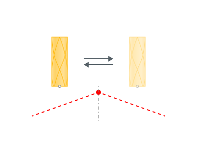
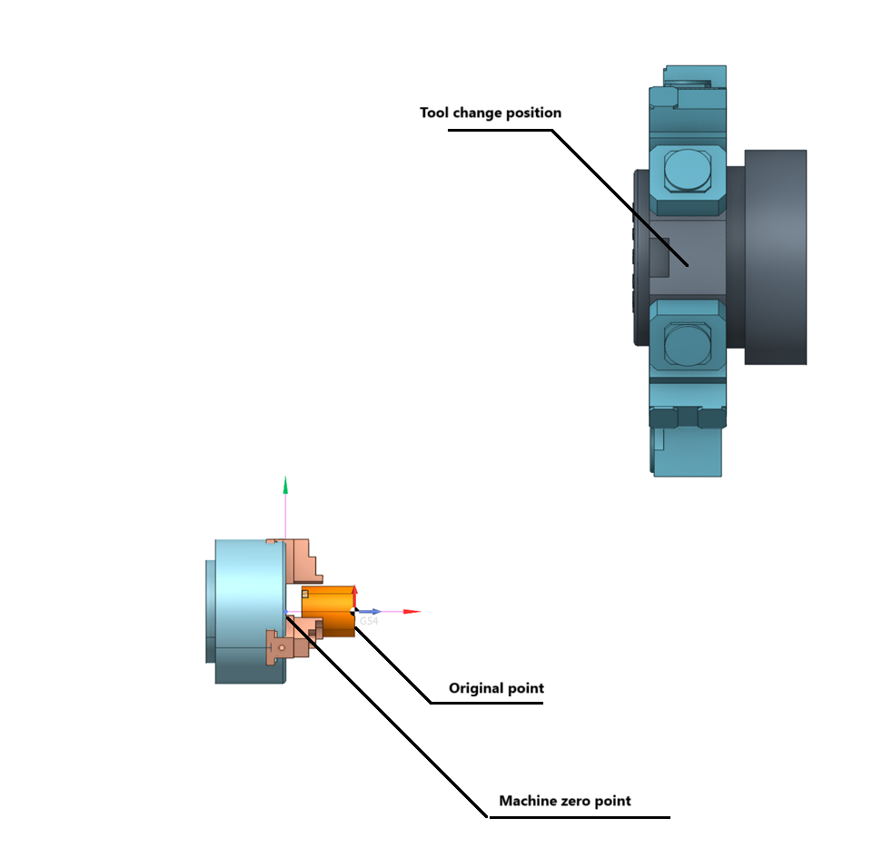
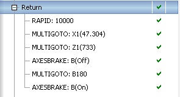
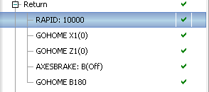
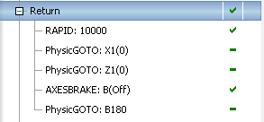
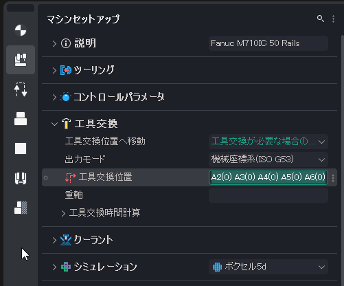

# Posição de mudança de ferramenta



## Área de aplicação:

A posição de troca de ferramenta é a posição da máquina na qual a troca de ferramenta é realizada. No sistema CAM você pode especificar uma posição de troca de ferramenta padrão para uma lista de trabalhos inteira e substituir esta configuração em operações individuais conforme necessário. A posição de troca da ferramenta é especificada na seção Aproximação/Retorno no painel Configuração da operação. A definição de uma posição de troca de ferramenta não é obrigatória. Se não se definir uma posição de troca de ferramenta, então no modo Simulação a troca de ferramenta não será simulada. A ferramenta simplesmente aparece no início da operação atual e desaparece no final da operação. Esta configuração é geralmente usada para fresamento convencional de 3 eixos quando não há risco de danificar uma máquina ou peça durante a troca de ferramentas. No entanto, para máquinas complexas, como centros de fresamento de cinco eixos e máquinas de torneamento-fresamento, especificar uma posição de troca de ferramenta válida é crucial para uma usinagem segura e eficiente em termos de tempo.

Uma posição de troca de ferramenta é definida como um conjunto de coordenadas de máquina (por exemplo, na imagem acima X1(0) Y1(0) Z1(0)...) no sistema de coordenadas da máquina (G53). Essas coordenadas são as coordenadas físicas e não as coordenadas da ponta da ferramenta no sistema de coordenadas da peça de trabalho. Portanto, para um torno-fresador, essas coordenadas são as coordenadas do ponto central do cabeçote da torre.



Para a operação atual, é possível selecionar a posição de troca de ferramenta na lista das seguintes opções

1. Da operação anterior - a posição de troca de ferramenta é herdada da operação anterior.

2. Da máquina - a posição de troca da ferramenta é herdada da posição especificada no nó da máquina.

3. Personalizado. Se você selecionar este item, será exibida a caixa de diálogo da posição de troca de ferramenta.

A caixa de diálogo da posição de troca de ferramenta é usada para definir, em modo interativo, a posição de troca de ferramenta e o comportamento da troca de ferramenta para a operação atual. Aqui você pode definir:

1. Modo (modo de atribuição) (Evitar colisão, Curto, Da raiz, Da operação anterior e Personalizado).

2. Utilização da posição de troca de ferramenta.

- Auto (vá para a posição para troca de ferramenta). Se esta opção for selecionada, a posição de troca de ferramenta será usada somente quando duas operações vizinhas utilizam ferramentas diferentes com números de ferramentas diferentes. Se duas operações vizinhas utilizam a mesma ferramenta então nenhum código NC é gerado para a troca de ferramenta, a segunda operação apenas inicia a usinagem no último ponto da operação anterior. Este é o comportamento padrão.
- Use de qualquer maneira. Quando a opção é selecionada, uma ferramenta passa incondicionalmente para a posição de troca de ferramenta ao final da operação.
- Não use. A ferramenta não passa para a posição de troca de ferramenta no final da usinagem.

3. Modo de saída de troca de ferramenta.

- Tool Tip coordinates (coordenadas da ponta da ferramenta). O sistema CAM gera os movimentos de troca de ferramenta usando comandos regulares GOTO e MULTIGOTO, representando as coordenadas da ponta da ferramenta no sistema de coordenadas da peça.



- Ponto de referência (ISO G28). Quando selecionada, a opção força o sistema CAM a gerar os comandos GOHOME para posicionamento de troca de ferramenta. Os comandos GOHOME representam coordenadas no sistema de coordenadas da máquina e podem ser utilizados no pós-processador para gerar comandos "Ir para ponto de referência" (ISO G28).



- Coordenadas da máquina (ISO G53). Quando selecionada, a opção força o sistema CAM a gerar os comandos PhysicGOTO para o posicionamento de troca de ferramenta. Os comandos PhysicGOTO representam coordenadas no sistema de coordenadas da máquina e podem ser usados no pós-processador para gerar comandos "Ir para coordenadas da máquina" (ISO G53).



4. Coordenadas da posição de troca da ferramenta.

As coordenadas são especificadas na lista. Para definir uma posição de troca de ferramenta você deve marcar as caixas próximas aos eixos apropriados e definir os valores para os eixos. As coordenadas dos eixos podem ser definidas tanto no sistema de coordenadas da máquina (G53) quanto no da peça (G54). O resultado é exibido na tela. Uma maneira conveniente de definir uma posição de troca de ferramenta é usar a roda do mouse para alterar as coordenadas dos eixos enquanto se observa o resultado na vista gráfica.

A posição de troca de ferramenta padrão pode ser especificada no painel de parâmetros da máquina



e em um arquivo de configuração de máquina na tag **ToolChangeMachineState**.

```
<SCType ID="TMyMachine" type="AbstractMachine" Enabled="true">
```

`SimulateToolChange DefaultValue="true"/`

`ToolChangeMachineState DefaultValue="X1(0) Y1(0) Z1(0) B180 A0 X2(0) Z2(0)"/`

`/SCType`
