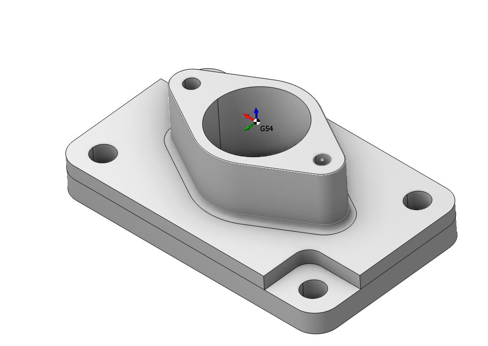
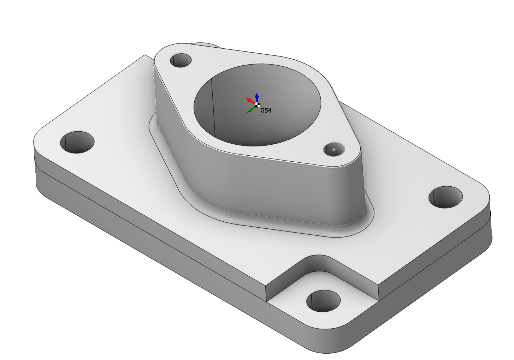
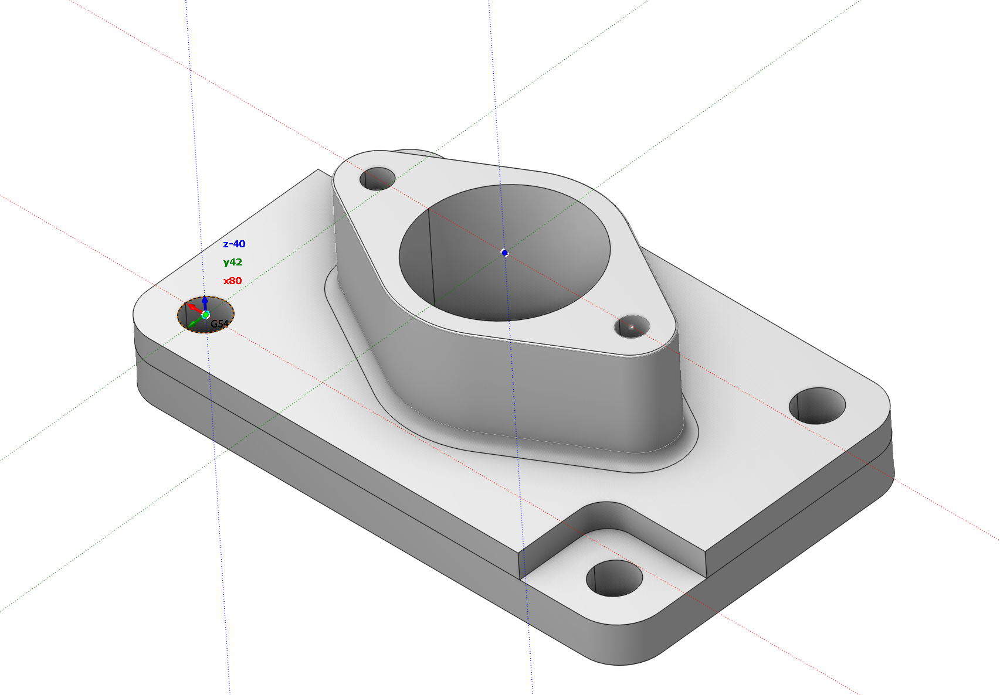

# ワーク座標系 (G54 - G59)

## 適用分野：

ワーク座標系（WCS、G54 – G59）は、ワーク上のNCプログラムの「原点」を定義します。加工モードおよびシミュレーションモードでは、ワーク座標系が常に画面に表示されます。

## ウィンドウの操作方法。

ワーク座標系は、ドロップダウンリストから選択する方法と、省略記号ボタンをクリックしてインタラクティブに設定する方法の2通りで定義できます。

ドロップダウンリストには、次の選択肢があります。

1. Off - ワーク座標系を無効にします。ワーク原点は、機械原点G53と一致します。

2. From previous - 前のオペレーションのワーク座標系を使用します。

3. プロジェクトの幾何[座標系](753.md)の一覧。幾何座標系をワーク座標系として使用できます。この場合は幾何座標系の原点だけが使用され、軸の向きはワーク座標系の定義には影響しません。

WCSパラメータの横にある省略記号ボタンをクリックすると、インタラクティブモードでWCSを指定できます。

インタラクティブモードでは、標準的な<strong>ドラッグ＆ドロップ</strong>操作で、グラフィックビュー内のWCS原点の位置を変更できます。画面上のWCSにマウスポインタを合わせると、ハイライト表示されます。左マウスボタンを押すとドラッグが開始されます。その後、パーツまたはワークの形状にスナップさせて座標系の位置を変更できます。また、このモードではWCS番号（54-59など）も変更できます。

 

変更に応じて、CAMはオペレーションヘッダーのCLDataを更新します。次の例では、ヘッダーに`ORIGIN G54`コマンドが追加されます。

