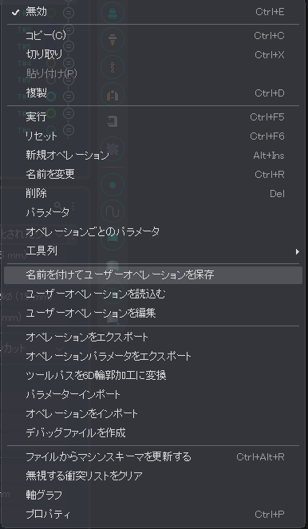
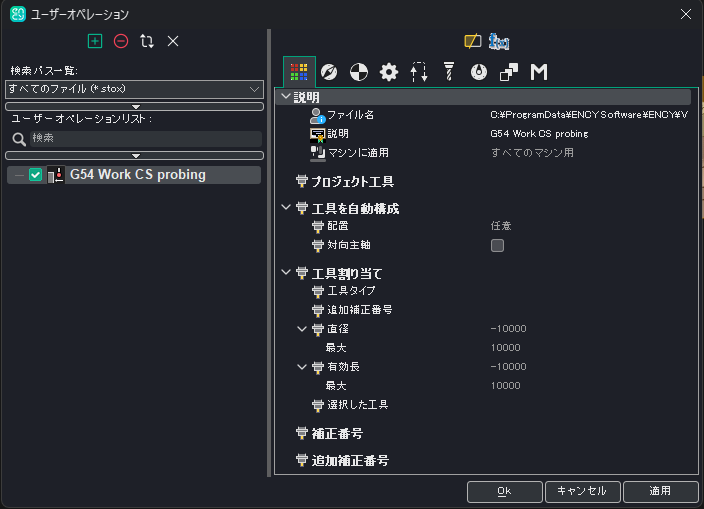
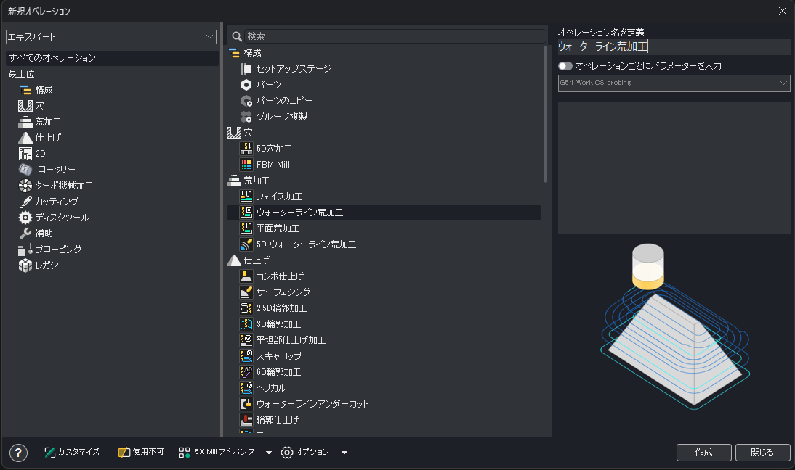
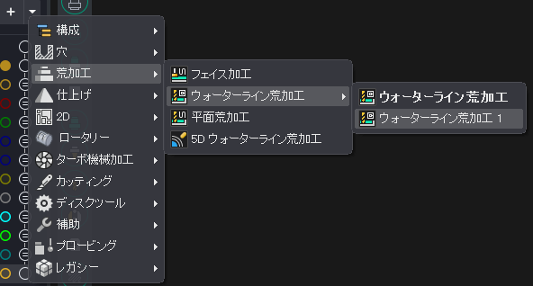

# Benutzeroperationen

Jede Bearbeitungsoperation besitzt einen umfangreichen Parametersatz für unterschiedliche Strategien und Bauteile. Neu erstellte Operationen enthalten bereits Systemstandardwerte und sind damit für die Werkzeugwegberechnung vorbereitet.

Die Erstellung eines Bearbeitungsprozesses umfasst üblicherweise folgende Schritte:

- Bearbeitungsstrategie für ein Bauteilelement festlegen.
- Eine passende Operation auswählen.
- Die Operation erstellen und das Bauteilelement als Auftragszuweisung festlegen.
- Werkzeugweg berechnen.
- Werkzeugweg analysieren.
- Operationsparameter zur Verbesserung des Ergebnisses anpassen.
- Die letzten drei Schritte bis zum gewünschten Ergebnis wiederholen.

Die Vielzahl universeller Parameter kann die Einrichtung aufwendig machen. **Benutzeroperationen** verkürzen diesen Aufwand, indem bewährte Einstellungen für bestimmte Aufgaben wiederverwendet werden.

Ein eingerichteter Parametersatz kann unter einem Namen in einer externen *.stox-Datei gespeichert werden. Für ein ähnliches Bauteilelement wird dieser Satz wieder geladen. Auch mehrere Operationen können gemeinsam gespeichert werden: Fassen Sie sie dazu in einer Gruppe zusammen und speichern Sie diese als Benutzeroperation.

Zum Übertragen auf einen anderen Computer kopieren Sie die entsprechenden *.stox-Dateien.

Die Befehle zum Speichern und Laden stehen im Kontextmenü der Operationsliste auf der Registerkarte für die Bearbeitungstechnologie zur Verfügung.

**Save as User operation...** speichert die Parameter der aktuellen Operation unabhängig vom Projekt in einer *.stox-Datei. Vor dem Speichern öffnet sich das Fenster der Benutzeroperationen, in dem weitere Eigenschaften festgelegt werden können.

Links befinden sich die Suchpfadliste, die verfügbaren Benutzeroperationen und ein Filter. Sie können nach Dateipfad, Operationstyp, Maschine oder Namen filtern.

Die Schaltflächen oberhalb der Listen dienen zu deren Verwaltung:

-  Öffnet die Ordnerauswahl und ergänzt den Ordner zur Suche nach *.stox-Dateien.
-  Entfernt den Ordner aus der Suchliste, ohne ihn vom Datenträger zu löschen.
-  Sucht erneut nach *.stox-Dateien in den eingetragenen Ordnern.
-  Löscht die ausgewählte Datei vom Datenträger und entfernt sie aus der Liste. Über das Kontrollkästchen neben einem Operationsnamen kann dessen Sichtbarkeit und Verfügbarkeit stattdessen deaktiviert werden, ohne die Datei zu löschen.

Rechts zeigt der Eigenschafteninspektor die Parameter der ausgewählten Benutzeroperation, gegliedert nach Registerkarten. Die erste Registerkarte  enthält folgende Grundeinstellungen:

- **File name (Dateiname).** Vollständiger Name der *.stox-Datei. Der Speicherort entscheidet, ob die Operation allen Benutzern des Computers oder nur dem aktuellen Benutzer zur Verfügung steht. Standardmäßig wird ein gemeinsamer Ordner für Benutzeroperationen verwendet. Andere Namen und Speicherorte einschließlich Netzwerkpfaden sind möglich.
- **Caption (Bezeichnung).** Name in der Liste und Standardname beim Hinzufügen zum Bearbeitungsprozess.
- **Icon file name (Symboldatei).** Bilddatei in einem unterstützten Format, die neben dem Operationsnamen angezeigt wird.
- **Applicable to machines (Für Maschinen verfügbar).** Beschränkt die Verfügbarkeit auf bestimmte Maschinen. Bei **For all machines** ist die Operation unabhängig von der aktiven Maschine verfügbar. Bei **For selected machines** markieren Sie die zulässigen Maschinen in der Liste.

Die übrigen Registerkarten hängen vom Operationstyp ab. Ihre Werte können bearbeitet werden, ohne die ursprüngliche Operation zu ändern, aus der die Benutzeroperation erstellt wurde.

Oberhalb der Parameterliste stehen Schaltflächen für deren Darstellung:

-  Blendet Parameter ein oder aus, deren Werte den Systemstandardwerten entsprechen. Dadurch sind abweichende Einstellungen leichter erkennbar. Standardwerte erscheinen grau. Um einen bearbeiteten Wert zurückzusetzen, markieren Sie den Feldinhalt und drücken **Entf**.
-  Zeigt Formeln berechneter Parameter an und ermöglicht ihre Bearbeitung. Neben festen Zahlen und Zeichenfolgen können Ausdrücke verwendet werden, die von anderen Parametern abhängen. Berechnete Felder erscheinen grün. Unterstützt werden mathematische Operationen `+, -, *, /, ^, (, ), ,`, trigonometrische Funktionen und Parameterverweise. Ein Parametername wird dafür in eckige Klammern gesetzt, beispielsweise `[Length]`.

Eine zuvor gespeicherte Benutzeroperation kann auf mehrere Arten in ein Projekt eingefügt werden.

Wählen Sie sie im [Fenster zum Erstellen neuer Operationen](91.md) aus.

Alternativ verwenden Sie das Menü neben **New** auf der Registerkarte für die Bearbeitungstechnologie.

Die Parameter können auch auf eine bestehende Operation angewendet werden. Wählen Sie dazu im Kontextmenü **Load from User operation...**. Die Liste zeigt passende Benutzeroperationen für den aktuellen Operationstyp. Durch Auswahl eines Eintrags werden dessen Parameter in die aktuelle Operation geladen.

