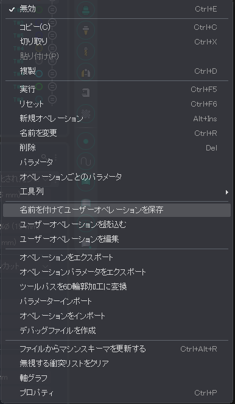
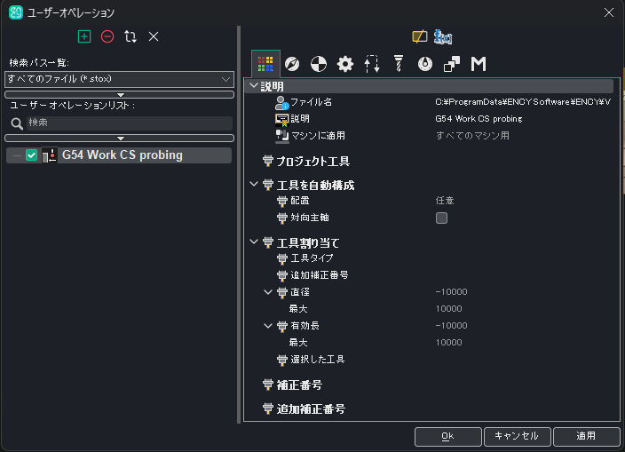
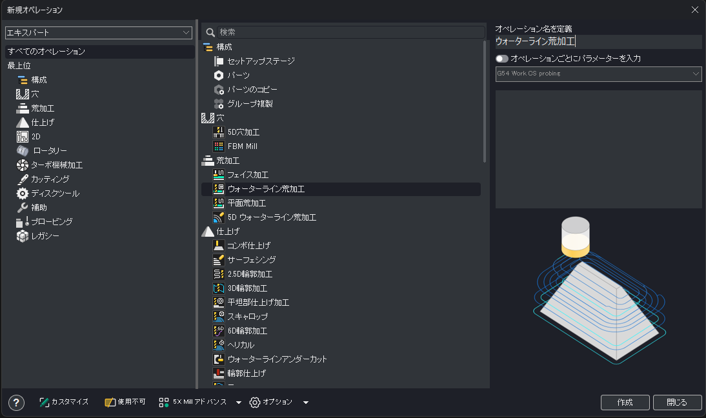
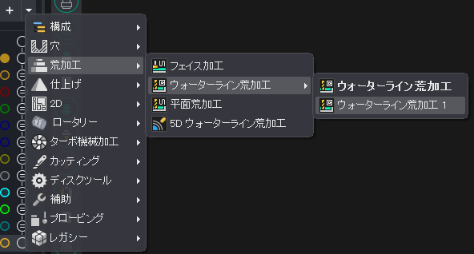

# ユーザーオペレーション

CAMシステムの各加工オペレーションには、豊富なパラメータセットが用意されており、複雑な加工プロセスに対しても柔軟な加工方法を構築し、精密な部品加工を可能にします。オペレーションを作成すると、すでにいくつかのパラメータ値が事前に設定されています。これを“システムデフォルトパラメータ（システムデフォルトパラメータ）”と呼びます。これでツールパス計算の準備が整います。

加工プロセスの作成には、一般的に以下のステップが含まれます。

- 部品の特定の要素に対する加工戦略を決定します。
- 適切な戦略を実行できる工程を見極めます。
- オペレーションを作成し、ジョブ割り当てとして加工部品の要素を指定します。
- ツールパスの計算します。
- ツールパスのアナライズをします。
- 加工オペレーションのパラメータを修正して、より良い加工結果を得ます。
- 後半の3つのステップは、望ましい結果が得られるまで繰り返す必要があります。

汎用的で柔軟な対応を実現するために、CAMシステムの各オペレーションには多数のパラメータが用意されています。そのため、オペレーションのカスタマイズには多くの時間と労力がかかる場合があります。この課題を軽減するために、CAMシステムには <strong>`ユーザーオペレーション`</strong> 機能が用意されています。これにより、汎用的なCAMオペレーションを用途に応じて特化させることが可能になります。

特定の用途に合わせてオペレーションを設定した後、そのパラメータセットを任意の名前で外部の <strong>*.stox</strong> ファイルとして保存することができます。次に類似した要素を加工する際には、このパラメータセットを読み込むことで、オペレーション設定にかかる時間を大幅に短縮できます。ユーザーオペレーションとしては、個々のオペレーションだけでなく、複数のオペレーションをまとめて保存することも可能です。その場合、対象のオペレーションをグループにまとめ、そのグループをユーザーオペレーションとして保存します。

ユーザーオペレーションは、対応するオペレーションの*.stoxファイルを転送するだけで、簡単に別のコンピュータにインポートできます。

デフォルトパラメータの保存および読み込みは、<strong>`加工`</strong> タブの <strong>`加工オペレーションのリスト`</strong> にあるオペレーションのポップアップメニューから行います。

<strong>`名前を付けてユーザーオペレーションを保存`</strong> を選択すると、現在のオペレーションのパラメータが専用の *.stox ファイルに保存されます。これにより、現在のプロジェクトとは独立して保存され、他のプロジェクトでも使用することができます。保存の前にユーザーオペレーションウィンドウが表示され、そこでいくつかのプロパティを設定することができます。

ウィンドウの左側には、ユーザーオペレーションのファイルを検索するための検索パスリスト、利用可能なユーザーオペレーションのリスト、フィルターパネルがあります。フィルターを使用すると、ファイルの場所、オペレーションの種類、マシン、または名前でオペレーションをすばやく見つけることができます。

リストをオペレーションするには、ウィンドウ左上にあるボタンを使用します。

-  フォルダー選択ダイアログを開き、ユーザーオペレーションのファイル（*.stox）を検索するためのパスリストに選択したフォルダーを追加することができます。
-  検索パスリストから選択したフォルダを削除します。その際フォルダは削除されません。
-  検索パスのリストに指定されたフォルダー内のユーザーオペレーション*.stoxファイルの検索を強制的に再開することができます。
-  選択されたユーザーオペレーションファイルをハードディスクから物理的に削除し、リストからも除外します。リスト内のオペレーション名の横にあるチェックボックスをオンにすると、ファイルを削除せずに、ユーザーオペレーションの表示とアクセシビリティをオフにできます。

ウィンドウ右側には、選択したユーザーオペレーションのパラメータをタブごとに表示するプロパティインスペクタがあります。最初のタブ には、以下の基本パラメータが含まれています。

- `ファイル名` *.stox のファイル名です。保存場所によって、このオペレーションはこのコンピュータのすべてのユーザーからアクセス可能にも、現在のユーザーのみに限定することもできます。デフォルトでは、ファイルはすべてのユーザーが利用可能なユーザーオペレーション用の専用フォルダに保存されます。ただし、任意の名前や保存場所（ネットワーク上の場所を含む）を指定することも可能です。
- `説明` ユーザーオペレーションの名称です。リストに表示され、技術プロセスにオペレーションを追加する際のデフォルト名として使用されます。
- `アイコンファイル名` オペレーション名の横に表示される、一般的な画像形式のアイコンファイル名です。
- `マシンに適用` オペレーションの適用範囲を制限するオプションです。現在アクティブなマシンに応じて、そのオペレーションを技術プロセスに追加できるかどうかを制御します。複数のマシンを1台のコンピュータで扱う場合に便利です。 `全てのマシン用` を選択すると、選択中のマシンに関係なくオペレーションが利用可能になります。 `選択されたマシン用` を選択すると、対象となるマシンの一覧が表示され、どのマシンでそのオペレーションを利用可能にするか指定できます。

他のタブにあるパラメータは、特定のオペレーションタイプによって異なる場合があります。これらすべてのパラメータは、元のCAMシステムオペレーションの設定を変更することなく、ユーザーオペレーションの値を簡単に編集できるようになっています。

パラメーターのリストの上には、これらのパラメーターの表示をコントロールするためのボタンがいくつか配置されています。

-  これにより、元のオペレーションに対して変更された重要なパラメータを簡単に識別できるようになります。インスペクターでは、デフォルト値と一致する値はグレーで表示されます。編集したフィールドの値をデフォルトの状態に戻すには、の内容を選択してキーボードのDeleteキーを押す必要があります。
-  では、計算パラメータの計算式を表示および編集できます。演算のパラメータの値は、数値や文字列の定数だけでなく、数式でも定義できます。これにより、他のパラメータに依存させることができ、より柔軟に動作を管理することができます。計算されたフィールドはインスペクターに緑色で表示されます。式は、数学演算「＋、ー、＊、／、^、（、）、＜、＞」や三角関数、他のパラメータへのリンクを使うことができます。別のパラメータへのリンクを式に追加するには、パラメータ名を角括弧 [ ] で囲んで指定します。例：[長さ]

以前に作成したユーザーオペレーションのインスタンスを、正確なプロジェクトの技術プロセスに追加するには、いくつかの方法があります。

[新規オペレーションウィンドウ](91.md)で、あらかじめ作成したユーザーオペレーションを選択します。

ユーザーオペレーションの作成は、<strong>`加工`</strong> タブの <strong>`新規`</strong> ボタン横にある新規オペレーションのポップアップからも行うことができます。

ユーザーオペレーションのパラメータは、オペレーションの作成時だけでなく、既存のオペレーションにも適用できます。このオペレーションのポップアップで `ユーザーオペレーションを読込む` メニュー項目を選択してください。このタイプのサイクルで利用可能なユーザーオペレーションのリストが表示されます。項目を選択すると、選択したユーザーオペレーションのパラメータが現在の CAM システムのオペレーションに読み込まれます。

