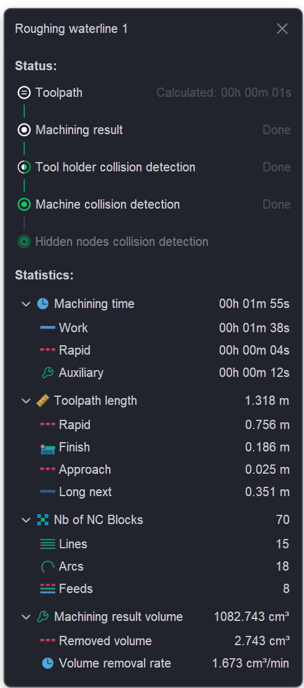

# Statuspanel einer Operation

## Anwendungsbereich:

Klicken Sie im Technologiebaum auf das Statussymbol neben dem Operationsnamen, um das Statuspanel zu öffnen.

Das **Statuspanel** zeigt den aktuellen Berechnungs- und Bearbeitungsstatus der Operation.

Es bietet folgende Informationen:

- Bearbeitungsschritte wie Werkzeugwegberechnung, Berechnung des Bearbeitungsergebnisses und Kollisionserkennung;
- Zeitstatistik der Werkzeugbewegungen nach Vorschubart;
- Kennzahlen des NC-Programms, insbesondere die Anzahl der NC-Sätze nach Knotentyp.

Die möglichen **Operationszustände** sind im folgenden Abschnitt ausführlich beschrieben. [Details](1118119.md)
