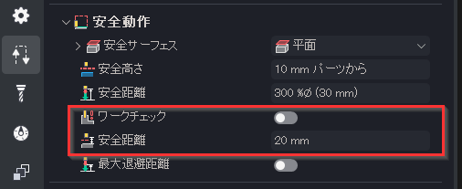
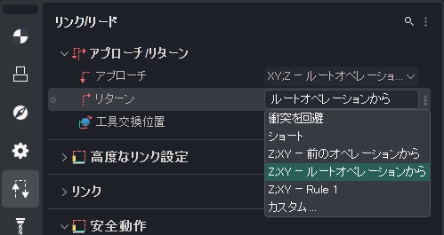

# Regras de aproximação e retorno

As regras de aproximação e retorno definem um caminho adicional de aproximação/retorno da ferramenta até o primeiro ponto de usinagem ou a partir do último. Quando usada em conjunto com a posição de troca da ferramenta, a regra de aproximação determina o percurso da ferramenta desde a posição de troca da ferramenta até o primeiro ponto de usinagem, enquanto a regra de retorno determina o percurso da ferramenta desde o último ponto de usinagem até a posição de troca da ferramenta.

#### Definindo regra de aproximação/retorno de uma operação

A regra de aproximação/retorno é especificada na seção Approach/Return do painel do inspetor <strong>Links/Leads</strong> da operação. A caixa de seleção indica se a aproximação/retorno é ou não gerada automaticamente para <strong>evitar colisões</strong>. <strong><em>Collision avoidance</em></strong> - gera a trajetória de aproximação/retorno automaticamente com um algoritmo especial, evitando colisões da máquina. Desmarque a caixa de seleção para selecionar este tipo de aproximação/retorno. Se este tipo for escolhido, é possível definir adicionalmente os parâmetros "<em>Safe distance</em>" e "<em>Check workpiece</em>" para a aproximação/retorno.

Se a caixa de seleção de aproximação/retorno estiver <strong>marcada</strong>, isso significa que a regra está definida explicitamente ou possui um dos tipos especiais listados abaixo. O campo de edição mostra a regra real, calculada de acordo com o tipo (oculto) de aproximação/retorno. Para ajustar a aproximação/retorno usada pela operação, basta editar o comando diretamente.

#### Tipos de definição de aproximação/retorno

A aproximação/retorno pode ter um dos seguintes tipos de definição. Este tipo é oculto e é mostrado apenas no [formulário de edição das regras de aproximação/retorno](10072.md).

<em><strong>Default rule</strong></em> - uma operação recém-criada tem a aproximação/retorno deste tipo. Para restaurar a regra padrão, limpe o campo de edição e pressione **Enter**. Os seguintes fatores são considerados no cálculo da regra real do tipo padrão (em ordem decrescente de prioridade): se a <strong>submáquina</strong> estiver definida para o par porta-peça/porta-ferramentas da operação, será usada a <strong>aproximação/retorno da submáquina</strong>. Consulte [Definição de submáquina nos esquemas da máquina](10410.md) para obter mais informações sobre submáquinas. Se a operação tiver o mesmo porta-peça e o mesmo conector da ferramenta que a operação anterior, a aproximação/retorno será obtida <strong>da operação anterior</strong>. Caso contrário, será usada a regra da <strong>etapa de preparação</strong> da operação ou a regra definida na primeira operação da árvore de operações (<strong>a máquina</strong>), caso não existam etapas de preparação ou a própria operação seja uma etapa de preparação.

2. <em><strong>Rule from the previous operation</strong>.</em>

3. <strong><em>Rule from root operation</em></strong> - usa a regra especificada na raiz da árvore de operações na guia 'Technology' (e não a regra única definida na máquina, como no sistema CAM legado anterior).

4. <strong><em>Custom</em></strong> - a regra é definida explicitamente como uma lista de comandos.

5. <strong><em>Short</em></strong> - nenhum ponto adicional é inserido no percurso da ferramenta. A ferramenta se move da posição de troca da ferramenta diretamente para o primeiro ponto do percurso de usinagem pela menor distância. Se a máquina for um robô, esse movimento é feito pelos eixos físicos (PhysicGOTO).

6. <strong><em>Rule(s) from the machine approach/return list</em></strong> - a operação pode fazer referência a um dos itens da [lista de aproximações/retornos](10073.md) da máquina. Várias aproximações/retornos podem ser especificados na máquina com nomes significativos. Primeiro é exibido o nome da regra e, em seguida, entre parênteses, a sequência de comandos da regra. Mais informações sobre a lista estão disponíveis em um artigo separado.

#### Sintaxe das regras de aproximação/retorno

Uma regra de aproximação/retorno <strong>Custom</strong> define explicitamente o <strong>CLData</strong> gerado na seção "Approach" ou "Return" do percurso da ferramenta. Uma regra de aproximação ou de retorno consiste em vários <em>comandos</em>, separados por <strong>ponto e vírgula</strong>. Um <em>comando</em> é definido por uma <em>palavra-chave</em>, que pode ser seguida por uma lista de nomes e valores (coordenadas) dos eixos da máquina.

A *lista de valores dos eixos* é definida como uma lista, separada por espaços, de IDs (ou endereços) dos eixos da máquina, com posições exatas opcionais dos eixos no estado correspondente ao *comando* dado. O valor do eixo pode ser especificado entre parênteses ou diretamente após o ID do eixo. Exemplos de definições de valores de eixos: X100 Y(200) Z A1 A2(253.2) A3(100.4) A4 A5 A6

Os seguintes **tipos de comando** (*palavras-chave*) são suportados: **MultiGOTO** (ou nenhum comando) + *lista de valores dos eixos* - define um movimento em múltiplas coordenadas (nó CLData "Multigoto"). **PhysicGOTO** (ou **G53**) + *lista de valores dos eixos* - define um movimento nas coordenadas dos eixos físicos (nó CLData "Physicgoto"). **GOTO** + *lista de valores dos eixos* (devem ser "X", "Y" ou "Z") - define um movimento linear simples (nó CLData "Goto"). **GOHOME** + *lista de valores dos eixos* - movimento para a posição "Tool change" (nó CLData "GOHOME"). Destina-se apenas às regras de retorno. **LCS** - comando multifuncional. A lógica geral é que um modo de usinagem é habilitado em um ponto específico da aproximação e depois desabilitado pelo mesmo comando no retorno. O CLData gerado depende dos parâmetros da operação: se o [sistema de coordenadas local da operação](726.md) estiver habilitado, o comando de habilitação do LCS ("Origin LCS: On") é gerado na aproximação e o de desabilitação do LCS (Origin LCS: Off) no retorno. Se "Tool center point management" estiver habilitado, o comando de habilitação do modo TCPM ("Interp 5axis: On") é gerado na aproximação e o de desabilitação do TCPM (Interp 5axis: Off) no retorno. Observação: o modo "TCPM" não pode ser usado simultaneamente com o sistema de coordenadas local. Habilitação/desabilitação da [interpolação polar](10083.md); habilitação/desabilitação do modo de [torneamento pelo eixo U](10409.md). **SLCS(**...**)** - usado para habilitar **temporariamente** o "sistema de coordenadas local" dentro da aproximação ou do retorno. Consulte a seção "Aproximação/retorno para operações com TCPM habilitado" abaixo para obter mais informações sobre este recurso.

###### Aproximação/retorno para operações com TCPM habilitado usando o LCS

O modo "Tool change point management" é comumente usado na usinagem em 5 eixos, mas surgem problemas quando a cinemática da máquina e a fixação do bruto no modelo não correspondem completamente à cinemática real da máquina e à fixação real da peça. Isso muito provavelmente causará uma colisão. A solução é executar alguns movimentos da máquina, colocados dentro do bloco **SLCS(**...**)**, no "sistema de coordenadas local" específico *antes* de o modo "TCPM" ser habilitado na aproximação. Se o comando **SLCS()** for usado, o modo "TCPM" será ativado no **final** da aproximação; ele será desativado no início do retorno, se a sequência de comandos estiver na regra de retorno.

O LCS usado por este comando não é definido pelos parâmetros da operação; ele corresponde ao **primeiro ponto** do percurso da ferramenta, se o comando **SLCS** estiver na **seção de aproximação**, e ao **último ponto** do percurso da ferramenta, se o comando estiver na **seção de retorno**. Os movimentos dos **eixos rotativos** devem ser feitos **antes** de habilitar este LCS.

Dentro dos parênteses, é possível especificar um ou mais comandos de movimento, por exemplo, SLCS(G53 X100; YZ). Esses movimentos serão executados no sistema de coordenadas local dado. Exemplo de regra de aproximação completa usando **SLCS()**: `G53 Z(-0.5); G53 X(0.5) Y(-0.5); AC; XY; SLСS(XYZ)`

#### Edição avançada de regras de aproximação/retorno

O campo de edição permite ajustar rapidamente a aproximação/retorno da operação. Se for necessário, por exemplo, vincular a aproximação da operação à operação anterior ou especificar uma sequência longa de comandos, use o [formulário de edição de aproximação/retorno](10072.md). Para abri-lo, clique no botão de reticências do campo de edição. O formulário também permite editar a lista de aproximações/retornos da máquina.

