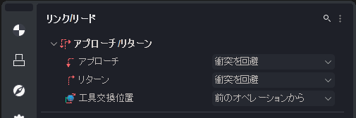
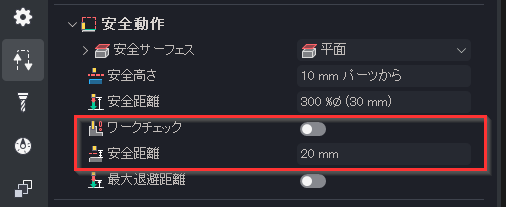
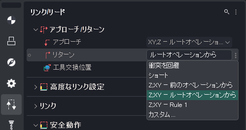

# アプローチとリターンのルール

アプローチおよびリターンのルールは、最初および最後の加工点への、または最後の加工点からの追加の工具アプローチ/リターン経路を定義します。工具交換位置のアプローチルールと併用することで、アプローチルールは、工具交換位置から最初の加工点までのツールパスを決定し、リターンルールは、最後の加工点から工具交換位置までの工具経路を決定します。

#### オペレーションのアプローチ／リターンルールの定義

アプローチ／リターンルールは、オペレーションの<strong>リンク／リード</strong> インスペクターパネルのアプローチ／リターンセクションで指定します。チェックボックスは、 <strong>衝突を回避</strong>するためのアプローチ／リターンが自動生成されるかどうかを示します。<strong><em>衝突回避</em></strong> - マシンの衝突を回避しながら、特別なアルゴリズムでアプローチ/リターンの軌道を自動的に生成します。このアプローチ／リターンのタイプを選択するにはチェックボックスを無効にします。このタイプを選択した場合、アプローチ/リターンの"<em>安全距離</em>"と"<em>ワークチェック</em>"パラメータを追加で定義できます。

アプローチ/リターンのチェックボックスが<strong>有効</strong>の場合、ルールが明示的に定義されているか、以下に示す特別なタイプのいずれかで定義されていることを意味します。編集フィールドには、アプローチ／リターン（非表示）タイプに基づいて計算された実際のルールが表示されます。オペレーションで使用するアプローチ／リターンを調整するには、コマンドを直接編集してください。

#### アプローチ／リターンの定義タイプ

アプローチ／リターンは以下のいすれかの定義タイプを持ちます。このタイプは通常は非表示で、 [アプローチ／リターンルール編集フォーム](10072.md)でのみ表示されます。

<em><strong>デフォルトルール</strong></em> - 新規作成されたオペレーションのアプローチ/リターンはこのタイプが運用されます。ルールをデフォルトに戻すには、編集フィールドをクリアして**Enter**を押します。 デフォルトタイプの実際のルール計算時に考慮される要素は、以下の通りです（優先度の高い順）： <strong>サブマシン</strong> がオペレーションのワークホルダー/工具ホルダーのペアに対して定義されている場合、 <strong>サブマシンアプローチ/リターン</strong>を使用します。サブマシンについての詳細は [マシンスキーマ内のサブマシン定義](10410.md) を参照してください。 前の加工と同じワークホルダーおよび工具コネクタを使用している場合、アプローチ／リターンは<strong>前のオペレーションから</strong>継承されます。 それ以外の場合は、加工のセットアップステージで定義されたルール、または <strong>セットアップステージ</strong>が存在しない場合、もしくはその加工自体がセットアップステージである場合には、オペレーションツリー内の最初の加工(<strong>マシン</strong>)で定義されたルールを使用します。

2. <strong><em>前のオペレーションからのルール</em></strong>

3. <strong><em>ルートオペレーションからのルール</em></strong> - オペレーションツリーのルートにある加工タブで指定されたルールを使用します(従来のCAMシステムのように、マシン内で定義された単一のルールではありません)。

4. <strong><em>カスタム</em></strong> - ルールはコマンドのリストとして明示的に定義されます。

5. <strong><em>ショート</em></strong> -ツールパスに点は追加されません。工具は、工具交換位置から加工ツールパスの最初の点まで最短距離で直接移動します。マシンがロボットの場合、この動作は物理軸（PhysicGOTO）を使用して行われます。

6. <strong><em>機械のアプローチ／リターンリストからのルール</em></strong> - オペレーションはマシンの [アプローチ/リターンリスト](10073.md)内の項目を参照することができます。マシンには、意味の分かりやすい名前で複数のアプローチ／リターンを指定できます。最初にルール名が表示され、次に括弧内にルールの一連のコマンドが表示されます。リストの詳細については、別の記事を参考してください。

#### アプローチ／リターンのルール構文

<strong>カスタム</strong>"アプローチ/リターンルールは、ツールパスの "アプローチ "または "リターン "セクションで出力される <strong>CLData</strong> を明示的に定義します。単一のアプローチまたはリターンルールは、<strong>セミコロン</strong>で区切られた複数の <em>コマンド</em>で構成されます。<em>コマンド</em> は<em>キーワード</em>で定義され、その後に機械軸名と値(座標)のリストが続く場合があります。

`軸値リスト` は、機械の軸ID（またはアドレス）を空白で区切って並べたリストとして定義され、指定されたコマンドに対応する状態における各軸の正確な位置をオプションで指定できます。軸の値は、括弧内または軸IDの直後に直接記述できます。

軸値の定義例X100 Y(200) Z A1 A2(253.2) A3(100.4) A4 A5 A6

以下の<strong>コマンドタイプ</strong> (<em>キーワード</em>)がサポートされています。`MultiGOTO`(またはコマンドなし) + <<em>軸値リスト</em>- 多座標移動を定義します("Multigoto" CLDataノード)。 `PhysicGOTO`(または`G53`)+ <<em>軸値リスト</em>- 物理軸座標("Physicgoto"CLDataノード)での移動を定義します。 `GOTO` + `軸値リスト` (X"、"Y "、"Z "のいずれかである必要があります。) - 単純な直線移動("GOTO"CLDataノード)を定義します。 `GOHOME` + `軸値リスト` - "工具交換 "位置("GOHOME"CLDataノード)への移動します。リターンルール専用です。 <<strong>LCS</strong>- 多目的コマンド 一般のロジックとして、アプローチの特定箇所で加工モードを有効にし、リターン時に同じコマンドを使用して無効にするコマンドです。出力されるCLDataは、オペレーションパラメータに依存します。 [オペレーションのローカル座標系](726.md)が有効な場合、アプローチ内ではローカル座標系有効コマンド（"Origin LCS: On"）が出力され、リターン時はローカル座標系無効コマンド（"Origin LCS: Off"）が出力されます。 工具交換位置管理（TCPM）」が有効な場合、アプローチ内でTCPMモード有効コマンド（"Interp 5axis: On"）が出力され、リターン時はTCPM無効コマンド（"Interp 5axis: Off"）が出力されます。 注意：「TCPM」モードはローカル座標系と同時に使用することはできません。 [極座標補間](10083.md) 有効化/無効化 [U軸旋削](https://confluence.encycam.com/pages/viewpage.action?pageId=128525404) モード有効化/無効化 `SLCS(...)`- アプローチまたはリターンの内部で「ローカル座標系」を<strong>一般的</strong>に有効にするために使用されます。この機能の詳細については、下記の 「TCPM 有効加工のアプローチ」 セクションを参照してください。

###### ローカル座標系を使用したTCPM対応オペレーションのアプローチ/リターン

工具交換位置管理（TCPM）モードは5軸加工で一般的に使用されます。しかし、機械のキネマティクスやワークの取り付け状態が実機の状態と完全に一致していない場合、問題が発生する可能性があります。これにより、衝突が発生する可能性が高くなります。この問題の解説策としては、アプローチで「TCPM」モードを有効にする前に、<strong>SLCS(...)</strong> ブロック内の特定の「ローカル座標系」内で、機械動作を実行することです。`SLCS()`コマンドが使用された場合、アプローチ<strong>終了</strong>時にTCPMモードが有効になり、同じコマンドシーケンスがリターンルール内に含まれる場合は、リターンの開始時に無効になります。

このコマンドで使用されるLCSは、オペレーションのパラメータで定義されるものではなく、`SLCS`コマンドが<strong>アプローチセクション</strong>内にある場合はツールパスの<strong>最初の点</strong>に対応し、<strong>リターンセクション</strong>内にある場合はツールパスの<strong>最後の点</strong>に対応します。<strong>回転軸</strong>の移動は、このローカル座標系を有効にする<strong>前</strong>に実行する必要があります。

括弧内には、1つ以上の移動コマンドを指定できます。例：SLCS(G53 X100; YZ)これらの移動は、指定されたローカル座標系で実行されます。`SLCS()`を使用したフルアプローチルールの例： `G53 Z(-0.5); G53 X(0.5) Y(-0.5); AC; XY; SLСS(XYZ)`

#### 高度なアプローチ／リターンルールの編集

編集フィールドでは、操作のアプローチ／リターンを素早く調整できます。例えば、加工のアプローチを前の加工と連動させたい場合や、長いコマンドシーケンスを指定したい場合は、 [アプローチ/リターン編集フォーム](10072.md)を使用してください。編集フィールドの 「…」（省略記号）ボタンをクリックすると、フォームが開きます。 また、機械のアプローチ／リターンリストを編集することもできます。

