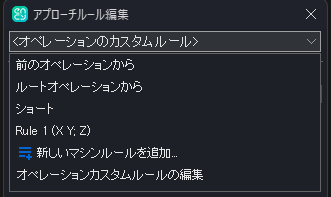
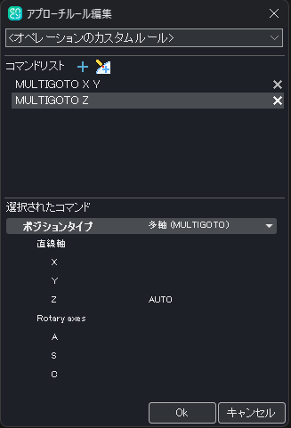
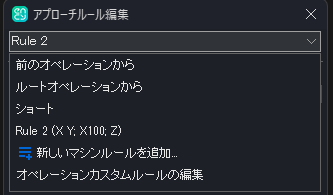

# アプローチ／リターンのルール編集画面

#### アプローチ／リターンタイプの選択

上記のコンボボックスを使用して、アプローチの定義タイプを選択します。例えば、'<em>前のオペレーション</em><em>から'</em>の項目は、 <strong>前のオペレーション</strong>と同じアプローチになることを意味します。アプローチ/リターンのタイプの詳細については [メイン記事](10071.md)を参照してください。

#### アプローチ／リターンのインタラクティブ編集

<strong>アプローチ／リターン編集</strong>ダイアログでは、オペレーションのアプローチ／リターンのツールパスを定義したり、マシンのルールリストを編集することができます。ダイアログウィンドウは3つの領域に分かれています。

1. 一番上のコンボボックスでは、加工自身のアプローチ／リターンを編集、または、ルールリスト内のいずれかの項目を編集するかを選択できます。

2. フォーム中央には、現在選択されているルールを定義するコマンドのリストが表示されます。そのリストの各行（コマンド）は、リードパスの個別の点を表しています。点の形式は以下の通りです。行の先頭にG53がある場合、続く座標は機械座標系での座標を表します。それ以外の場合、現在のワーク座標系におけるツール先端の座標となります。 続くテキストは以下のような形式になります。 ・移動軸1の名称 ・続いて、必要に応じて移動軸1の値（丸括弧付き） （例： X1 または X1 (30) ） ・スペース ・移動軸2の名称 ・続いて、必要に応じて移動軸2の値 ・スペース この手順を繰り返して、すべての移動軸を順番に記 述します。

軸名の後に座標が指定されていない場合は、対応する座標がCAMシステムによって自動的に計算されます。アプローチパスの場合は、座標は加工ツールパスの最初の点から取得され、リターンパスの場合は、工具交換位置から取得されます。例えば、アプローチパスを "X Y; A;C; Z "と設定した場合、工具は工具交換位置から加工ツールパスの最初の点まで、まずX軸とY軸で同時に移動、次にA軸で移動、次にC軸で移動、最後にZ軸に沿って垂直プランジになります。新しい空のコマンドを追加するには  ボタンを押します。現在のマシン状態をコマンドとして追加するには  ボタンを押します。ルールからコマンドを削除するには、右カラムの「X」アイコンをクリックします。コマンドは ドラッグ＆ドロップ で希望する順序に並べ替えることができます。 コマンドをダブルクリックすると、選択したコマンドで定義された座標に基づいてツールの位置が設定されます。 ポップアップメニュー（コマンド上で右クリック）または対応するショートカットキーを使用して、選択したコマンドを切り取り、コピー、貼り付け、削除することができます。 コマンドのテキストは「編集」ポップアップ項目（またはCtrl+Eキー）を使用して直接編集できます。

3. フォームの下部には、機械軸のリストがあります。パスに新しいリファレンス点を追加するには、該当する軸の座標に希望の値を入力するか、軸の横にある …（省略記号）ボタン をクリックして一部の軸を AUTO に設定する必要があります。リファレンス点を編集するには、上部のリストでリファレンス点をクリックすると、下部のリストもそれに応じて更新されます。その後、リファレンス点のパラメーターを変更することができます。

インスペクターの中央にある「ポジションタイプ」オプションは、リファレンス点のモードを設定するために使います。チェックを入れると、そのリファレンス点は G53リファレンス点 に変わります。G53リファレンス点の座標は機械座標系で指定されます。これらの点は、PhysicGOTOコマンドを使用してCLDATAに出力されます。通常のリファレンス点は、現在のワーク座標系における工具先端の座標として指定されます。これらの点は、GOTOとMULTIGOTOコマンドを使用してCLDATAに出力されます。

アプローチおよびリターンのリファレンス点は、明示的な座標値を用いずに機械軸で指定できるため、実際の機械に対して標準的なアプローチおよびリターンのシーケンスを定義することが可能です。例えば、5軸フライス盤の場合、デフォルトのアプローチシーケンスは XY; A C; Z のようになり、リターンシーケンスは Z; XY; A Cのようになります。

マシンのルールリストの編集 マシン内のアプローチ／リターンルールをインタラクティブに編集するには、まず最上部のコンボボックスでそのルール名を選択します。選択されたルールに従ってコマンドツリーが更新されます。その後、このルールは 操作自体のルールと同様の方法で編集できます。 コンボボックスは、現在のルールの名前を変更するための編集として使用することができます。 リストからルールを削除するには、コンボボックスの項目の上にマウスカーソルを置くと表示される「X」アイコンをクリックします。 リストに新しい空のルールを追加するには、ドロップダウンされたコンボボックスにある'<strong>新しいマシンルールを追加</strong>'ボタンを押してください。 オペレーションルールに戻るには、「<strong>オペレーションカスタムルールの編集</strong>」をクリックしてください。

