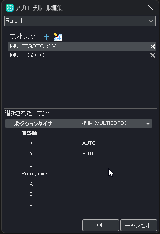

# マシンのアプローチ／リターンリスト

<a id="approachreturn-list-overview"></a>

## アプローチ／リターンリストの概要

マシンのXMLファイルの「Leads」セクション では、複数のアプローチ／リターンルールを便利に指定できます。リストの各項目には、他のルールと区別するための名前が付けられています。リスト内のルールを編集した場合、そのルールを参照するすべてのオペレーションに影響します。オペレーションにルールを割り当てるには、 [アプローチ/リターン編集フォーム](10072.md)で必要な項目を選択してください。



<a id="approachreturn-list-alternative"></a>

## アプローチ／リターンリストの代替案

アプローチとリターンに対して複数の規則を持たせる別の方法として、プロジェクトで使用するワークホルダー、工具ホルダーのペアに対してサブマシンを作成し、各サブマシンに適切なアプローチルールとリターンルールを定義する方法があります。CAMシステムのサブマシンについての詳細は[マシンスキーマ内のサブマシン定義](10410.md)を参照してください。

<a id="editing-approachreturn-list"></a>

## アプローチ／リターンリストの編集

マシンのアプローチ／リターンリストを編集する方法は2つあります。

1. マシンのXMLファイルを直接編集する。（本記事で紹介している方法）
2. [アプローチ/リターン編集フォーム](10072.md)を使用する。フォームを表示するには、アプローチ／リターン編集欄の省略記号ボタンをクリックします。

<a id="editing-machines-xml-file"></a>

## マシンのxmlファイルを編集する

マシンのアプローチ/リターンリストは <strong>Leads</strong>セクションにあります。（以前はここで 1つのアプローチ／リターンルールのみ指定可能でした。）<strong>ApproachCommands</strong> と <strong>ReturnCommands</strong> はそれぞれのサブセクションの名前です。各ルールには3つのフィールドがあります。

1. <strong>RuleID</strong> - ルールの一意なGUIDこれは、オペレーションが特定のルールを参照するための方法として使用されます。例としてオペレーションのGUIDを参照してください。
2. <strong>Name</strong> - ルールの名前
3. <strong>Command</strong> - ルールそのもの、つまりアプローチ/リターンの中間点のシーケンス衝突回避を伴うアプローチ/リターンを指定するには、キーワード'<strong>Auto</strong>'を使用してください。
4. <strong>Type</strong> - アプローチ/リターンの可能な使用ケースを定義するルールのタイプ。現在、4つのタイプが利用可能です。

- LCS - アプローチ/リターンは、オペレーションでローカル座標系が有効になっている場合にのみ使用できます。
- TCPM は、工具中心点管理が有効になっている場合にのみ使用できます。（ローカル座標系とTCPM は同時に有効にすることはできません）
- General - このルールは、ローカル座標系とTCPMの両方がオフの場合にのみ使用できます。
- Undefined - このルールはLCSまたはTCPMの状態に依存しません。タイプが明示的に定義されていない場合は、「Undefined」とみなされます。

以下はxmlファイルの一部の例です。

```
                    MaxTurn65WithCounterSpindle
<SCType ID="MaxTurn65WithCounterSpindle" Caption="MaxTurn65 with Counter Spindle" type="MaxTurn65" Enabled="true">
	<GUID DefaultValue="{8E0CEF0A-8045-436D-89FD-BBE70D387AB1}"/>
	<Priority DefaultValue="172"/>
	<Name DefaultValue="MaxTurn 65 with Counter Spindle"/>
	<Comment DefaultValue="MaxTurn 65 with Counter Spindle"/>
	<Leads>
	<ApproachCommands>
		<SCArray>
			<Rule>
				<RuleID>{41D3BB1C-2F23-47AC-B5F9-5DAF7030A015}</RuleID>
				<Command>C;Z10;X;Z</Command>
				<Name>Left spindle approach</Name>
			</Rule>
			<Rule>
				<RuleID>{54FC19E5-8ACB-491A-8E94-FC9990FC8680}</RuleID>
				<Command>C2;Z-10;X;Z</Command>
				<Name>Right spindle approach</Name>
			</Rule>
		</SCArray>
	</ApproachCommands>
	<ReturnCommands>
		<SCArray>
			<Rule>
				<RuleID>{380D355A-6708-4C86-BA69-7521A0198A8E}</RuleID>
				<Command>Z10;X;Z;C</Command>
				<Name>Left spindle return</Name>
			</Rule>
			<Rule>
				<RuleID>{18B61D64-EEC9-4403-8922-CCFCC017E53E}</RuleID>
				<Command>Z-10;X;Z;C2</Command>
				<Name>Right spindle return</Name>
			</Rule>
		</SCArray>
	</ReturnCommands>
</Leads>
```

<a id="conversion-of-the-older-version-machinesprojects"></a>

## 旧バージョンのマシン／プロジェクトの変換

旧バージョンのマシンを初めて開くと、そのマシンの以前のアプローチ／リターンルールを含むリストが作成されます。また、ルートオペレーションはこのルールを参照します。（カスタムルールが割り当てられていない場合）。その結果、「From root operation」 ルールタイプを持つオペレーションは、従来と同じ アプローチ／リターン を使用します。
