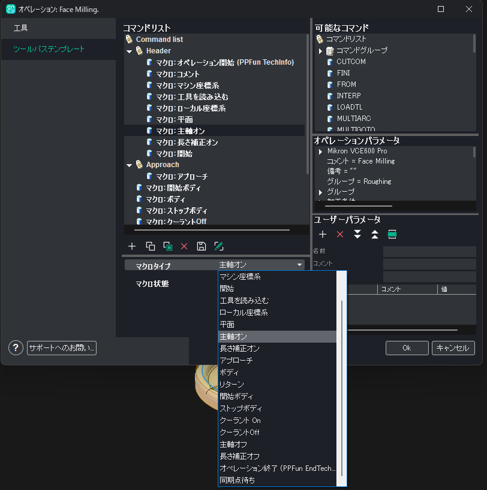
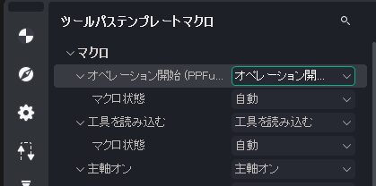

# ツールパステンプレートのマクロコマンド

ツールパステンプレート内の単純なコマンドは、対応するコマンドを直接CLDataに出力します。一方で、マクロコマンドは、CAMシステム内で定義された内部サブルーチンを呼び出して実行します。このルーチンを実行すると、特定のコマンドがCLDataとして出力される場合があります。これらのコマンドのタイプと順序はマクロタイプに依存します。テンプレートのページでマクロタイプを選択すると、マクロサブルーチンのリストが開きます。

また、マクロコマンドは<strong>状態（State）</strong>があります。状態は、サブルーチンの実行方法を定義します。自動状態（Auto）はデフォルトの状態です。このモードでは、必要に応じてCLdataコマンドが出力されます。

状態が無効の場合、CLDataコマンドは出力されません。テンプレートを大幅に編集することなく、不要なコマンドを除外することができます。例えば、前回の操作でクーラントスイッチが無効になっていなくても、クーラントスイッチオフコマンドを出力することができます。マクロコマンドの状態を編集しやすくするため、オペレーションプロパティインスペクタの追加ページに表示されています。

