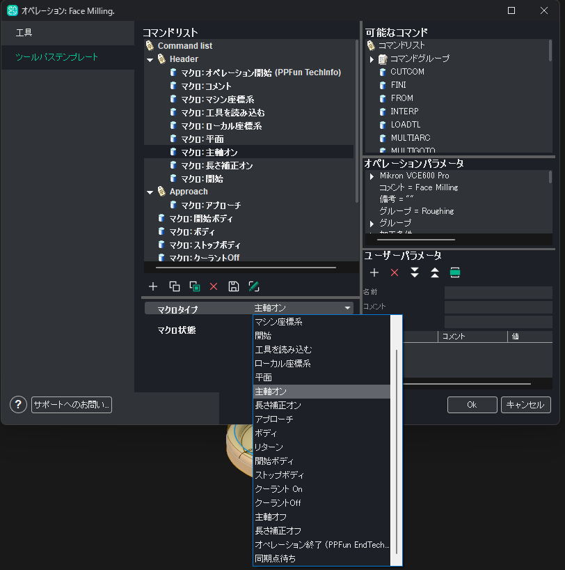
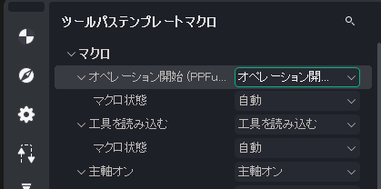

# Comandos de macro no modelo de trajetória da ferramenta

Um comando simples no modelo de percurso da ferramenta emite diretamente o comando correspondente no CLData. Já o comando de macro executa uma sub-rotina implementada no sistema CAM. Como resultado da execução dessa sub-rotina, alguns comandos podem ser emitidos no CLData. O tipo e a sequência desses comandos dependem do tipo de macro. A lista das sub-rotinas de macro é aberta ao selecionar o tipo de macro na página do modelo.

Além disso, o comando de macro tem um estado (State), que define o modo de execução da sub-rotina. O estado padrão é Auto. Nesse modo, os comandos CLData são emitidos quando necessário.

Se o estado estiver desativado, os comandos CLData não serão emitidos. Isso permite excluir comandos desnecessários sem editar significativamente o modelo. Por exemplo, é possível emitir o comando de desligamento do refrigerante mesmo que ele não tenha sido desligado na operação anterior. Para facilitar a edição dos estados dos comandos de macro, eles ficam em uma página adicional do inspetor de propriedades da operação.

