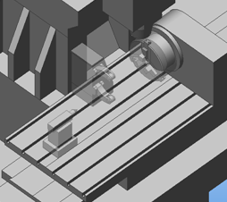
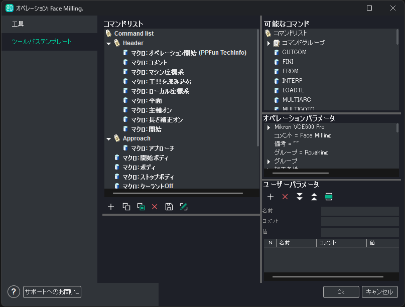

# Operação auxiliar

As **operações auxiliares** do sistema CAM servem para armazenar uma sequência específica de comandos CLData (para determinados tipos de máquinas ou para uma empresa específica) em uma lista nomeada, que pode ser salva e usada muitas vezes no trabalho com o sistema. Podem ser, por exemplo, operações como fixação da placa, troca de ferramenta, aproximação do contraponto, virada da peça, ativação do sistema de coordenadas da peça G54-G59 etc.

Uma operação auxiliar do sistema CAM é criada como qualquer outra operação: clicando no botão **Create** na janela do processo ou usando o menu de contexto desse botão. Nos grupos de operações, junto com os grupos **Roughing**, **Finishing** e **Rest milling**, fica disponível o grupo **Auxiliary**. Esse grupo lista as operações disponíveis para a máquina específica. Por padrão, para todos os tipos de máquinas, somente a **Abstract auxiliary operation** está ativa; ela é um modelo com um conjunto vazio de comandos CLData e uma lista de parâmetros.

As propriedades da operação auxiliar são editadas na janela aberta pelo botão **Parameters** na janela de tecnologia, na aba [Toolpath template](500.md).

