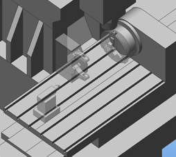
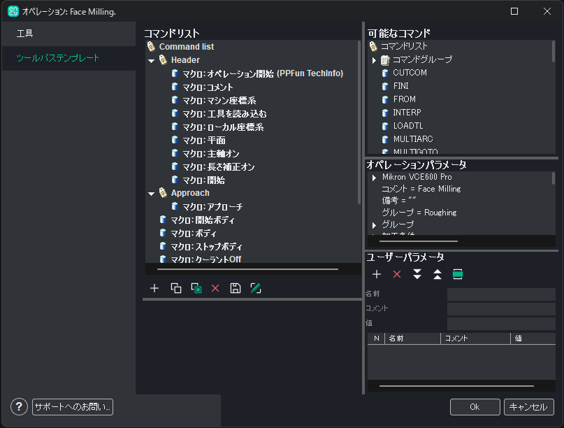

# 補助的な加工操作の作成

CAMシステムの`補助オペレーション` は、特定のCLDataコマンドのシーケンス（特定の機械や特定の企業向け）を名前付きリストとして保存するために設計されています。これにより、それらを保存して、システムの作業プロセスの中で何度も再利用することが可能になります。例えば、チャックのクランプ、工具交換、心押台の接近、ワークの反転、アクティブなワーク座標系（G54～G59）の設定などの操作が該当します。

CAMシステムの補助オペレーションのインスタンスは、他のオペレーションと同様に、プロセスウィンドウ内の`作成`ボタンをクリックするか、このボタンのコンテキストメニューから作成します。`荒取加工`、`仕上げ`、`取り残し` の各グループと同様に、`補助`グループも利用可能になります。このグループには、対象の機械に応じた利用可能なオペレーションの一覧が表示されます。デフォルトでは、すべての機械タイプにおいて`補助オペレーションの概要`のみが有効であり、これはCLDataが空で、パラメータリストのみを持つ未完成品として表示されます。

補助オペレーションのプロパティの編集は、加工ウィンドウの[ツールパステンプレート](500.md)タブ内にある`パラメータ`ボタンを押すことで開くウィンドウで行われます。

