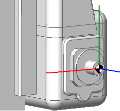
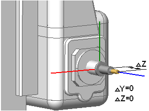
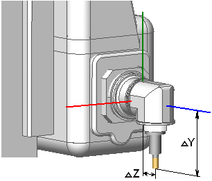
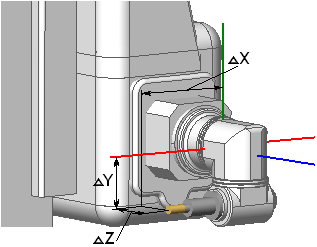
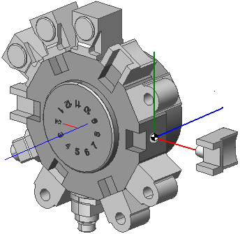
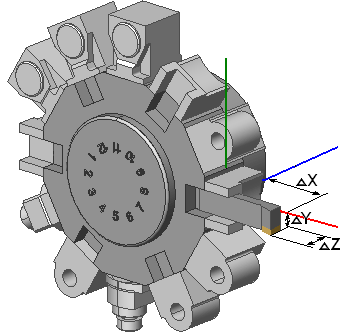
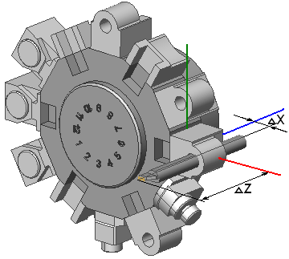
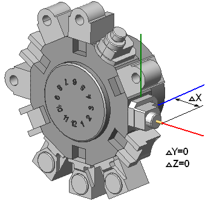
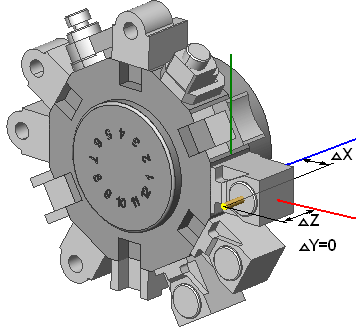

# Sporgenza dell'utensile

La sporgenza dell'utensile è la distanza tra il punto base dell'utensile e il punto di lavoro dell'utensile.

Il punto base dell'utensile è il punto base del blocco utensile (utensile e portautensile) nel sistema di coordinate della macchina.

Per le fresatrici il punto di lavoro giace sull'asse dell'utensile.

Di seguito sono mostrate alcune definizioni della sporgenza per le fresatrici.

Punto base dell'utensile

Sporgenza assiale dell'utensile

Sporgenza per testa rotativa

Sporgenza per 2 teste rotative

Per i torni il punto base giace sul piano di base della torretta, lungo l'asse del sistema di fissaggio dell'utensile.

Di seguito sono mostrate alcune definizioni della sporgenza per i torni-fresa.

Punto base dell'utensile sulla torretta

Sporgenza di un utensile da tornitura diritto

Sporgenza di una barra di alesatura

Punto base per testa di fresatura radiale

Punto base per testa di fresatura assiale
