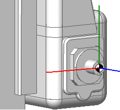
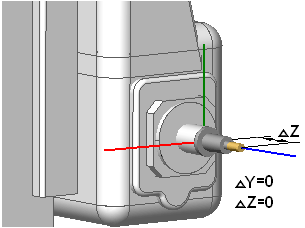
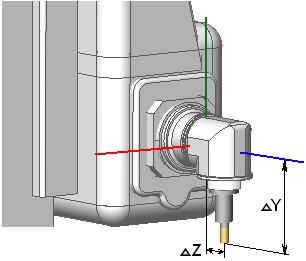
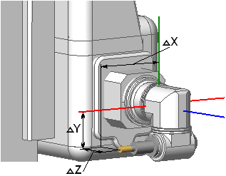
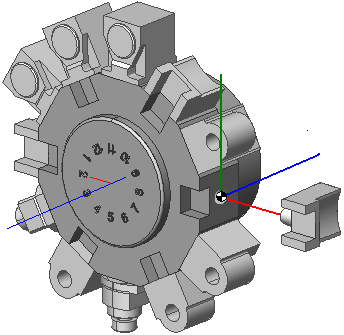
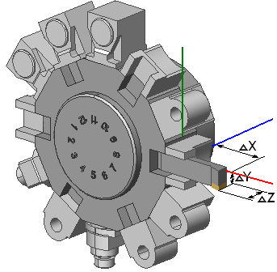
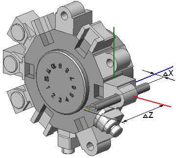
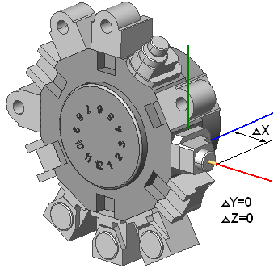
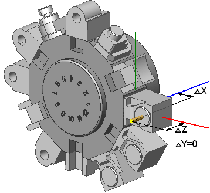

# 工具の突き出し（アングルヘッド）

工具の突き出し量は、工具の基準点から先端までの距離です。

工具基準点とは、機械座標系での工具およびホルダーの基準点です。

フライス盤の場合、工具軸に沿って設定されます。

Millマシンの突き出し量の定義は以下になります。

工具基準点

軸方向の工具の突き出し

アングルヘッド用突き出し

アングルヘッド2個用突き出し

旋盤では、基準点は工具固定系軸に沿ってタレットの基準面上に置かれます。

以下に、ミル旋盤での張り出しの定義例を示します。

タレット上の工具の基準点

ストレートターニング工具の突き出し

ボーリングビットの突き出し

径方向のミーリングヘッド基準点

軸方向のミーリングヘッド基準点
