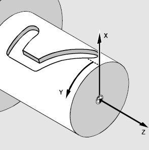
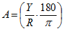

# 円筒補間

円筒補間は次のオペレーションで使用可能です。2D輪郭加工、ポケット加工、2.5Dポケット加工、2.5D壁加工

円筒補間により、展開した曲線をプログラムすることで、円筒の側面をフライス加工することが可能になります。展開された曲線は [X, Y, Z] 座標 でプログラムされますが、円筒加工は [X, C, Z] 座標 で実行されます。つまり、円筒補間は[X,Y,Z] => [X,C,Z]の変換を行います。

円筒の側面加工を行う可否は、機械構造に依存します。

1. ワークを回転させる<strong>回転軸</strong>(回転テーブル、旋盤スピンドル)が存在しなければなりません。
2. ロータリー軸は、工具回転軸に対して垂直に配置されなければなりません。
3. 工具の回転軸はワークの回転軸と交差しなければなりません。
4. **回転軸**が存在し、工具をワークの回転軸に垂直な平面内で移動できる必要があります。
5. 回転軸に沿って工具を移動させる<strong>軸方向軸</strong>が必ず存在しなければなりません。

すべての条件が満たされ、かつマシン変数<strong>マシン</strong> → <strong>コントロールパラメータ</strong> → <strong>回転変換</strong> → <strong>円筒補間が可能</strong>が有効に設定されている場合、変換ページ上で回転変換パネルが利用可能になります。

<strong>モード</strong>フィールドでは、回転変換モード（なし、極座標補間、または円筒変換）を定義します。トレランスは、変換後のツールパスが理想的な経路からどの程度ずれるかを示すもので、ミリメートル（インチ）で測定されます。

円筒変換は次の計算を実行します。

,

ここで：

А - ロータリー軸の位置（度）

Y - ロータリー軸に対応する仮想展開軸の位置

R - 円筒の半径

対応する欄は、回転軸、半径軸などとして使用される機械軸を定義します。これらのパラメータのデフォルト値は、機械スキーマに定義されています。

最新の数値制御装置（CNC）には、円筒変換を実行する機能があります。そのため、この変換処理はCAMソフトウェア内ではなく、制御装置側で実行されます。このような機械の場合は、<strong>CNC 補間</strong>のチェックを有効にすることが推奨されます。この場合、Gコードは［X,Y,Z］座標で生成され、制御装置が［X,Y,Z］⇒［X,C,Z］の変換を行います。Gコードは通常、次のようなシーケンスになります。

1. 実機軸にプログラムされた開始点への位置決
2. 円筒半径を指定して円筒補間モードをオン
3. 座標[X,Y,Z]でプログラムされたプロファイルに沿った動き
4. 円筒補間モードをオフ

よく知られている各種制御装置に対応するコマンドは、以下の表に示されています。

| 数値制御 | 円筒補間を有効にするコマンド | 円筒補間を無効にするコマンド |
|---|---|---|
| FANUC, Mоri Seiki, HAASなど | G07.1（G107） | G07.1（G107） |
| Sinumeric | TRACYL | TRAOFF |
| Heidenhain | Cycle 27 | - |

マシン変数<strong>マシン</strong> → <strong>コントロールパラメータ</strong> → <strong>回転変換</strong> → <strong>CNC は円筒補間をサポート</strong>が有効に設定されている場合、<strong>CNC 補間</strong>のチェックが利用可能になります。このパラメータがオンの場合、円筒補間のオン／オフを切り替えるコマンドを含むGコードが生成されます。オフの場合は、Gコードは［X,C,Z］座標で生成されます。

<strong>内側の補間で早送り動作を許可ブロック</strong>がチェックされている場合、補間はツールパスの開始時にオンになり、終了時にオフになります。チェックされていない場合は、CNC補間は加工送りの前に開始され、早送りの前に終了します。
