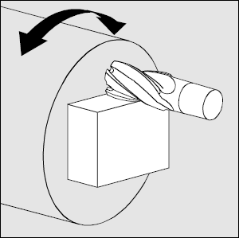
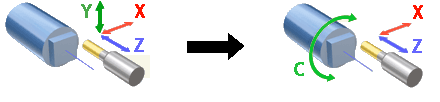
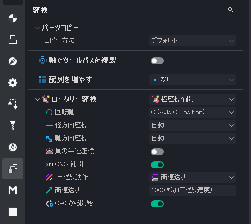
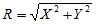
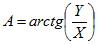

# Interpolazione polare

L'interpolazione cilindrica è disponibile in tutte le operazioni di fresatura, se la macchina ne consente l'uso.

L'interpolazione polare sostituisce un asse lineare con un asse rotativo in un normale processo di fresatura a 3 assi. Di solito è necessaria sui torni dotati di utensili motorizzati. Talvolta l'interpolazione polare viene utilizzata anche su altri tipi di macchine. Un tornio ordinario dispone di due assi lineari, di solito X e Z, e della rotazione del mandrino, di solito l'asse C.

In modalità semplice il sistema CAM genera il codice G nelle coordinate [X,Y,Z]. Se la trasformazione polare è attiva, lo stesso codice G viene generato nelle coordinate [X,C,Z]. L'interpolazione polare trasforma quindi [X,Y,Z] => [X,C,Z]

La possibilità di utilizzare l'interpolazione polare dipende dalla struttura della macchina:

1. Deve essere presente un **Rotary axis** (asse rotativo: tavola rotante, mandrino del tornio) che fa ruotare il grezzo.
2. L'asse rotativo deve essere parallelo all'asse di rotazione dell'utensile.
3. Deve essere presente un **Radial axis** (asse radiale) che sposta l'utensile nel piano perpendicolare all'asse rotativo.
4. Deve essere presente un **Axial axis** (asse assiale) che sposta l'utensile lungo l'asse rotativo.

Se tutte le condizioni elencate sono soddisfatte ed è impostata la variabile macchina Machine –> Control parameters –> Rotary transformations –> Polar interpolation is available, nella pagina delle trasformazioni è disponibile il pannello delle trasformazioni rotative.

Il campo **Mode** (modalità) definisce la modalità di trasformazione rotativa: nessuna, trasformazione polare o cilindrica. La tolleranza definisce lo scostamento del percorso utensile trasformato da quello ideale. Si misura in millimetri (pollici).

La trasformazione polare esegue il seguente calcolo:

,

dove:

R – posizione dell'asse radiale,

A – posizione dell'asse rotativo,

X – posizione del primo asse lineare,

Y – posizione del secondo asse lineare.

I campi corrispondenti definiscono gli assi della macchina da utilizzare come asse rotativo, asse radiale ecc. I valori predefiniti di questi parametri sono definiti nello schema della macchina.

I controlli numerici moderni sono in grado di eseguire la trasformazione polare. In tal caso la trasformazione descritta viene eseguita all'interno del controllo e non nel software CAM. Il codice G viene quindi generato nelle coordinate [X,Y,Z] e il controllo esegue la trasformazione [X,Y,Z] => [X,C,Z]. Nella maggior parte dei casi il codice G ha la seguente sequenza:

1. Posizionamento sul punto iniziale, programmato negli assi reali della macchina.
2. Attivazione della modalità di interpolazione polare con indicazione del raggio del cilindro.
3. Movimento lungo il profilo, programmato nelle coordinate [X,Y,Z].
4. Disattivazione della modalità di interpolazione polare.

I comandi corrispondenti per i controlli più diffusi sono riportati nella tabella seguente.

| Controllo numerico | Comando di attivazione dell'interpolazione polare | Comando di disattivazione dell'interpolazione polare |
|---|---|---|
| FANUC, Mоri Seiki, HAAS ecc. | G112 | G113 |
| Sinumeric | TRANSMIT | TRAOFF |
| Heidenhain | - | - |

Se è impostata la variabile macchina Machine –> Control parameters –> Rotary transformations –> CNC support polar interpolation, è disponibile la casella di controllo CNC interpolation (interpolazione nel CNC). Se questo parametro è attivo, il codice G viene generato con i comandi di attivazione/disattivazione dell'interpolazione polare. In caso contrario, il codice G viene generato nelle coordinate [X,C,Z].
