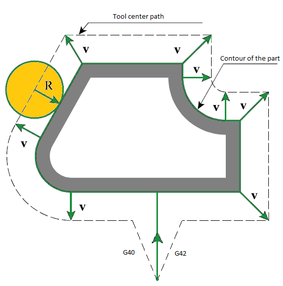
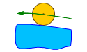
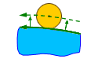
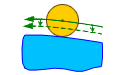
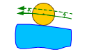
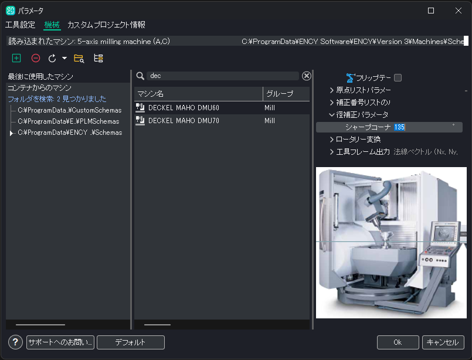
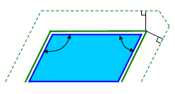

# Werkzeugradiuskorrektur beim Fräsen

Mit der Werkzeugradiuskorrektur kann eine CNC-Steuerung die Werkzeugmittelpunktsbahn aus der programmierten Bauteilkontur, dem Werkzeugradius und der Bearbeitungsseite berechnen. Im NC-Programm wird dann die Kontur statt der Werkzeugmittelpunktsbahn angegeben.

Die Steuerung benötigt für jeden Bahnabschnitt die Korrekturseite. Üblicherweise aktiviert G41 die Korrektur links und G42 rechts von der programmierten Bewegungsrichtung. G40 hebt sie auf. Der Korrekturwert wird meist in einer Werkzeugkorrekturtabelle der Steuerung gespeichert.

Die Radiuskorrektur stellt Anforderungen an die programmierte Kontur. Bei Bögen mit einem Radius kleiner als der Korrekturwert oder sehr kurzen Bahnabschnitten kann die Steuerung möglicherweise keine korrekte Werkzeugmittelpunktsbahn erzeugen. Schleifen und unerwünschte Einschnitte können die Folge sein. Besondere Aufmerksamkeit erfordern die Abschnitte zum Ein- und Ausschalten der Korrektur. Da dort zwischen korrigierter und unkorrigierter Bahn gewechselt wird, kann die tatsächliche Bewegung deutlich von der programmierten Kontur abweichen. Dafür werden spezielle Ein- und Ausschaltbewegungen eingefügt.

Das CAM-System kann Werkzeugwege mit Radiuskorrektur erzeugen. Auf der Seite [Lead In/Lead Out](101147.md#compensation-switch) aktivieren Sie die Korrektur und wählen die [Art der Ein- und Ausschaltbewegungen](101147.md#compensation-switch).

Folgende Korrekturarten werden beschrieben:

- **Computer.** Das CAM-System berechnet die Werkzeugmittelpunktsbahn anhand der Werkzeugabmessungen. Es werden keine Befehle zum Ein- und Ausschalten der Korrektur ausgegeben. Der Bediener kann die Bahn daher nicht über die Radiuskorrektur an der Steuerung anpassen. Das CAM-System kann kritische Geometriesituationen bei der Berechnung behandeln und Schleifen entfernen. Dies ist die Standardoption.

- **NC Control (NC-Steuerung).** Die Bahn wird ohne Berücksichtigung des Werkzeugradius berechnet. Ausgegeben werden die Bauteilkontur und die Korrekturbefehle mit der entsprechenden Seite. Der Bediener kann die Bahn an den tatsächlich verwendeten Radius anpassen. Zur Nachbildung des Steuerungsverhaltens verwendet die Simulation einen Korrekturwert in Höhe des Werkzeugradius.

- **Wear (Verschleiß).** Die Berechnung berücksichtigt die Werkzeugabmessungen wie bei **Computer**. Zusätzlich werden Korrekturbefehle ausgegeben. Die Korrektur ist zum Bauteil gerichtet. Als Korrekturwert kann die Differenz zwischen ursprünglichem und tatsächlichem Werkzeugradius verwendet werden. Die Simulation verwendet den Korrekturwert null.

- **Reverse wear (Umgekehrte Verschleißkorrektur).** Entspricht **Wear**, jedoch mit umgekehrtem Vorzeichen; die Korrektur ist vom Bauteil weg gerichtet.

**Simulation der Radiuskorrektur**

Das CAM-System kann korrigierte Werkzeugbewegungen berechnen, anzeigen und simulieren. CLData enthält dazu die Befehle zum Ein- und Ausschalten, üblicherweise `G41`, `G42` und `G40` mit einer Korrekturnummer. So kann die Wirkung auf der Maschine in der Simulation nachgebildet werden.

CNC-Steuerungen können die Korrektur auf unterschiedliche Weise aktivieren und aufheben. Zur Anpassung der Simulation stehen im Fenster `Machine:... Parameters` auf der Registerkarte **Machine** unter **Control parameters → Radius compensation** entsprechende Eigenschaften zur Verfügung.

Verwendete Eigenschaft:

- **Sharp corner (Scharfe Ecke).** Bestimmt die Behandlung einer Ecke. Ist der Winkel zwischen den Bewegungen größer als der eingestellte Wert, werden die Bewegungen bis zu ihrem Schnittpunkt verlängert. Andernfalls wird jede Bewegung um den Korrekturwert verlängert und durch eine lineare Bewegung verbunden. Im Beispiel ist der linke Winkel größer und der rechte kleiner als der Grenzwert.

**Weiterführendes Thema:**

[Ein- und Ausschaltbewegungen der Werkzeugradiuskorrektur](101147.md#compensation-switch)
