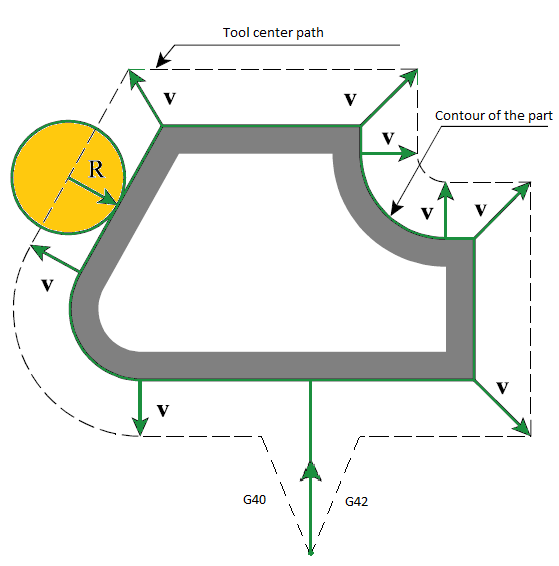
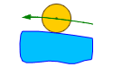
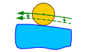
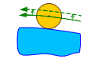
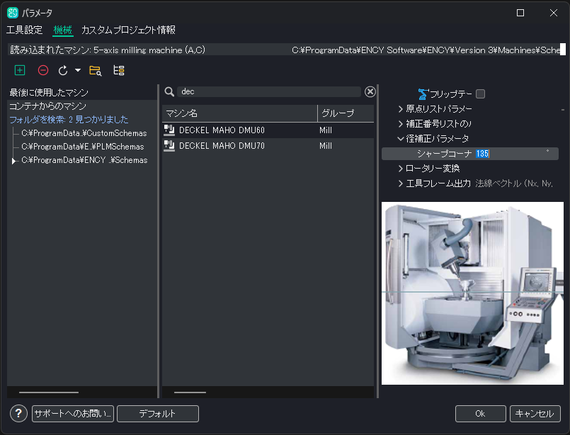
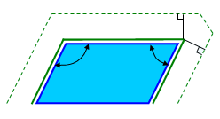

# Mill 加工における工具径補正

工具径補正は、CNC制御装置の機能で、工具中心パスの代わりに、部品の輪郭、工具半径、および加工面を指定することにより、部品のプログラミングを可能にします。工具中心軌跡は、与えられたデータに基づいてCNC制御装置により計算されます。

工具中心の軌跡を正しく計算するために、CNCは軌跡の各フレームについて工具を移動させる方向を知る必要があります。NCプログラムの補正方向を設定する特別なコマンドがあります。通常、このコマンドは G41 がプログラムパスの左側への補正、G42 がプログラムパスの右側への補正を意味します。補正を無効にするには、G40コマンドを使用します。補正値は、通常CNCの工具補正テーブルに格納されます。

ただし、径補正を使用する場合、NCコードでプログラムされた輪郭の形状にはいくつかの制限が課されます。輪郭に補正値より小さい半径の円弧や、補正値に比べて著しく短い線分などの不適切な要素が含まれている場合、CNCは常に正しい工具中心軌跡を生成できるとは限りません。その結果、軌跡がループを含むことがあり、通常はオーバーカットにつながります。補正がオン/オフされる軌跡の要素にも、特に注意を払う必要があります。これらの領域では、工具の移動は事前にプログラムされた軌跡と大きく異なる場合があります。これは、ある部分では補正がオフになり、別の部分ではオンになるためです。これらの箇所でのオーバーカットを避けるため、通常は補正切替用カットと呼ばれる特別なセクションが追加されます。

CAMシステムは、工具半径を補正した軌跡を生成することができます。[進入/退出](https://confluence.encycam.com/pages/viewpage.action?pageId=153783642)ページには、補正の使用を有効にするためのパネルがあり、さらに[補正切替ラインの種類](https://confluence.encycam.com/pages/viewpage.action?pageId=153783642)を選択することができます。

補正には5つのタイプがあります。

- `コンピューター`この場合、CAMシステム自身が選択された工具のサイズで軌跡を計算します。プログラムでは、工具中心の軌跡が生成されます。補正コマンドのオンとオフが表示されません。これでは、加工中にオペレーターが補正に影響を与えることはできません。しかし、CAMシステムはツールパスを計算する際、不適切なケースを正しく処理し、ループを除去することができます。これにより、軌跡の精度とえぐれの発生しないことがほぼ保証されます。このタイプはデフォルトでインストールされています。

- `制御機` この場合、軌跡の計算は工具半径を考慮せずに行われます。NCプログラムには、部品の輪郭と、適切な符号の補正コマンドのオンとオフが表示されます。これにより、オペレーターは加工時に実際に使用する工具半径を考慮して軌跡を調整することができます。CNCの動作をシミュレートするシミュレーションモードでは、補正値は工具の半径に等しくなります。

- `コンピュータと制御機`計算は、 `コンピュータ` と同様に、工具のサイズを考慮して行われます。ただし、NCプログラムには補正切替コマンドも出力されます。補正はワーク方向に向けられます。これにより、オペレーターは工具摩耗を補正でき、補正値を元の工具半径と実際に使用する工具半径の差として設定することができます。CNCの動作を模擬するシミュレーションモードでは、補正値としてゼロが使用されます。

- `両補正リバース` `コンピュータと制御機` と同様ですが、補正の符号は逆で（ワークから外向きに）設定されます。

半径補正シミュレーションオプション

CAMシステムは、工具半径の補正を使用して、工具の動きを計算や表示、シミュレートすることができます。補正を使用する場合、CLDataには補正をオン／オフにするコマンドが含まれています。通常、これらは補正番号付きの`G41` 、`G42`、`G40` コードです。CAMシステムは、工具の動作経路を描画し、工具径補正を適用した加工を、実際の機械上で行われる動作に非常に近い形でシミュレーションすることができます。

NC機械によって、補正の適用および解除の方法は異なる場合があります。CAMシステムには、機械コントローラで使用される工具径補正と一致するように調整（チューニング）するための複数のオプションが用意されています。これらのオプションは、`マシン`タブ内の`マシン:... パラメータ`ウィンドウで利用できます。 `コントロールパラメータ`→`径補正`というノードがあり、そのプロパティエディタ内の各種設定は、CAMシミュレーションにおける径補正の挙動を調整するために使用されます。

これらのプロパティを使用してください。

- `シャープコーナー` – この値は、コーナーの丸め方法を定義します。移動間の角度がこの値より大きい場合、動作は交差するまで延長されます。それ以外の場合、角度が小さい場合は、各動作は半径補正値分だけ延長され、直線移動で接続されます。下図には、左側のコーナーがシャープコーナー 値より大きく、右側のコーナーがそれより小さい例が示されています。

<strong>関連参照：</strong>

[CRCスイッチのオン/オフ動作](https://confluence.encycam.com/pages/viewpage.action?pageId=153783642)
