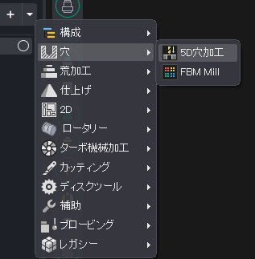

# FBM （フィーチャーベースマシニング）

フィーチャーベースマシニング

製造フィーチャー とは、標準的な加工プロセスで製造可能な部品の次の項目で構成されます。フィーチャーの例には、穴、ポケット、スロット、溝、面取りなどがあります。

<strong>フィーチャーベースマシニング（FBM）</strong>は、<strong>フィーチャ認識</strong>に基づくCAM手法であり、認識されたフィーチャーから抽出された情報と加工<strong>ナレッジベース</strong>に基づいて、加工プロセスを自動または半自動で生成するアプローチです。

FBM Mill グループ

FBM Mill グループは、フィーチャーベースマシニングを実行するための、CAMシステムにおけるグループオペレーションです。

新しいFBM Mill グループオペレーションを作成すると、CAMシステムは部品内の既知のフィーチャを自動的に認識します。その後、<strong>FBMプロシージャライブラリ</strong>から各フィーチャに対して、あらかじめ定義された、または保存された<strong>加工プロシージャ</strong>を簡単に選択できます。CAMシステムは、これらのフィーチャを加工するために必要なオペレーションを自動的に生成し、現在のルールに基づいて並び替えます。（例えば、工具交換回数を最小限に抑えるように並び替える戦略があります）

新しいFBM Mill グループオペレーションの作成は、通常のオペレーションを作成するのと同じくらい簡単です。新規メニュー から該当項目を選択します。
