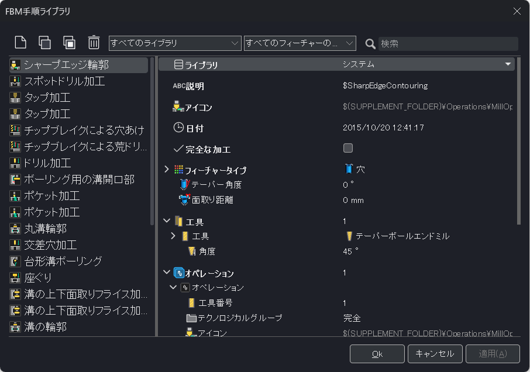
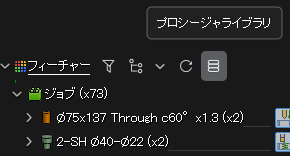
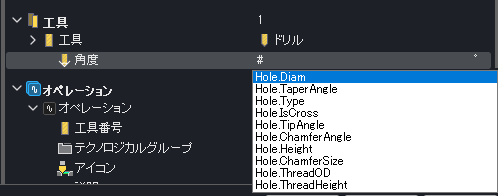

# Interface da biblioteca de procedimentos FBM

A FBM Procedure Library é o local de armazenamento dos procedimentos de usinagem. Há quatro pastas na biblioteca:

- System;
- All users;
- Personal;
- History.

A pasta System é somente leitura e é fornecida com a instalação do sistema CAM, contendo os procedimentos completos (Complete) e atômicos (Atomic) de uso mais universal.

A pasta All Users contém procedimentos acessíveis a todos os usuários do PC.

A pasta Personal é destinada aos seus próprios procedimentos.

A pasta History contém procedimentos que são salvos automaticamente com cada projeto. Durante o trabalho com o FBM Mill do sistema CAM, o usuário cria dinamicamente novos procedimentos diretamente na interface, simplesmente editando os parâmetros dos procedimentos existentes e inserindo ou removendo operações neles. Quando o usuário salva o projeto, todos os procedimentos novos e modificados são salvos automaticamente na pasta History para possível reutilização futura. Esse recurso permite que o usuário amplie sua base de conhecimento de usinagem sem esforço.

Abertura da biblioteca

Para abrir a biblioteca, pressione o botão Procedures library na barra de ferramentas Features.

Filtragem de procedimentos

Use a lista suspensa Libraries para alternar entre as bibliotecas.

Use o seletor Feature Type para filtrar os procedimentos por tipo de recurso.

Digite um texto na caixa Search para filtrar os procedimentos por nome.

Criação, exclusão e cópia de procedimentos

- Para criar um novo procedimento, pressione o botão New.
- Para excluir um procedimento, selecione-o e pressione o botão Delete.
- Para copiar um procedimento, pressione o botão Copy e, em seguida, o botão Paste.

Edição de um procedimento

A edição de um procedimento é feita no Inspector. No entanto, esse inspetor é um pouco incomum: a expansão e o recolhimento habituais dos nós funcionam de forma diferente aqui:

- quando o nó é expandido, todos os nós internos são exibidos. Não há nada de novo nisso.
- entretanto, quando o nó é recolhido, os nós internos que têm valores redefinidos continuam visíveis.

Por padrão, todos os nós estão recolhidos, de modo que você vê apenas os parâmetros redefinidos. Isso faz sentido, pois são os parâmetros redefinidos que determinam o procedimento.

- Para editar um parâmetro, expanda o nó correspondente no inspetor, insira o valor e, em seguida, recolha o nó.
- Para restaurar o valor padrão do parâmetro, basta apagar o valor selecionando tudo (Select All) e pressionando a tecla BackSpace ou Del do teclado; em seguida, pressione Enter.

Os campos de valor dos parâmetros com valores padrão são exibidos em cinza.

Os parâmetros com valores inválidos são marcados em vermelho.

Alteração da biblioteca de um procedimento

É possível alterar a biblioteca do procedimento selecionando-a na lista suspensa Library do inspetor.

Alteração do tipo de um procedimento

Para alternar entre os tipos de procedimento Atomic/Complete, marque/desmarque a caixa Complete machining no inspetor.

Edição das restrições do recurso

1. Selecione o Feature Type.
2. Expanda o Feature Type.
3. Especifique as restrições para os parâmetros do recurso. O valor padrão de uma restrição é Any, ou seja, não há restrições para o parâmetro.

Edição das consultas de ferramentas

- Para alterar o número de ferramentas na lista Tool query, digite o valor no campo Tools e pressione Enter.
- Para referenciar um parâmetro do recurso na consulta de ferramenta, basta digitar #. O painel de preenchimento automático de parâmetros deve aparecer. Selecione nele o parâmetro necessário com o mouse ou com as teclas Up/Down.

Edição das operações

- Para alterar o número de operações na lista, basta digitar o valor no campo Operations e pressionar Enter.
- Para cada operação, é necessário definir o número da ferramenta (Tool Number), o tipo de ciclo (Cycle type) e os parâmetros do ciclo (Cycle parameters). O número de ferramenta padrão da operação é igual ao seu número de sequência.

Aplicação/cancelamento das alterações

Os procedimentos editados são marcados em negrito na lista.

- Para aplicar as alterações, pressione o botão Apply na parte inferior.
- Para aplicar as alterações e fechar a FBM Procedure Library, clique em Ok na parte inferior.
- Para cancelar as alterações e fechar a FBM Procedure Library, clique em Cancel na parte inferior.
