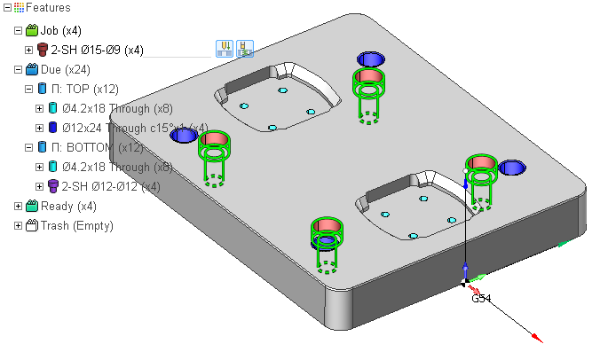
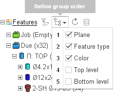
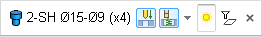

# フィーチャーツリーUI

CAMシステムがフィーチャーを認識した後、それらを階層的なツリー構造にソート分類します。最上位レベルのフィーチャーツリー は以下の4つのグループで構成されます。

- ジョブ
- 未処理
- 準備完了
- ゴミ箱

ジョブフィーチャーは、現在の FBM Mill グループで加工されるフィーチャーです。グラフィックビューでは、明るいライム色のアウトラインで表示されるため、容易に識別できます。

未処理フォルダには、まだどの FBM Mill グループでも加工されていないフィーチャーが含まれます。

準備完了フォルダ には、プロジェクト内の他のFBM Millグループオペレーションですでに加工済みのフィーチャーが含まれます。

ゴミ箱フォルダには、削除されたフィーチャーが含まれます。

これらのフォルダの1つが折りたたまれると、そのフォルダのフィーチャーはグラフィックビューに表示されません。デフォルトでは、ジョブフォルダと未処理フォルダは展開され、準備完了フォルダとゴミ箱フォルダは折りたたまれています。そのため、加工対象となるフィーチャーだけが画面に表示されています。

<strong>フィーチャーのカウントと代替フィーチャー</strong>

フィーチャーツリーの各ノードの横には、そのノードのフィーチャー数が括弧内に示されています。ツリーに表示されるフィーチャーの数が、予想されるフィーチャーの数より多いことに気付く場合があります。ツリー内に同じフィーチャーが2回表示されていることに気付く場合もあります。これはエラーではなく、仕様（意図された機能）です。これは、一部のフィーチャーが 交互フィーチャー を持っているために起こります。例えば、貫通穴を2つの側面から開けることができます。この場合、CAMシステムは1つではなく2つの穴を認識します。1つは正の軸方向、もう1つは負の軸方向です。この2つのフィーチャーは、互いに関連しています。どちらか一方の代替フィーチャーを加工すると、CAMシステムはもう一方を自動的に「準備完了」としてマークします。

<strong>グループ分けの変更</strong>

CAMシステムは、現在のグルーピング方式に従ってフィーチャーをグループ化します。フィーチャーは次の基準に基づいてグループ化できます：

- タイプ
- 平面（主方向）
- 上面と下面高さ
- 色

さらに、類似または同一のフィーチャーには同じ固有の色が割り当てられ、同じグループとしてまとめられます。

フィーチャーツリーのグループ化を変更するには、フィーチャーツールバーのグループ化ドロップダウンをクリックします。スキーム内の項目をチェック／チェック解除して有効／無効を切り替えたり、項目をドラッグして順序を変更したりできます。行った変更はすべてツリーに即座に反映されます。

<strong>フィーチャーの選択</strong>

フィーチャーの選択には2つの方法があります。

1. ツリー内のノードをクリック
2. グラフィックビューでフィーチャーをクリック

複数のフィーチャーを選択するには、CtrlキーまたはShiftキーを押したままにします。

<strong>アクションバー</strong>

ツリービューではなくグラフィックビューでフィーチャーを選択すると、カーソルの下にフィーチャーアクションバーが表示されます。アクションバーには、各機能でよく使用するコマンドが表示されます。

1. 「フィーチャー加工プロシージャ」コンボボックス
2. 表示切替スイッチ
3. フィルターコマンド
4. 削除ボタン

<strong>フィーチャーの表示/非表示</strong>

選択したフィーチャーを表示または非表示にするには、ツリーのフィーチャーアイコンをクリックするか、アクションバーの対応するボタンを押します。

<strong>フィーチャーのフィルタリング</strong>

平面でフィーチャーをフィルタリングすることも可能です。対象の平面上にあるフィーチャーを選択し、「平面でフィルター」ボタンを押すだけです。その結果、選択されたフィーチャーと同じ平面方向を持つフィーチャーのみが表示され、その他のフィーチャーはツリービューからもグラフィックビューからも除外されます。このコマンドは、3D工作機械で作業する際に、水平面にあるフィーチャーだけを見たい場合に便利です。

<strong>フィーチャーの削除</strong>

ツリーまたはグラフィックビューでフィーチャーを選択すると、ツリーで最初に選択されたノードの横に小さな十字のアイコンが表示されます。このアイコンを押すと、選択したフィーチャーが削除されます。また、アクションバーのDeleteボタンを押すことでフィーチャーを削除することもできます。

フィーチャーの削除操作はコンテキストに応じて実行されます。

- ジョブグループからフィーチャーを削除しても、フィーチャーは削除されず、ジョブフォルダから未処理フォルダに移動されるだけです。
- 未処理または準備完了フォルダからフィーチャーを削除すると、ゴミ箱フォルダに移動します。
- ゴミ箱フォルダからフィーチャーを削除すると、実際には削除されず、未処理フォルダに再び表示されます。
