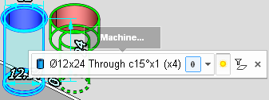
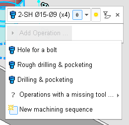
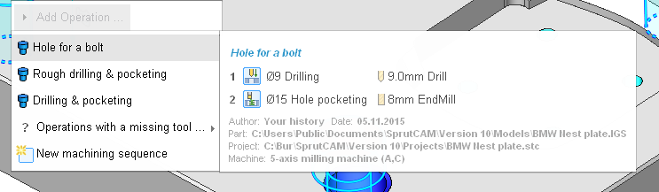
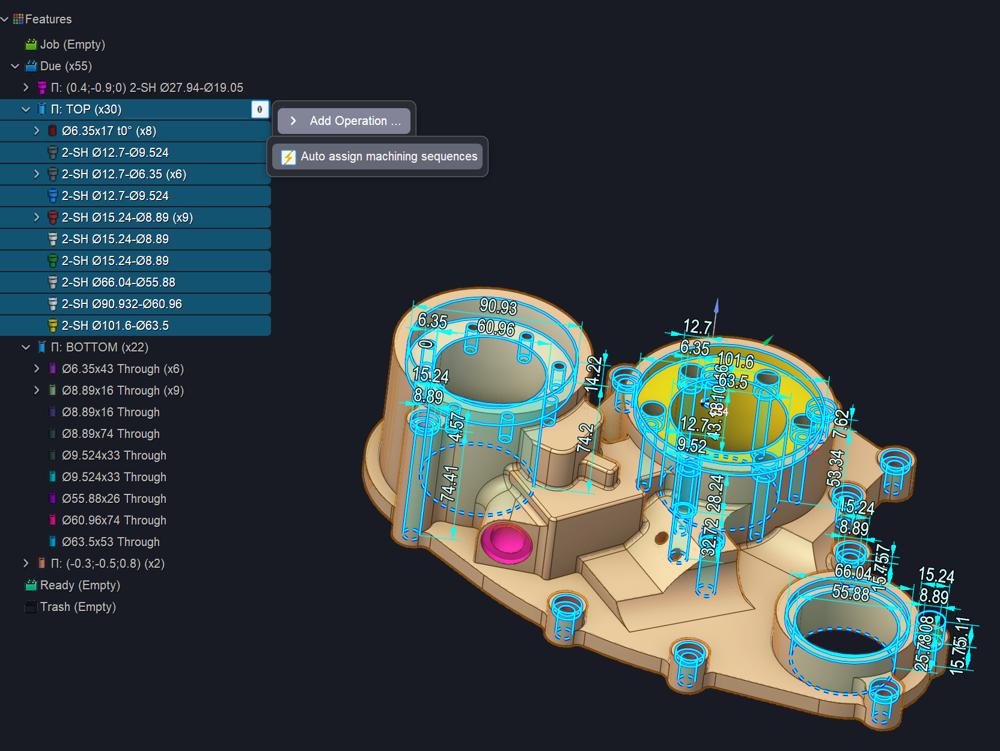

# Assegnazione delle procedure alle feature nell'interfaccia

Per selezionare una procedura di lavorazione per una feature,

- fare clic sull'icona  nell'albero. Questa icona compare quando si evidenzia un nodo dell'albero;

- oppure fare clic sull'elenco a discesa Machining procedure (procedura di lavorazione) nella barra delle azioni.

- Quindi posizionare il cursore sul menu Add Operation… (aggiungi operazione): viene visualizzato l'elenco delle procedure di lavorazione applicabili alle feature selezionate.

- Posizionando il cursore su una procedura del menu, viene visualizzato l'elenco delle operazioni che la compongono insieme agli utensili selezionati per esse.

Vengono inoltre mostrate alcune informazioni aggiuntive sull'origine della procedura proposta: l'autore, la data di creazione, il pezzo per cui è stata creata, il progetto in cui è stata utilizzata e la macchina impiegata in tale progetto.

Le operazioni per le quali il sistema CAM non trova gli utensili vengono inserite in un sottomenu separato, Operations with a missing tool… (operazioni con utensile mancante). Quando si seleziona una sequenza di lavorazione da questo menu, gli utensili mancanti nella libreria utensili (Tool Library) vengono creati.

Per creare una nuova sequenza di lavorazione anziché utilizzarne una esistente, scegliere il comando New Machining Sequence (nuova sequenza di lavorazione).

Dopo aver selezionato la procedura di lavorazione per una feature o averne creata una nuova, la feature viene spostata nella cartella Job e il sistema CAM aggiorna l'elenco delle operazioni risultante, mentre la procedura selezionata diventa disponibile per la modifica.

La possibilità di assegnare automaticamente le regole di lavorazione a un gruppo di fori in un piano specifico

