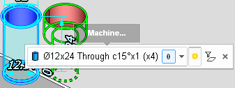
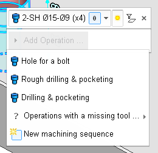
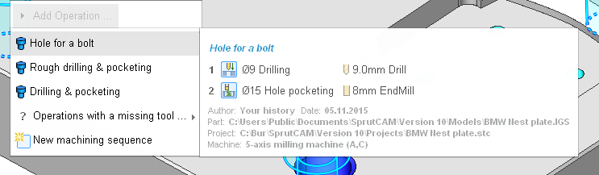
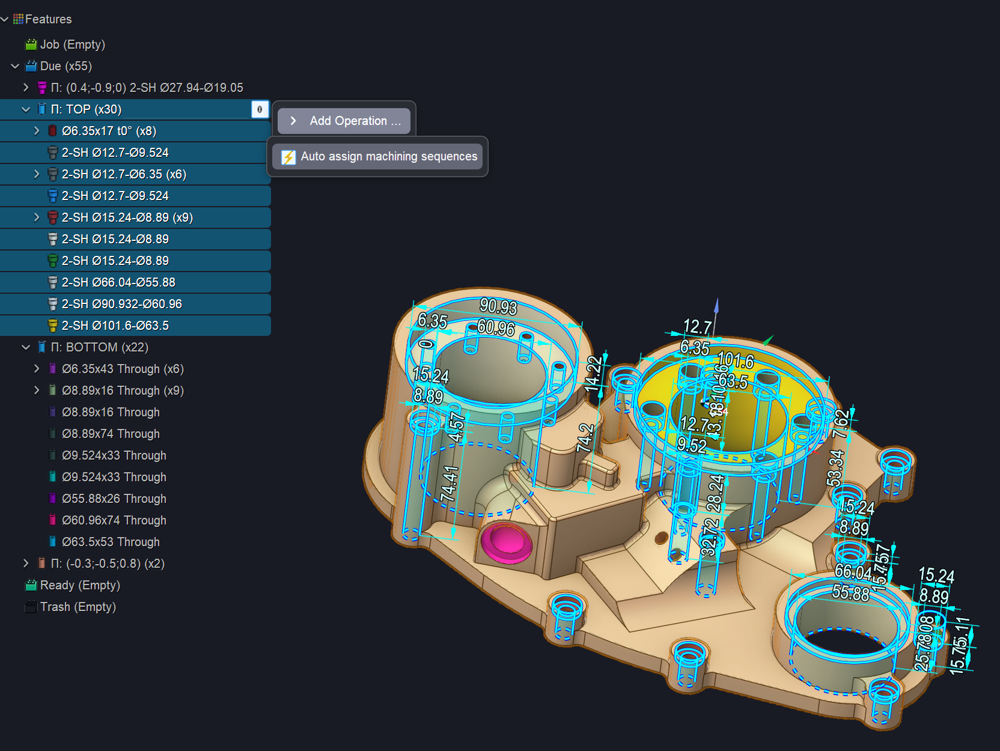

# プロシージャをフィーチャーに割り当て UI

フィーチャーの加工プロシージャを選択するには、

- ツリー内の  アイコンをクリックします。このアイコンは、ツリーでノードをハイライトしたときに表示されます。

- またはアクションバーの加工手順コンボをクリックしてください。

- その後、<strong>オペレーション</strong>追加メニューにカーソルを合わせると、選択したフィーチャーに適用可能な加工手順の一覧が表示されます。

- メニューの手順にカーソルを合わせると、手順を構成するオペレーションのリストと、その操作のために選択された工具が表示されます。

それとともに、提案された手順の起源に関する追加情報も表示されます。作成者、作成日、作成対象の部品、使用されたプロジェクト、そのプロジェクトで使用されたマシンが表示されます。

CAMシステムがツールを見つけられない操作は、別のサブメニュー <strong>工具</strong>が見つからないオペレーションにまとめられます。このメニューから加工順序を選択すると、工具ライブラリに存在しない工具が作成されます。

既存の加工順序を使うのではなく、新しい加工順序を作成するには、<strong>新規加工順序</strong>コマンドを選択します。

フィーチャーの加工手順を選択、または新規作成すると、そのフィーチャーはジョブフォルダに移動されます。

CAMシステムは結果として得られる加工リストを更新し、選択した加工手順は編集可能になります。

特定の平面上の複数の穴に対して加工ルールを自動的に割り当てる機能です。

