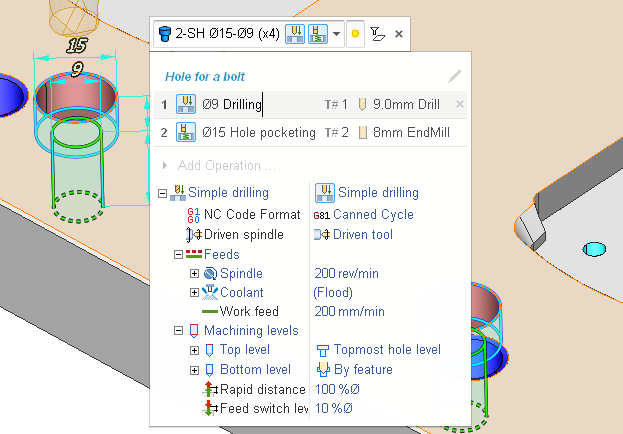
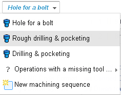
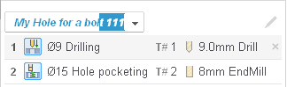
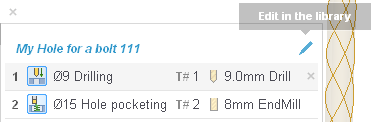
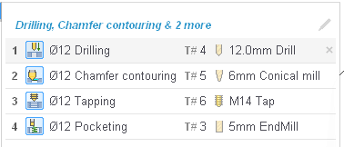
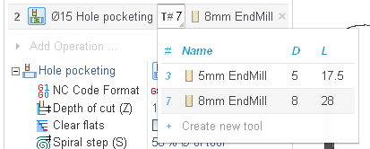
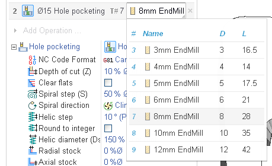
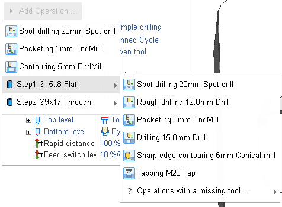
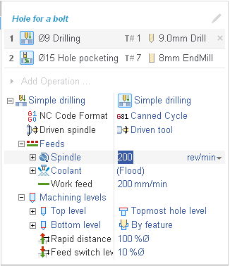

# Interfaccia di modifica delle procedure

La modifica delle procedure di lavorazione avviene nel piccolo pannello mostrato sopra.

<strong>Il selettore della procedura di lavorazione</strong>

Nella parte superiore del pannello si trova il selettore della procedura di lavorazione (nell'immagine, Hole for a bolt). Si tratta di una casella combinata, dalla quale è possibile selezionare rapidamente una procedura diversa per la feature. Nel campo di modifica interno di questa casella combinata è inoltre possibile modificare il nome della procedura corrente.

 

<strong>Il pulsante Edit in the Library</strong>

A destra del selettore della procedura si trova il pulsante Edit in the Library (modifica nella libreria). Facendo clic su di esso, la sequenza di lavorazione corrente viene salvata nella libreria delle procedure (Procedure Library) e si apre la libreria con la procedura selezionata.

<strong>L'elenco delle operazioni</strong>

Sotto l'intestazione si trova l'elenco delle operazioni che costituiscono la sequenza di lavorazione.

Ogni voce dell'elenco è composta dai seguenti campi.

1. Il numero d'ordine. Trascinando questo numero è possibile spostare le operazioni.
2. L'icona.
3. Il prefisso della sotto-feature (presente solo se un'operazione lavora una sotto-feature all'interno di una feature composta).
4. Il nome dell'operazione. Si tratta di un campo di modifica: il nome dell'operazione può essere modificato in qualsiasi momento.
5. Il selettore del numero dell'utensile. Si tratta di una casella combinata con cui si seleziona, dall'elenco degli utensili utilizzati (Used Tool List), l'utensile per l'operazione della sequenza di lavorazione. Sono disponibili per la selezione solo gli utensili applicabili che soddisfano la query sull'utensile. Lo stesso utensile può essere utilizzato in più operazioni; in tal caso, tra parentesi viene visualizzato il numero di operazioni che utilizzano l'utensile.

Per aggiungere un nuovo utensile all'elenco degli utensili utilizzati, selezionare il comando Create new tool.

6.Il selettore dell'utensile. In questa casella combinata si modifica l'utensile selezionato nel campo precedente. Se l'utensile è utilizzato in più operazioni, la modifica si applica a tutte queste operazioni.

7.Il pulsante Delete (elimina).

<strong>Il menu Add Operation…</strong>

Sotto l'elenco delle operazioni si trova il menu Add Operation… (aggiungi operazione).

Da questo menu è possibile aggiungere una nuova operazione alla sequenza di lavorazione. Nel menu vengono proposte solo le operazioni applicabili. Le operazioni per cui mancano gli utensili sono raccolte in un sottomenu separato. Se la feature ha sotto-feature, anche le operazioni per le sotto-feature sono disponibili in sottomenu separati.

<strong>L'inspector dei parametri dell'operazione</strong>

I parametri dell'operazione selezionata sono visualizzati nell'inspector, pronti per la modifica. Il primo parametro è il tipo di ciclo, che si seleziona dall'elenco dei cicli disponibili per la feature selezionata. Gli altri parametri sono i parametri del ciclo.

<strong>Utilizzo dell'interfaccia di modifica delle procedure per creare nuove procedure FBM</strong>

L'interfaccia di modifica delle procedure è un metodo molto semplice ed efficiente per aggiungere nuove procedure di lavorazione alla libreria. È sufficiente selezionare una feature, selezionare una sequenza di lavorazione applicabile o crearne una nuova, modificare il processo di lavorazione, quindi fare clic sul pulsante Edit in the library e apportare alcune modifiche alla procedura ormai presente nella libreria: la nuova procedura è pronta.

Con la funzione History (cronologia) il processo di ampliamento della propria base di conoscenze di lavorazione si semplifica ulteriormente. Quando si salva un progetto contenente operazioni del gruppo FBM Mill, tutte le sequenze di lavorazione del progetto vengono salvate automaticamente nella libreria, nella cartella History.
