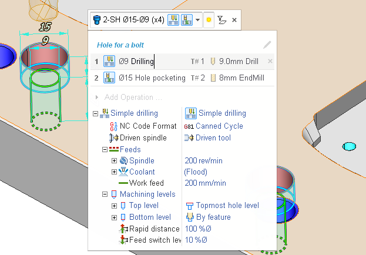
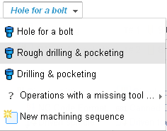
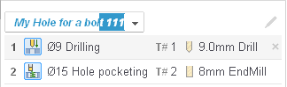
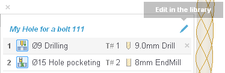
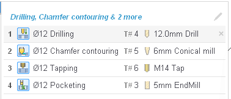
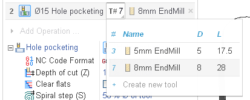
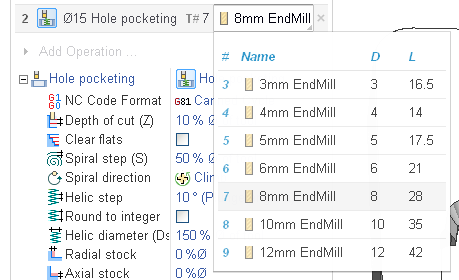
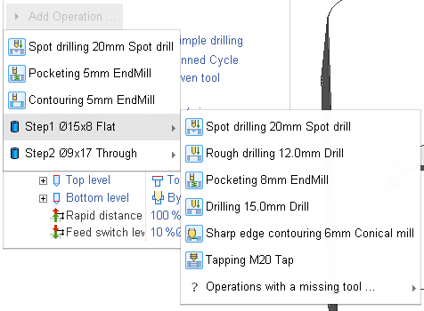
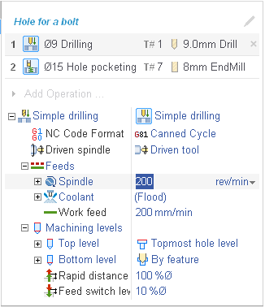

# プロシージャ編集UI

加工手順の編集は、上に表示されている小さなパネルで行います。

<strong>加工プロシージャセレクタ</strong>

パネルの上部には、プロシージャセレクター（<em>Hole for a bolt</em> 画像）があります。このパネルから、フィーチャーに対して別の手順を素早く選択できます。またパネルの編集ボックスで、現在の手順の名前を変更することもできます。

 

<strong>ライブラリーで編集ボタン</strong>

プロシージャセレクターの右側には、<strong>「</strong>ライブラリで編集」ボタンがあります。クリックすると、現在の加工順序がプロシージャライブラリに保存され、手順が選択された状態でライブラリが開きます。

<strong>オペレーションリスト</strong>

ヘッダーの下には、加工順序を構成するオペレーションのリストがあります。

リストの各エントリーは以下の欄で構成されています。

1. シーケンス番号。この番号でオペレーションをドラッグアンドドロップすることができます。
2. アイコン
3. サブフィーチャー接頭辞（複合フィーチャー内のサブフィーチャーを加工するオペレーションがある場合にのみ表示されます）。
4. オペレーション名は編集ボックスで、いつでも変更できます。
5. 工具番号セレクタはコンボボックスになっています。これを使って、加工順序のオペレーションに対して「使用中のツールリスト」からツールを選択します。工具クエリを満たす適用可能な工具だけが選択可能です。同じ工具を複数のオペレーションで使うことができます。この場合、工具が使用されているオペレーションの数が括弧内に表示されます。

使用中のツールリストに新しいツールを追加するには、<strong>新規工具を作成</strong>コマンドを選択します。

6. 工具セレクタこのコンボボックスで、前の欄で選択した工具を変更します。工具が複数のオペレーションで使用されている場合、それらのオペレーションすべてに影響します。

7. 削除ボタン

<strong>オペレーション追加...メニュー</strong>

オペレーションリストの下にオペレーション追加メニューがあります。

このメニューから、加工順序に新しいオペレーションを追加することができます。このメニューでは、適用可能な操作のみが提案されます。工具が不足しているオペレーションは、別のサブメニューにまとめられます。そのフィーチャーにサブフィーチャーがある場合、サブフィーチャーに対するオペレーションも別のサブメニューに表示されます。

<strong>オペレーションパラメーターインスペクター</strong>

選択したオペレーションのパラメータがインスペクターに表示され、編集できるようになります。最初のパラメーターはサイクルタイプです。選択したフィーチャーで利用可能なサイクルのリストから、サイクルの種類を選択できます。残りのパラメーターは、サイクルのパラメーターです。

<strong>プロシージャ編集UIを使って新しいFBMプロシージャを作成</strong>

加工手順の編集UIは、新しい加工プロシージャをライブラリに追加するシンプルで効率的な方法です。フィーチャーを選択し、それに適用可能な加工順序を選択するか、新しく作成し、加工プロセスを編集します。次にライブラリーで編集 ボタンをクリックして、ライブラリー内の既存のプロシージャを調整すれば、新しい手順が完成します。

「履歴」機能を使うと、加工ナレッジベースの拡張プロセスはさらに簡単になります。FBM Mill のグループ加工を含むプロジェクトを保存すると、そのプロジェクトのすべての加工順序が自動的に履歴フォルダに保存されます。
