# Bohrungsbearbeitung

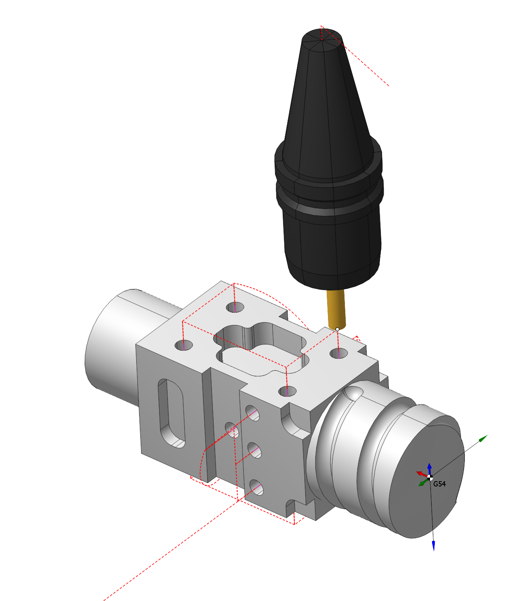

## Anwendungsbereich:

Die Bohrungsbearbeitung umfasst Bohren, Zentrieren, Ausbohren, Senken, Gewindebohren, Gewindefräsen und das Ausfräsen von Bohrungen. Bohrungen können in unterschiedlichen und auch nicht rechtwinklig zueinander angeordneten Ebenen liegen. Die Operation eignet sich sowohl für Bohrungen im Modell als auch zum Vorbohren von Eintauchpunkten, beispielsweise für das Taschenfräsen.

### Einrichtung:

Auf der Registerkarte **Setup (Einrichtung)** werden die grundlegenden Projekteinstellungen festgelegt, darunter die Position des Bauteils auf der Maschine und das Bauteilkoordinatensystem. [Details](1022.md)

### Auftragszuweisung:

**Center (Mittelpunkt).** Erstellt eine Bohrung anhand ihres Mittelpunkts.

**Create (Erstellen).** Erstellt eine Bohrung durch Koordinateneingabe. [Details](706.md)

**Recognize (Erkennen).** Erkennt Bohrungen im Bauteil automatisch. [Details](406.md)

**Pattern (Muster).** Erstellt eine Bohrungsanordnung anhand eines Musters. [Details](407.md)

**Properties (Eigenschaften).** Öffnet die Eigenschaften einer Bohrung. Auch durch Doppelklick auf einen Listeneintrag erreichbar. [Details](706.md)

**Sorting (Sortierung).** Sortiert die Bohrungsliste anhand der gewählten Kriterien. [Details](10158.md)

**Delete (Löschen).** Entfernt ein Element aus der Liste.

**Restrictions (Begrenzungen).** Definiert nicht zu bearbeitende Bereiche. [Details](101231.md)

### Strategie:

#### Bearbeitungsart:

Diese Gruppe enthält die grundlegenden Parameter der verschiedenen Verfahren zur Bohrungsbearbeitung.

Weitere Informationen anzeigen

**Drilling Type (Bearbeitungsart):**

**Simple drilling (Einfaches Bohren).** Bohrt mit Anfahren und Rückzug zur Sicherheitsebene im Eilgang.

Weitere Informationen anzeigen

.png)

Der Zyklus besteht aus folgenden Schritten:

- Eilgang zur Bohrungsmitte auf der Ebene **Rapid distance (RD)**. Der Abstand wird auf der Registerkarte **Links (Verbindungen)** eingestellt.
- Eilgang auf die Ebene **Feed distance (FD)**, ebenfalls auf der Registerkarte **Links** eingestellt.
- Arbeitsvorschub bis **Z min**. Die absolute Endtiefe wird in den Bohrungseigenschaften der **Auftragszuweisung** festgelegt. Für die relative Tiefe gilt **H = Zmax - Zmin**.
- Rückzug im Eilgang auf die Ebene **Rapid distance (RD)**.

**Drilling with dwell (Bohren mit Verweilzeit).** Bohrt mit Verweilzeit am Bohrungsgrund sowie Anfahren und Rückzug zur Sicherheitsebene im Eilgang.

Weitere Informationen anzeigen

.png)

Der Zyklus besteht aus folgenden Schritten:

- Eilgang zur Bohrungsmitte auf der Ebene **Rapid distance (RD)**. Der Abstand wird auf der Registerkarte **Links (Verbindungen)** eingestellt.
- Eilgang auf die Ebene **Feed distance (FD)**, ebenfalls auf der Registerkarte **Links** eingestellt.
- Arbeitsvorschub bis **Z min**. Die absolute Endtiefe wird in den Bohrungseigenschaften der **Auftragszuweisung** festgelegt. Für die relative Tiefe gilt **H = Zmax - Zmin**.
- Verweilen für **Bottom Dwell (DWB)** auf der erreichten Tiefe.
- Rückzug im Eilgang auf die Ebene **Rapid distance (RD)**.

**Chip removing (Tieflochbohren mit Entspanen).** Fährt zur Bohrungsmitte auf der Ebene **RD** und bohrt schrittweise mit Rückzug auf die Ebene **FD** zur Spanabfuhr.

Weitere Informationen anzeigen

.png)

Der Zyklus besteht aus folgenden Schritten:

- Eilgang zur Bohrungsmitte auf der Ebene **Rapid distance (RD)**. Der Abstand wird auf der Registerkarte **Links (Verbindungen)** eingestellt.
- Eilgang auf die Ebene **Feed distance (FD)**, ebenfalls auf der Registerkarte **Links** eingestellt.
- Zustellung um **Step (S)** mit Arbeitsvorschub.
- Verweilen für **Bottom Dwell (DWB)** auf der erreichten Tiefe.
- Rückzug im Eilgang auf die Ebene **FD**.
- Verweilen für **Top Dwell (DWT)**.
- Anfahren der vorherigen Bohrtiefe im Eilgang bis zum Sicherheitsabstand **Deceleration (Dcl)**.
- Überwinden des verbleibenden Abstands **Dcl** und Zustellung um den nächsten Schritt **S** mit Arbeitsvorschub.
- Verweilen für **Bottom Dwell (DWB)** auf der erreichten Tiefe.
- Wiederholen von Rückzug, oberer Verweilzeit, Anfahren, Zustellung und unterer Verweilzeit bis zur vollständigen Bohrtiefe.
- Rückzug im Eilgang auf die Ebene **Rapid distance (RD)**.

**Chip breaking (Tieflochbohren mit Spanbrechen).** Fährt zur Bohrungsmitte auf der Ebene **RD** und bohrt schrittweise mit kurzen Rückzugsbewegungen zum Brechen der Späne.

Weitere Informationen anzeigen

.png)

Der Zyklus besteht aus folgenden Schritten:

- Eilgang zur Bohrungsmitte auf der Ebene **Rapid distance (RD)**. Der Abstand wird auf der Registerkarte **Links (Verbindungen)** eingestellt.
- Eilgang auf die Ebene **Feed distance (FD)**, ebenfalls auf der Registerkarte **Links** eingestellt.
- Zustellung um **Step (S)** mit Arbeitsvorschub.
- Verweilen für **Bottom Dwell (DWB)** auf der erreichten Tiefe.
- Rückzug im Eilgang um **Lead-out (Ld)**.
- Verweilen für **Top Dwell (DWT)**.
- Anfahren der vorherigen Bohrtiefe im Eilgang bis zum Sicherheitsabstand **Deceleration (Dcl)**.
- Überwinden des verbleibenden Abstands **Dcl** und Zustellung um den nächsten Schritt **S** mit Arbeitsvorschub.
- Verweilen für **Bottom Dwell (DWB)** auf der erreichten Tiefe.
- Wiederholen der letzten fünf Schritte bis zur vollständigen Bohrtiefe.
- Rückzug im Eilgang auf die Ebene **Rapid distance (RD)**.

**Tapping (Gewindebohren).** Fährt im Eilgang an, schneidet das Gewinde und fährt mit umgekehrter Spindeldrehrichtung und Arbeitsvorschub wieder heraus.

Weitere Informationen anzeigen

.png)

Der Gewindebohrzyklus `G84` besteht aus folgenden Schritten:

- Eilgang zur Bohrungsmitte auf der Ebene **Rapid distance (RD)**. Der Abstand wird auf der Registerkarte **Links (Verbindungen)** eingestellt.
- Eilgang auf die Ebene **Feed distance (FD)**, ebenfalls auf der Registerkarte **Links** eingestellt.
- Arbeitsvorschub bis **Z min** bei **M3 (M4)**, anschließend Umkehr der Spindeldrehrichtung mit **M4 (M3)**.
- Rückzug mit Arbeitsvorschub auf die Ebene **Feed distance (FD)**.
- Rückzug im Eilgang auf die Ebene **Rapid distance (RD)**.
- Wiederherstellen von Spindeldrehrichtung und Drehzahl.

**Bore 5 (Ausbohren 5).** Fährt zur Bohrungsmitte, bearbeitet die Bohrung bis zur unteren Ebene und führt anschließend den Rückzug aus.

Weitere Informationen anzeigen

.png)

Der Zyklus besteht aus folgenden Schritten:

- Eilgang zur Bohrungsmitte auf der Ebene **Rapid distance (RD)**. Der Abstand wird auf der Registerkarte **Links (Verbindungen)** eingestellt.
- Eilgang auf die Ebene **Feed distance (FD)**, ebenfalls auf der Registerkarte **Links** eingestellt.
- Arbeitsvorschub bis **Z min**. Die absolute Endtiefe wird in den Bohrungseigenschaften der **Auftragszuweisung** festgelegt. Für die relative Tiefe gilt **H = Zmax - Zmin**.
- Spindelstopp mit **M5**.
- Verweilen für **Bottom Dwell (DWB)** auf der erreichten Tiefe.
- Rückzug im Eilgang auf die Ebene **Rapid distance (RD)**.
- Wiederherstellen von Spindeldrehrichtung und Drehzahl.

**Bore 6 (Ausbohren 6).** Bearbeitet die Bohrung, stoppt die Spindel auf der unteren Ebene und fährt im Eilgang auf die Ebene **RD** zurück.

Weitere Informationen anzeigen

.png)

Der Zyklus besteht aus folgenden Schritten:

- Eilgang zur Bohrungsmitte auf der Ebene **Rapid distance (RD)**. Der Abstand wird auf der Registerkarte **Links (Verbindungen)** eingestellt.
- Eilgang auf die Ebene **Feed distance (FD)**, ebenfalls auf der Registerkarte **Links** eingestellt.
- Arbeitsvorschub bis **Z min**. Die absolute Endtiefe wird in den Bohrungseigenschaften der **Auftragszuweisung** festgelegt. Für die relative Tiefe gilt **H = Zmax - Zmin**.
- Spindelstopp mit **M5**. Bei aktiviertem **Oriented tool retract (Orientierter Werkzeugrückzug)** stoppt die Spindel in der vorgegebenen Winkelstellung. Anschließend wird das Werkzeug um die angegebenen Werte seitlich versetzt.
- Verweilen für **Bottom Dwell (DWB)** auf der erreichten Tiefe.
- Rückzug im Eilgang auf die Ebene **Rapid distance (RD)**.
- Wiederherstellen von Spindeldrehrichtung und Drehzahl.

**Bore 7 (Ausbohren 7).** Bearbeitet die Bohrung, stoppt die Spindel auf der unteren Ebene und ermöglicht einen manuellen Werkzeugrückzug.

Weitere Informationen anzeigen

.png)

Der Zyklus besteht aus folgenden Schritten:

- Eilgang zur Bohrungsmitte auf der Ebene **Rapid distance (RD)**. Der Abstand wird auf der Registerkarte **Links (Verbindungen)** eingestellt.
- Eilgang auf die Ebene **Feed distance (FD)**, ebenfalls auf der Registerkarte **Links** eingestellt.
- Arbeitsvorschub bis **Z min**. Die absolute Endtiefe wird in den Bohrungseigenschaften der **Auftragszuweisung** festgelegt. Für die relative Tiefe gilt **H = Zmax - Zmin**.
- Spindelstopp mit **M5**. Bei aktiviertem **Oriented tool retract (Orientierter Werkzeugrückzug)** stoppt die Spindel in der vorgegebenen Winkelstellung. Anschließend wird das Werkzeug um die angegebenen Werte seitlich versetzt.
- Am Bohrungsgrund wird **M1** zum Warten auf den Bediener ausgegeben. Das Werkzeug kann manuell zurückgezogen werden.
- Rückzug im Eilgang auf die Ebene **Rapid distance (RD)**.
- Wiederherstellen von Spindeldrehrichtung und Drehzahl.

**Bore 8 (Ausbohren 8).** Fährt im Eilgang an, bearbeitet die Bohrung, verweilt am Bohrungsgrund und stoppt die Spindel für den manuellen Rückzug.

Weitere Informationen anzeigen

.png)

Der Zyklus besteht aus folgenden Schritten:

- Eilgang zur Bohrungsmitte auf der Ebene **Rapid distance (RD)**. Der Abstand wird auf der Registerkarte **Links (Verbindungen)** eingestellt.
- Eilgang auf die Ebene **Feed distance (FD)**, ebenfalls auf der Registerkarte **Links** eingestellt.
- Arbeitsvorschub bis **Z min**. Die absolute Endtiefe wird in den Bohrungseigenschaften der **Auftragszuweisung** festgelegt. Für die relative Tiefe gilt **H = Zmax - Zmin**.
- Verweilen für **Bottom Dwell (DWB)** auf der erreichten Tiefe.
- Spindelstopp mit **M5**.
- Am Bohrungsgrund wird **M1** zum Warten auf den Bediener ausgegeben. Das Werkzeug kann manuell zurückgezogen werden.
- Rückzug im Eilgang auf die Ebene **Rapid distance (RD)**.
- Wiederherstellen von Spindeldrehrichtung und Drehzahl.

**Bore 9 (Ausbohren 9).** Fährt im Eilgang an, bearbeitet die Bohrung mit Verweilzeit am Grund und fährt mit Arbeitsvorschub bis **FD**, anschließend im Eilgang bis **RD** zurück.

Weitere Informationen anzeigen

.png)

Der Zyklus besteht aus folgenden Schritten:

- Eilgang zur Bohrungsmitte auf der Ebene **Rapid distance (RD)**. Der Abstand wird auf der Registerkarte **Links (Verbindungen)** eingestellt.
- Eilgang auf die Ebene **Feed distance (FD)**, ebenfalls auf der Registerkarte **Links** eingestellt.
- Arbeitsvorschub bis **Z min**. Die absolute Endtiefe wird in den Bohrungseigenschaften der **Auftragszuweisung** festgelegt. Für die relative Tiefe gilt **H = Zmax - Zmin**.
- Verweilen für **Bottom Dwell (DWB)** auf der erreichten Tiefe.
- Rückzug mit Arbeitsvorschub auf die Ebene **Feed distance (FD)**.
- Rückzug im Eilgang auf die Ebene **Rapid distance (RD)**.

**By spiral (thread milling) (Helixbearbeitung/Gewindefräsen).** Bearbeitet Innen- oder Außengewinde sowie Bohrungen mit einer Helixbahn. Beim Bohrungsfräsen muss der Bohrungsdurchmesser größer als der Werkzeugdurchmesser sein. Das Werkzeug umläuft die Bohrungsachse und bewegt sich gleichzeitig axial. Der Helixdurchmesser wird aus Bohrungs- und Werkzeugabmessungen bestimmt. Mehrere Durchgänge können verwendet werden, um den gewünschten Durchmesser zu erreichen.

Weitere Informationen anzeigen

.png)

Der Zyklus besteht aus folgenden Schritten:

- Eilgang zur Bohrungsmitte auf der Ebene **Rapid distance (RD)**. Der Abstand wird auf der Registerkarte **Links (Verbindungen)** eingestellt.
- Eilgang auf die Ebene **Feed distance (FD)**, ebenfalls auf der Registerkarte **Links** eingestellt.
- Anfahren des Helixbeginns mit Arbeitsvorschub; die Steigung wird durch **Thread step (TS)** bestimmt.
- Arbeitsvorschub bis **Z min**. Die absolute Endtiefe wird in den Bohrungseigenschaften der **Auftragszuweisung** festgelegt. Für die relative Tiefe gilt **H = Zmax - Zmin**.
- Rückkehr zur Bohrungsmitte.
- Rückzug mit Arbeitsvorschub auf die Ebene **Feed distance (FD)**.
- Rückzug im Eilgang auf die Ebene **Rapid distance (RD)**.

**Hole pocketing (Bohrung ausfräsen).** Fräst Bohrungen, deren Durchmesser größer als der Werkzeugdurchmesser ist, schichtweise aus. Das Werkzeug taucht helikal auf jede Ebene ein und erweitert die Bohrung entlang einer archimedischen Spirale auf den gewünschten Durchmesser. Ein abschließender Kreiszug bearbeitet den Umfang. Die archimedische Spirale wird durch Kreisbögen angenähert.

Weitere Informationen anzeigen

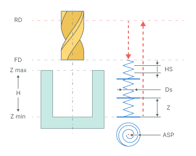

Der Zyklus besteht aus folgenden Schritten:

- Eilgang zur Bohrungsmitte auf der Ebene **Rapid distance (RD)**. Der Abstand wird auf der Registerkarte **Links (Verbindungen)** eingestellt.
- Eilgang auf die Ebene **Feed distance (FD)**, ebenfalls auf der Registerkarte **Links** eingestellt.
- Helikales Eintauchen mit Arbeitsvorschub um die **Schnitttiefe Z**. **Helic diameter (Ds)** wird als Prozentsatz des Werkzeugdurchmessers angegeben. **Helic step (HS)** wird über den Rampenwinkel **a**, die Höhe **Hi** in mm oder die Anzahl der Werkzeugwindungen festgelegt.
- Ausfräsen auf dieser Ebene entlang einer archimedischen Spirale mit **Spiral step (ASP)**, bis die Werkzeugachse einen Kreis mit dem Durchmesser „Bohrungsdurchmesser minus Werkzeugdurchmesser“ erreicht.
- Schlichtdurchgang entlang dieses Kreises ohne Höhenänderung.
- Wiederholen der letzten drei Schritte bis zur gewünschten Bohrtiefe. Der nächste Eintauchpunkt wird ohne Höhenänderung angefahren.
- Rückkehr zur Bohrungsmitte.
- Rückzug im Eilgang auf die Ebene **FD**.
- Rückzug im Eilgang auf die Ebene **Rapid distance (RD)**.

**Tapping with chip removing (Gewindebohren mit Entspanen).**

Weitere Informationen anzeigen

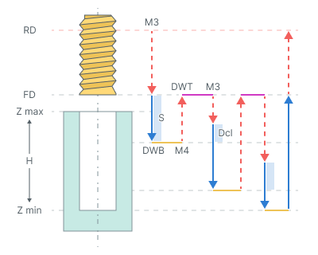

Der Zyklus besteht aus folgenden Schritten:

- Eilgang zur Bohrungsmitte auf der Ebene **Rapid distance (RD)**. Der Abstand wird auf der Registerkarte **Links (Verbindungen)** eingestellt.
- Eilgang auf die Ebene **Feed distance (FD)**, ebenfalls auf der Registerkarte **Links** eingestellt.
- Zustellung um **Step (S)** mit Arbeitsvorschub.
- Umkehr der Spindeldrehrichtung mit **M4**.
- Verweilen für **Bottom Dwell (DWB)** auf der erreichten Tiefe.
- Rückzug im Eilgang auf die Ebene **FD**.
- Verweilen für **Top Dwell (DWT)**.
- Wiederherstellen der Schneidrichtung mit **M3**.
- Anfahren der vorherigen Tiefe im Eilgang bis zum Sicherheitsabstand **Deceleration (Dcl)**.
- Überwinden von **Dcl** und Zustellung um den nächsten Schritt **S** mit Arbeitsvorschub.
- Umkehr der Spindeldrehrichtung mit **M4**.
- Verweilen für **Bottom Dwell (DWB)** auf der erreichten Tiefe.
- Wiederholen der letzten sieben Schritte bis zur vollständigen Gewindetiefe.
- Rückzug mit Arbeitsvorschub auf die Ebene **Feed distance (FD)**.
- Rückzug im Eilgang auf die Ebene **Rapid distance (RD)**.

**Tapping with chip breaking (Gewindebohren mit Spanbrechen).**

Weitere Informationen anzeigen

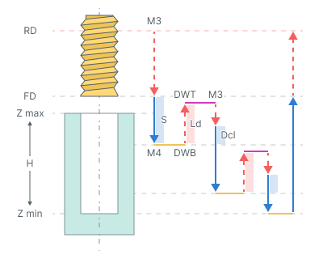

Der Zyklus besteht aus folgenden Schritten:

- Eilgang zur Bohrungsmitte auf der Ebene **Rapid distance (RD)**. Der Abstand wird auf der Registerkarte **Links (Verbindungen)** eingestellt.
- Eilgang auf die Ebene **Feed distance (FD)**, ebenfalls auf der Registerkarte **Links** eingestellt.
- Zustellung um **Step (S)** mit Arbeitsvorschub.
- Umkehr der Spindeldrehrichtung mit **M4**.
- Verweilen für **Bottom Dwell (DWB)** auf der erreichten Tiefe.
- Rückzug im Eilgang um **Lead-out (Ld)**.
- Verweilen für **Top Dwell (DWT)**.
- Wiederherstellen der Schneidrichtung mit **M3**.
- Anfahren der vorherigen Tiefe im Eilgang bis zum Sicherheitsabstand **Deceleration (Dcl)**.
- Überwinden von **Dcl** und Zustellung um den nächsten Schritt **S** mit Arbeitsvorschub.
- Umkehr der Spindeldrehrichtung mit **M4**.
- Verweilen für **Bottom Dwell (DWB)** auf der erreichten Tiefe.
- Wiederholen der letzten sieben Schritte bis zur vollständigen Gewindetiefe.
- Rückzug mit Arbeitsvorschub auf die Ebene **Feed distance (FD)**.
- Rückzug im Eilgang auf die Ebene **Rapid distance (RD)**.

**Groove boring (Nutenausbohren).** Für diese Bearbeitung wird **Oriented tool retract (Orientierter Werkzeugrückzug)** empfohlen.

Weitere Informationen anzeigen

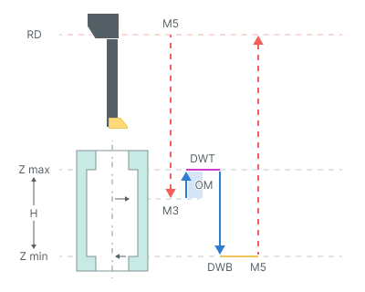

Der Zyklus besteht aus folgenden Schritten:

- Eilgang auf der Ebene **Rapid distance (RD)** aus der Registerkarte **Links**.
- Eilgang bis **Zmax − Opposite move length (OM)**.
- Spindeldrehung mit **M3** einschalten.
- Arbeitsvorschub bis **Zmax + Opposite move length (OM)**.
- Verweilen für **Top Dwell (DWT)**.
- Arbeitsvorschub bis **Z min**. Die absolute Endtiefe wird in den Bohrungseigenschaften der **Auftragszuweisung** festgelegt. Für die relative Tiefe gilt **H = Zmax - Zmin**.
- Verweilen für **Bottom Dwell (DWB)** auf der erreichten Tiefe.
- Spindelstopp mit **M5**.
- Rückzug im Eilgang auf die Ebene **Rapid distance (RD)**.

**Die folgenden Parameter sind abhängig von der gewählten Bearbeitungsart verfügbar. Die Bezeichnungen in Klammern entsprechen den Zyklusskizzen.**

**Top Dwell (DWT) (Obere Verweilzeit).** Verweilzeit auf der oberen Rückzugsebene. Siehe die Darstellung der jeweiligen Bearbeitungsart.

**Bottom Dwell (DWB) (Untere Verweilzeit).** Verweilzeit auf der erreichten Bohrtiefe. Siehe die Darstellung der jeweiligen Bearbeitungsart.

**Step (S) (Zustellung).** Tiefenzuwachs je Bohrschritt beim Tieflochbohren.

**Deceleration (Dcl) (Umschaltabstand).** Abstand vor der bereits erreichten Bohrtiefe, an dem das schnelle Anfahren endet. Die verbleibende Strecke und die nächste Zustellung werden mit Arbeitsvorschub ausgeführt.

**Lead-out (Ld) (Rückzugsweg).** Rückzugsbetrag nach einem Bohrschritt.

**Helic step (Helixsteigung).** Steigung der helikalen Eintauchbahn.

**Helic diameter (Ds) (Helixdurchmesser).** Durchmesser der helikalen Eintauchbahn.

**Spiral step (S) (Spiralabstand).** Abstand **ASP** der archimedischen Spirale beim Ausfräsen auf einer Ebene. Die Spiralbewegung endet, wenn die Werkzeugachse den Kreis mit dem Durchmesser „Bohrungsdurchmesser minus Werkzeugdurchmesser“ erreicht.

**Depth of cut (Z) (Schnitttiefe).** Abstand zwischen den horizontalen Bearbeitungsebenen beim Ausfräsen mit archimedischer Spirale.

**Opposite move length (OM) (Länge der Gegenbewegung).** Länge der Arbeitsbewegung beim Nutenausbohren.

**Thread step (TS) (Gewindesteigung).** Helixsteigung bei der helikalen Bohrungsbearbeitung bzw. Gewindesteigung beim Gewindefräsen.

**Degression (DG), aktiviert:** Verringert jede nachfolgende Zustellung um den angegebenen Betrag, bis die minimale Zustellung erreicht ist. Weitere Schritte werden mit diesem Mindestwert ausgeführt.

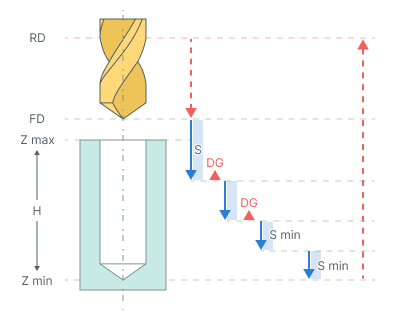

**Deaktiviert:** Die Zustellung bleibt konstant. Der letzte Schritt deckt die noch verbleibende Bohrtiefe ab.

**Minimal step (Smin) (Minimale Zustellung).** Mindestzustellung als Prozentsatz der ersten Zustellung.

**Thread pitch (Gewindesteigung).** Steigung in Millimetern oder Zoll entsprechend dem aktuellen Einheitensystem.

**Spindle position / Initial angular position (Anfängliche Spindelwinkelstellung).** Anfangswinkel in Grad für mehrgängige Gewinde.

**Socket type (Futtertyp).** Auswahl des Gewindebohrfutters. Die Steuerung kann unterschiedliche Zyklen für Futter mit Längenausgleich und starre Futter verwenden.

**Floating (Mit Längenausgleich).**

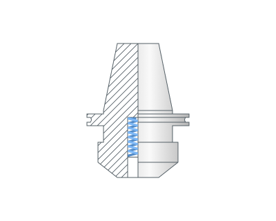

**Fixed (Starr).**

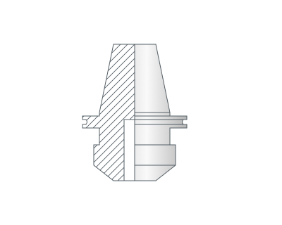

**Oriented tool retract (Orientierter Werkzeugrückzug).** Ermöglicht den Rückzug ohne Berührung der bearbeiteten Wand. Nach Erreichen der Endtiefe stoppt die Spindel in einer definierten Winkelstellung. Das Werkzeug wird geringfügig seitlich versetzt und bei stehender Spindel auf die obere Ebene zurückgezogen.

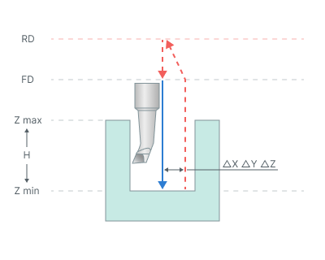

**Spindle orientation angle (Spindelorientierungswinkel).** Winkelstellung der Spindel in Grad.

**ΔX, ΔY, ΔZ.** Versatz von der Bohrungsmitte beim orientierten Werkzeugrückzug.

**Thread type (Gewindeart).** Auswahl zwischen **External (OD) (Außengewinde)** und **Internal (ID) (Innengewinde)**.

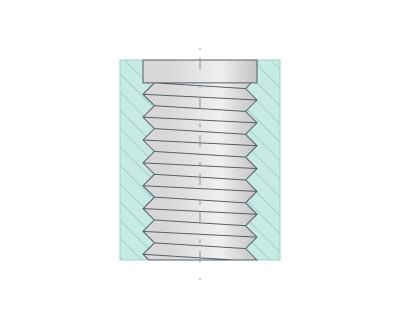 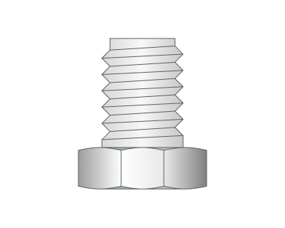

**Taper angle (Kegelwinkel).** Kegelwinkel für konische Gewinde.

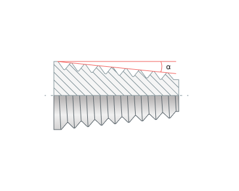

**Compensation mode (Korrekturmodus).** Entspricht der Gruppe **Ausgabe** der 2D-Konturbearbeitung. [Details](404.md)

**Thread direction / Spiral direction (Gewinde-/Spiralrichtung).** Legt Rechts- oder Linksgewinde bzw. die Bewegungsrichtung beim Fräsen fest.

**Conventional (Gegenlauf).** Für das Ausfräsen von Bohrungen. Entspricht der Fräsarteinstellung beim Wasserlinien-Schruppen. [Details](736.md)

**Climb (Gleichlauf).** Für das Ausfräsen von Bohrungen. Entspricht der Fräsarteinstellung beim Wasserlinien-Schruppen. [Details](736.md)

**CW (Right) (Im Uhrzeigersinn/rechts).** Rechtsgängige Spiralbahn. Das Werkzeug umläuft die Bohrungsachse von oben gesehen im Uhrzeigersinn. Für das Gewindefräsen.

_(1).png)

**CWW (Left) (Gegen den Uhrzeigersinn/links).** Linksgängige Spiralbahn. Das Werkzeug umläuft die Bohrungsachse von oben gesehen gegen den Uhrzeigersinn. Für das Gewindefräsen.

_(1).png)

**Round thread count to integer / Round to integer (Windungszahl ganzzahlig runden).** Rundet die Anzahl der Umläufe nach Möglichkeit auf eine kleinere oder größere ganze Zahl.

.png) .png)

**Thread depth (Td) (Gewindetiefe).** Differenz zwischen Außen- und Innendurchmesser des Gewindes. Bei Innen- und Außengewinden gibt der Durchmesser in der Auftragszuweisung den maximalen Außendurchmesser an. Der Innendurchmesser ergibt sich aus Außendurchmesser minus `*<THREAD depth>*`.

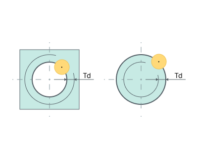

**Start count (Gangzahl).** Anzahl der Gewindegänge bei mehrgängigen Gewinden.

**Thread Mill Path (Gewindefräsbahn).** Wählt passend zum Werkzeugtyp zwischen **Continuous (Kontinuierlich)** und **Axial Divide (Axial unterteilt)**.

**Continuous (Kontinuierlich).** Für Werkzeuge mit einem einzelnen Gewindeprofil, die je Helixumlauf eine Gewindewindung erzeugen. Die Bahn ist eine durchgehende Helix mit der Steigung **TS**.

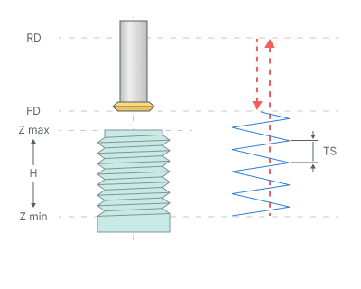

**Axial Divide (Axial unterteilt).** Für Werkzeuge mit mehreren axial angeordneten Gewindeprofilen, die je Helixumlauf mehrere Windungen erzeugen. Aufeinanderfolgende Helixumläufe werden durch schnelle axiale Übergänge verbunden. Maßgeblich sind **Thread step (TS)** und **Tool working length (TWL)**.

.png)

**Turn count (Windungszahl).** Anzahl der Gewindewindungen.

**Tool working length (TWL) (Werkzeugarbeitslänge).** Länge der axialen Übergänge zwischen benachbarten Helixumläufen. Sie ergibt sich aus der Gewindesteigung multipliziert mit der Anzahl der Windungen, die das Werkzeug in einem Umlauf erzeugen kann. Siehe **Axial Divide**.

**Machining sequence / Direction (Bearbeitungsrichtung).** Reihenfolge der Bearbeitung.

**Top-down (Von oben nach unten).**

**Bottom-up (Von unten nach oben).**

**Rough passes (Schruppdurchgänge).** Erzeugt zusätzliche, in der Ebene versetzte Durchgänge.

**Finish pass (Schlichtdurchgang).** Verwendet den letzten Durchgang zum Schlichten und fügt im angegebenen Abstand einen zusätzlichen Schruppdurchgang hinzu.

**Final circular pass (Abschließender Kreiszug).** Fügt einen Kreiszug am Bohrungsgrund hinzu.

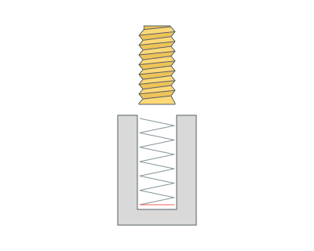

#### Werkzeugkontaktpunkt:

Der Werkzeugkontaktpunkt (TCP) definiert die Stelle am Schneidwerkzeug, an der der Kontakt mit der Werkstückoberfläche bzw. den Geometrieelementen während der Bearbeitung erfolgt.

Die Parameter entsprechen denen der 5D-Flächenbearbeitung. [Details.](10135.md)

#### Bohrungen sortieren:

Legt die Bearbeitungsreihenfolge der Bohrungen fest.

Weitere Informationen anzeigen

**Optimal.** Minimiert die Länge der Leerbewegungen.

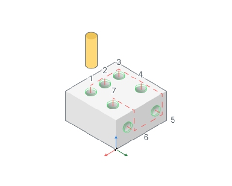

**By list (Nach Liste).** Bearbeitet die Bohrungen in der Reihenfolge der Auftragszuweisung.

**Group holes with the same plane (Bohrungen derselben Ebene gruppieren).** Optimiert die Reihenfolge innerhalb der Gruppen von Bohrungen in derselben Ebene.

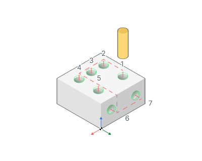

#### Bohrungskoordinatensystem verwenden:

Weitere Informationen anzeigen

**Aktiviert:** Vor der Bearbeitung jeder Bohrung wird **ORIGIN** ausgegeben. Jede Bohrung wird in ihrem eigenen lokalen Koordinatensystem bearbeitet. Dadurch kann der Zyklus auf die XY-Ebene bezogen werden, die von den meisten CNC-Steuerungen für Bohrzyklen unterstützt wird. Weitere Informationen zu **ORIGIN** enthält der Abschnitt zum Operationskoordinatensystem.

**Deaktiviert:** Alle Bohrungen werden in einem gemeinsamen Koordinatensystem bearbeitet.

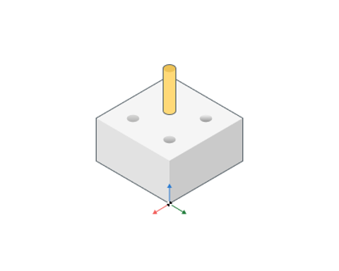 

#### NC-Ausgabeformat

Legt fest, wie die Bohrungsbearbeitung ausgegeben wird.

Weitere Informationen anzeigen

**Long Hand (Einzelbewegungen).** Die CLData enthält einfache Bewegungsbefehle zur Ausgabe beispielsweise als **G0** und **G1**.

**Canned cycle (Fester Zyklus).** Die CLData verwendet Zyklusbefehle zur Ausgabe beispielsweise als **G81**.

**Cycle format (Zyklusformat).** Auswahl des CLData-Zyklusformats, insbesondere zur Kompatibilität mit älteren Postprozessoren.

**Default (Standard gemäß Systemeinstellungen).** Verwendet das in den [Systemeinstellungen](740.md) festgelegte Format. Dort ist standardmäßig **EXTCYCLE** eingestellt.

**EXTCYCLE (empfohlen).** Neues Zyklusformat mit erweitertem Parametersatz für alle implementierten Bearbeitungsstrategien. Ermöglicht die realistische Simulation der Bewegungen entsprechend der gewählten Strategie.

**CYCLE (für ältere Postprozessoren).** Älteres Format für Postprozessoren ohne EXTCYCLE-Befehlshandler. Es unterstützt nicht alle Strategien, beispielsweise kein Bohrungsausfräsen und keine Helixbearbeitung. In der Simulation wird der Zyklus nur als einfache Bewegung auf die untere Bohrungsebene dargestellt.

**Start cycles at air move safety level (Zyklen auf der Sicherheitsebene für Leerbewegungen beginnen).** Legt die Startposition der Zyklusbahn fest.

**Aktiviert:** Der erste Zykluspunkt liegt auf der Sicherheitsebene für Leerbewegungen. Deren Lage bezieht sich auf die Bauteiloberkante oder den Koordinatensystemursprung. Dies kann zusätzliche Verbindungspunkte reduzieren und eine modale Zyklusausgabe bei aufeinanderfolgenden Bewegungen ohne unnötige **G80**-Abwahlbefehle ermöglichen.

.png)

**Deaktiviert:** Der erste Zykluspunkt liegt im Eilgangabstand oberhalb der Bohrungsoberkante.

.png)

**Standardeinstellung:** Fester Zyklus.

#### Vorschub an Querbohrungen optimieren

Reduziert den Vorschub an sich schneidenden Bohrungen. Nur mit dem NC-Ausgabeformat **Long Hand (Einzelbewegungen)** verfügbar.

Weitere Informationen anzeigen

.png) .png)

**Blau:** Arbeitsvorschub. **Gelb:** Minimaler Vorschub. **Grün:** Zwischenwert des Vorschubs.

**Min feed (Minimaler Vorschub).** Unterer Vorschubwert beim Ein- und Austritt in den Schnittbereich der Bohrung.

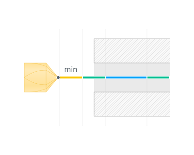

**Step count (Anzahl der Stufen).** Anzahl der Stufen für die Vorschubanpassung beim Ein- und Austritt in den Schnittbereich.

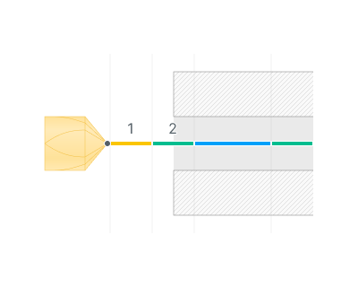

**Step distance (Stufenlänge).** Länge einer Stufe.

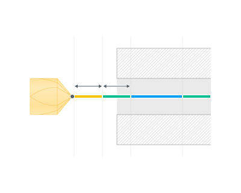

**Reduce spindle speed (Spindeldrehzahl reduzieren).** Verringert die Drehzahl beim Ein- und Austritt in den Schnittbereich der Querbohrung, um Schwingungen und die Belastung der Schneiden zu reduzieren.

**Always finish with reduced feed (Immer mit reduziertem Vorschub beenden).** Endet die Bahn noch mit Arbeitsvorschub, werden zusätzliche Stufen bis zum minimalen Vorschub angefügt. Die Bahn wird dadurch verlängert.

**Void feed (Vorschub im Hohlraum).** Ermöglicht einen eigenen Vorschub innerhalb einer Querbohrung. Standardmäßig deaktiviert.

.png) .png)

**Offset inside cross-hole (Abstand innerhalb der Querbohrung).** Abstand von den Wänden der Querbohrung innerhalb ihres Hohlraums.

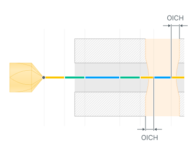

**OICH** – Abstand innerhalb der Querbohrung.

**Special part entry/exit feed (Separater Vorschub am Bauteilein-/-austritt).** Ermöglicht separate Vorschub- und Drehzahlwerte beim Ein- und Austritt am Bauteil.

.png) .png)

.png) .png)

**Step count (Anzahl der Stufen).** Anzahl der Stufen für die Vorschubanpassung beim Ein- und Austritt am Bauteil.

 .png)

**Step distance (Stufenlänge).** Länge einer Stufe.

 .png)

**Reduce spindle speed (Spindeldrehzahl reduzieren).** Verringert die Drehzahl beim Ein- und Austritt am Bauteil, um Schwingungen und die Belastung der Schneiden zu reduzieren.

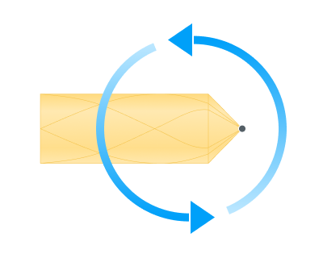

### Parameter:

Grundlegende Einstellungen zur Berücksichtigung von Bauteil, Werkstück, Vorrichtungen und weiteren Elementen bei der Bahnberechnung. [Details](100112.md)

### Verbindungen und An-/Abfahren:

Auf der Registerkarte **Links/Leads** werden das Anfahren von der Werkzeugwechselposition, das Einfahren zum ersten Schnitt, das Ausfahren nach dem letzten Schnitt, die Verbindungen zwischen Arbeitsbahnen und die Rückkehr zur Werkzeugwechselposition festgelegt. Einstellbar sind die Reihenfolge der Achsbewegungen, der Bahnverlauf und die Bewegungsabstände.

Weitere Informationen anzeigen

**Parametergruppen:**

**Approach/Return (Anfahren/Rückkehr).** Steuert die Bewegungen von der Werkzeugwechselposition zum Beginn der Einfahrbahn und zurück. [Details](100116.md).

**Safe motions (Sichere Bewegungen).** Legt Art und Abstand der Sicherheitsfläche zum Werkstück fest. Sie dient den Übergängen zwischen Bearbeitungsflächen oder Bahnen und wird beim Anfahren bzw. bei der Rückkehr zunächst angesteuert. [Details](100117.md).

**Advanced links settings (Erweiterte Verbindungseinstellungen).** Steuert die Bahnbildung insbesondere bei 5-Achsen-Operationen unter Berücksichtigung günstiger Drehachsbewegungen. [Details](100118.md).

**Links (Verbindungen).** Regeln für Ein- und Ausfahrverbindungen sowie Verbindungen zwischen Arbeitsbewegungen. [Details](100133.md).

**Distances (Abstände).** Abstände für das Umschalten der Vorschubart. [Details](100141.md).

### Vorschübe und Drehzahlen:

Legt Spindeldrehzahl, Eilgang und Vorschübe für die verschiedenen Bahnabschnitte fest. Die Drehzahl kann direkt in Umdrehungen pro Minute oder über die Schnittgeschwindigkeit vorgegeben werden. Der vorgegebene Wert wird unterstrichen; der andere wird anhand des Werkzeugdurchmessers berechnet. [Details](100142.md)

### Transformationen:

Koordinatentransformationen der berechneten Werkzeugbahn. [Details](10168.md)

### Bauteil:

Geometrische Elemente zur Prüfung auf unerwünschte Einschnitte. [Details](330.md)

### Werkstück:

Modell des zu bearbeitenden Materials. [Details](738.md)

### Vorrichtungen:

Vorrichtungen umfassen Spannmittel wie Spannfutter, Greifer und Klemmen sowie andere Begrenzungsbereiche. [Details](10283.md)
