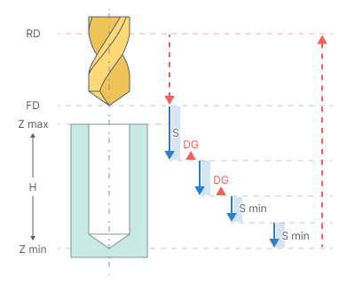

# Chip breaking

## Application area:

Drilling with chip breaking cycle performs tool approach to the hole center at the **Rapid distance(RD)**. When cyclic drilling is performed with tool retraction for chip breaking.

## Cycle sequence:

.png)

The cycle consists of:

- Rapid tool motion to the hole center at the **Rapid distance(RD)** level, that is located on the tab **Links.**
- Rapid descend to the **Feed distance(FD)** level, that is located on the tab **Links.**
- Work feedrate motion to the **Step (S).**
- **Bottom Dwell (DWB)** at this level.
- Rapid tool retraction for the **Lead-out** (Ld).
- Dwell for the **Top Dwell (DWT)** at the bottom time.
- Rapid motion to the previous depth level, with a **Deceleration (Dcl)**.
- Work feedrate to the **Deceleration (Dcl**) with **Step (S).**
- **Bottom Dwell (DWB)** at this level.
- Repeat previous five iterations until the full hole depth is reached.
- Tool return to the **Rapid distance(RD)** level at the rapid feed.

## Parameters:

**Top Dwell (DWT).** Defines the delay at the top level of the hole.

**Bottom Dwell (DWB).** Defines the delay at the bottom level of the hole.

**Step (S).** Defines the depth increment between successive drilling passes.

**Deceleration (Dcl).** Defines the distance before the previous cutting depth at which rapid motion changes to working feed for the next drilling pass.

**Degression (DG).** Controls the reduction in depth of successive drilling passes.

- **ON.** The depth of each subsequent pass is reduced by the specified value until it reaches **Minimal step**. Subsequent passes use the minimum step.
- **OFF.** The step remains constant. The final pass covers the remaining hole depth.

**Minimal step (Smin).** Defines the minimum step as a percentage of the first step value.

**Lead-out (Ld).** Defines the tool retraction distance from the previous cutting step for chip breaking.
