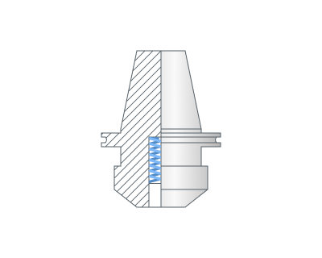
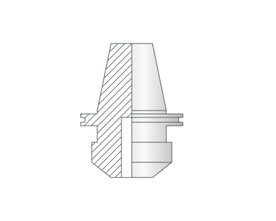

# タッピング

## 適用分野：

タッピングサイクルは、**早送り距離(RD)**の高さまで早送りで接近した後、タップ加工を行います。その後、スピンドルを逆回転させながら加工送りで工具を退避させます。

## サイクルの手順：

.png)

ドリルサイクル `G84` は以下の手順で構成されます。

- **リンク**タブで設定した**早送り距離(RD)**の高さまで早送りで穴の中心へ移動します。
- **リンク**タブで設定した**送りの距離(FD)**の高さまで早送りで下降します。
- **M3(M4)**で**Z最小**高さまで送り速度で移動し、次に**スピンドルの逆回転 M4(M3)**を行います。
- **早送り距離(RD)**の高さまで早送りで工具が退避します。
- スピンドルの回転方向と回転速度を元の設定に戻します。

## パラメータ：

**ねじピッチ** 現在の測定単位に応じて、ねじピッチをミリメートルまたはインチで設定します。

**主軸位置(初期角度位置)** 多条ねじ用に、主軸の初期角度位置を度単位で設定します。

**ソケットタイプ** タッピングホルダーのタイプとして、**フローティング**または**固定**を選択します。

詳細を表示

**フローティング**

**固定**

**トップドウェル(DWT)** 穴の上部高さでの停止時間を設定します。

**ボトムドウェル(DWB)** 穴の底部高さでの停止時間を設定します。
