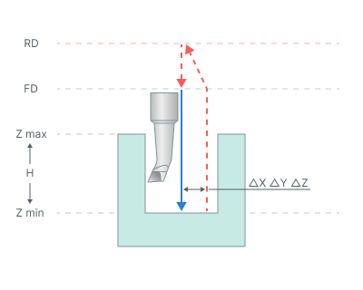

# Bore 7

## Application area:

Boring cycle performs tool approach to the hole center, hole boring with stop at minimum level and manual retract to the **Rapid distance(RD)** level.

## Cycle sequence:

.png)

The cycle consists of:

- Rapid tool motion to the hole center at the **Rapid distance(RD)** level, that is located on the tab **Links.**
- Rapid descend to the **Feed distance(FD)** level, that is located on the tab **Links.**
- Work feedrate motion to the Z min level, that is located on the tab **Job assignment** in the **Properties** hole<strong>.</strong> In absolute values. If you want to use relative values use the parameter **H = Zmax - Zmin.**
- **Spindle stop (M5).** If **Oriented tool retract** check box enabled, then spindle stops with the fixed angle of orientation and then the tool shifts slightly sideways in accordance with a given displacements.
- At the bottom of the pit, command **M1** is called - wait for the operator. The operator can remove the drill manually.
- Tool return to the **Rapid distance(RD)** level at the rapid feed.
- Restore the spindle rotation direction and speed.

## Parameters:

**Oriented tool retract.** Allows the tool to retract without contacting the machined surface. After reaching the final depth, the spindle stops at the specified orientation angle and the tool shifts by the specified offsets. The tool then returns to the top level with the spindle stopped.

Click here to expand..

**Spindle orientation angle.** Defines the spindle orientation angle in degrees before the tool retracts.

**ΔX, ΔY, ΔZ.** Define the tool offsets from the hole center along the corresponding axes.

