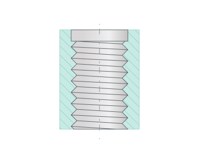
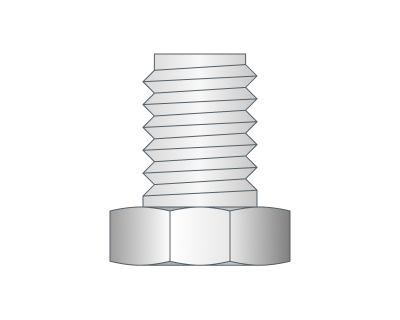
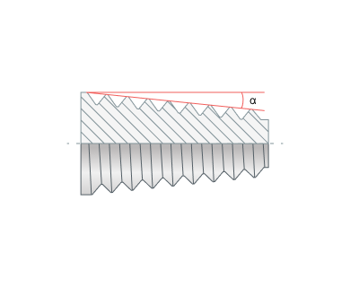
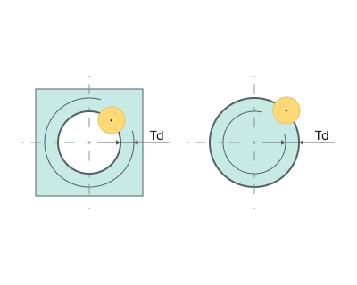
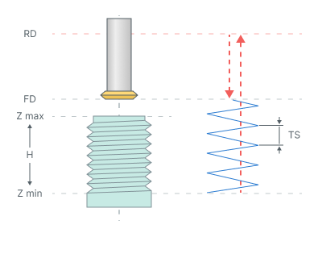
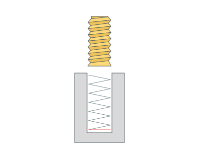

# By spiral (thread milling)

## Application area:

Thread milling cycle is used to machine external or internal threading or to machine hole by a helix. Spiral machining is used then hole diameter is larger than the tool diameter. The tool rotates around the hole axis and simultaneously travels along the axis. spiral diameter is chosen according to the hole and the tool dimensions. Machining can be done in several passes to mill holes of desired diameter.

*This drilling type is kept for operations created in earlier versions and is not offered in new operations. New operations use the **Helix spiral** and **Thread milling** types.*

## Cycle sequence:

.png)

The cycle consists of:

- Rapid tool motion to the hole center at the **Rapid distance(RD)** level, that is located on the tab **Links.**
- Rapid descend to the **Feed distance(FD)** level, that is located on the tab **Links.**
- Work feedrate travel to the spiral start with **Thread step (TS).**
- Work feedrate motion to the **Z min** level, that is located on the tab **Job assignment** in the **Properties** hole. In absolute values. If you want to use relative values use the parameter **H = Zmax - Zmin.**
- Return to the hole center.
- Tool return to the **Feed distance(FD)** level at the work feed.
- Rapid travel to the **Rapid distance(RD)** level.

## Parameters:

**Thread type.** Specifies whether the thread is internal (**ID**) or external (**OD**).

 

**Taper.** Enables a tapered thread and sets the taper angle.

**Compensation mode.** Configures compensation in the same way as the **Output** group in **2D contouring**. [Details](404.md)

**Thread direction.** Defines the direction of the spiral.

Click here to expand..

**CW.** The spiral is twisted right. Use it for a right-hand thread.

_(1).png)

**CCW.** The spiral is twisted left. Use it for a left-hand thread.

_(1).png)

**Conventional** and **Climb.** The spiral direction is chosen by the milling type in the same way as **Milling type** in the **Waterline roughing operation**. [Details](736.md) The resulting direction depends on the spindle rotation, the thread type and the machining sequence.

**Thread step (TS).** Defines the spiral lead: the distance along the hole axis per revolution. It can be specified by the ramp angle, as a distance, or as a number of tool pitches (**Tool pitch count**). The tool pitch is taken from the thread mill parameters; for other tools the cutting length is used.

**Round thread count to integer.** Attempts to round the number of revolutions to a smaller or larger integer. With a thread mill the calculation shows a warning: rounding can change the thread pitch.

.png) .png)

**Thread depth (Td).** Defines the distance between the outer and inner diameters of the thread. It is set as a distance or in percent of the tool diameter. For both internal and external threads the hole diameter from the job assignment is the outer (maximal) diameter of the thread. The inner diameter is smaller by twice the thread depth.

**Initial angular position.** Defines the initial angular position in degrees for the thread starts.

**Start count.** Number of thread starts.

**Thread Mill Path.** Defines the toolpath type according to the tool type.

Click here to expand..

**Continuous.** Used for a single-cutter tool that forms one thread turn per spiral turn. The toolpath is a continuous spiral with the **Thread step (TS)**.

**Axial Divide.** Used for a multi-cutter tool that forms several thread turns per spiral turn. The toolpath consists of spiral sections connected by transitions along the hole axis.

.png)

**Turn count.** Number of spiral turns in each section. Usually it is 1. Use 2 or more when the thread step is smaller than the tooth step of the tool.

**Tool working length (TWL).** Length of the transition between adjacent sections. It is set as a distance, in percent of the thread step, or taken from the tool (**Auto from tool**). The value is rounded to a whole number of thread steps.

**Machining sequence.** Defines the processing order along the hole axis.

Click here to expand..

**Top-down.** Machining proceeds from top to bottom.

**Bottom-up.** Machining proceeds from bottom to top.

### Additional passes:

**Rough passes.** Splits the thread depth into several radial passes. The step is set as a distance, in percent of the tool diameter, or by the number of passes.

**Last circle pass.** Adds a circular pass at the bottom of the hole. With a thread mill the calculation shows a warning: the circular pass makes a groove that does not follow the thread spiral.

**Finish pass.** Makes the final pass a finishing pass and adds a roughing pass at the specified distance from it.

