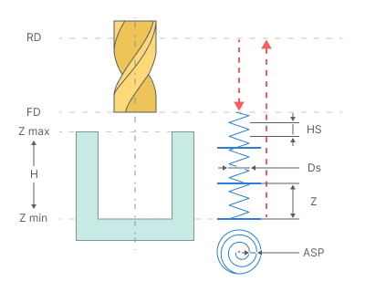

# 複合らせん

## 適用分野：

このサイクルは、工具径よりも大きな径の穴を加工するために使用されます。ポケット加工はレイヤー単位で実行されます。工具は各レイヤーに向かってらせん状に切り込み、その後、アルキメデスの螺旋に沿って移動しながら穴を所定の直径まで拡大し、仕上げとして円周に沿ったパスを行います。アルキメデスの螺旋は円弧で近似されます。

## サイクルの手順：

このサイクルは次のように構成されています。

- **リンク**タブで設定した**早送り距離(RD)**の高さまで早送りで穴の中心へ移動します。
- **リンク**タブで設定した**送りの距離(FD)**の高さまで早送りで下降します。
- 加工送りで**切り込み深さ(Z)**までらせん状に切り込みます。**ヘリカル直径(Ds)**は工具径の割合（％）で指定します。**ヘリカルステップ(HS)**は**ランプ角度a、mm(Hi)または工具ステップ数**によって定義されます。
- その高さで、工具軸が「穴径-工具径」に等しい直径の円に到達するまで、**らせんステップ(ASP)**でアルキメデスの螺旋に沿って移動します。
- 高さを変えずに、上記の円に沿って仕上げパスを行います。
- 高さを変えずに次の切り込み位置まで移動し、目的の穴深さまで加工が完了するまで、前の3つの手順を繰り返します。
- 穴中心に戻ります。
- **送りの距離(FD)**の高さまで早送りで工具が退避します。
- **早送り距離(RD)**の高さまで早送りで移動します。

## パラメータ：

**補正モード** **2D輪郭加工**の**出力**グループと同様に補正を設定します。[詳細を見る](404.md)

**ミーリングタイプ** **アップカット**または**ダウンカット**を選択します。このパラメータは、**ウォーターライン荒加工オペレーション**の**ミーリングタイプ**と同様に動作します。[詳細を見る](736.md)

### 軸方向：

**Depth per revolution**（1回転あたりの深さ） プランジのヘリカルステップを設定します。ランプ角度、1回転あたりの軸方向の深さ、または回転数で指定できます。

**Axial stepover**（軸方向ステップオーバー） 連続する水平加工レイヤー間の距離を設定します。

### 径方向：

**ヘリカル直径(Ds)** プランジのヘリカル径を、工具径に対する割合（％）で設定します。

**Radial stepover**（径方向ステップオーバー） 各加工高さで穴を拡大するために使用するアルキメデスの螺旋のステップを設定します。

### 追加設定：

**整数に丸める** 回転数を、より小さい、またはより大きい整数に丸めます。

.png) .png)

**仕上げパス** 最後のパスを仕上げパスにし、そこから指定された距離に荒加工パスを追加します。

