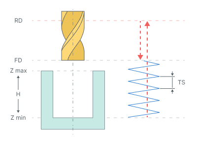
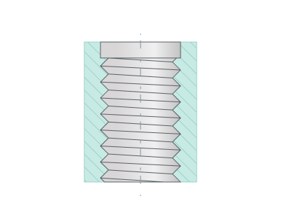
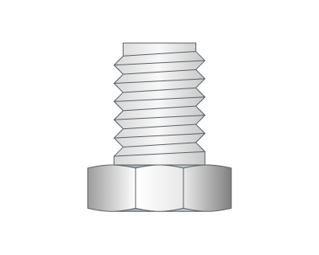
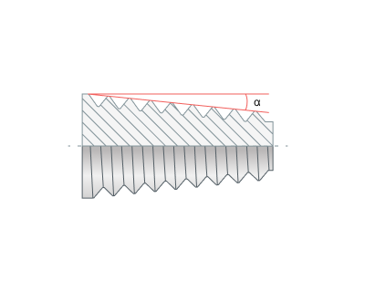
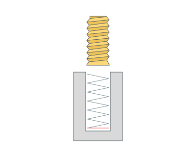

# Helix spiral

## Application area:

The cycle mills a hole or a boss by a helix when the hole diameter is larger than the tool diameter. The tool moves along a spiral around the hole axis and simultaneously travels along the axis. The material can be removed by several rough passes and a finish pass.

## Cycle sequence:

The cycle consists of:

- Rapid tool motion to the hole center at the **Rapid distance(RD)** level, that is located on the tab **Links.**
- Rapid descend to the **Feed distance(FD)** level, that is located on the tab **Links.**
- Engage to the spiral along a straight line or an arc, that is set by the **Engage/Retract** parameter on the tab **Links/Leads.**
- Work feedrate motion along the spiral with the **Axial stepover (TS)** to the **Z min** level, that is located on the tab **Job assignment** in the **Properties** hole. In absolute values. If you want to use relative values use the parameter **H = Zmax - Zmin.**
- Circular pass at the **Z min** level, if the **Bottom circle pass** is on.
- Retract from the spiral the same way and return to the hole axis.
- Repeat the previous four steps for each rough pass and the finish pass. Between the passes the tool moves along the hole axis.
- Tool return to the **Feed distance(FD)** level along the hole axis.
- Rapid travel to the **Rapid distance(RD)** level.

With the **Bottom-up** machining sequence the tool first moves along the hole axis to the **Z min** level, makes the circular pass there and then goes up along the spiral to the **Feed distance(FD)** level. For external machining (**OD**) the tool moves outside the boss at the **Radial safe distance** instead of the hole axis.

## Parameters:

**Machining side.** Selects internal (**ID**) or external (**OD**) machining.

 

**Taper.** Enables machining with a specified taper angle.

**Compensation mode.** Configures compensation in the same way as the **Output** group in **2D contouring**. [Details](404.md)

**Milling direction.** Defines the direction of the spiral around the hole axis.

_(1).png) _(1).png)

**Axial stepover.** Defines the axial step of the machining spiral.

**Round turn count to integer.** Attempts to round the number of revolutions to a smaller or larger integer.

.png) .png)

**Initial angular position.** Defines the initial angular position in degrees.

**Machining sequence.** Defines the processing order along the hole axis.

Click here to expand..

**Top-down.** Machining proceeds from top to bottom.

**Bottom-up.** Machining proceeds from bottom to top.

**Bottom circle pass.** Adds a circular pass at the bottom of the hole.

### Additional passes:

**Rough passes.** Defines the thickness of material removed by rough passes. It is set as a distance or in percent of the tool diameter. When it is off, the cycle makes no rough passes.

**Step.** Defines the step between rough passes. It is set as a distance, in percent of the tool diameter, or by the number of passes. Available when **Rough passes** is on.

**Finish pass.** Makes the final pass a finishing pass and adds a roughing pass at the specified distance from it. The distance is set as a length or in percent of the tool diameter. It is added to the rough passes thickness. For internal machining the total thickness is limited so that the tool does not cross the hole axis.

