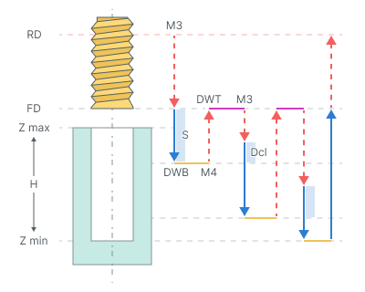
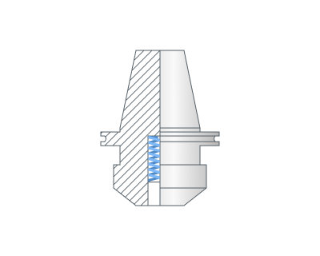
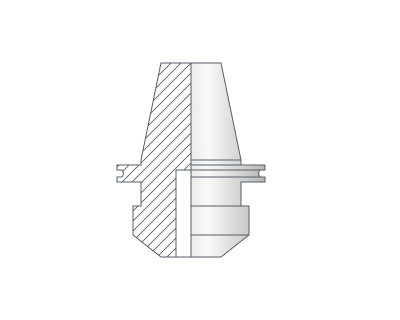
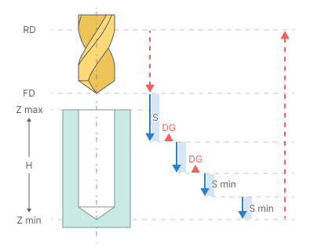

# Tapping with chip removing

## Application area:

The cycle taps a hole in steps with tool retraction to the **Feed distance (FD)** level for chip removal.

## Cycle sequence:

The cycle consists of:

- Rapid tool motion to the hole center at the **Rapid distance(RD)** level, that is located on the tab **Links.**
- Rapid descend to the **Feed distance(FD)** level, that is located on the tab **Links.**
- Work feedrate motion to the **Step (S).**
- Restore spindle rotation direction and speed (**M4**)
- **Bottom Dwell (DWB)** at this level.
- Rapid return to **Feed distance(FD)** level.
- Dwell for the **Top Dwell (DWT)** time.
- Restore spindle rotation direction and speed (**M3**)
- Rapid motion to the previous depth level, with a **Deceleration (Dcl)**.
- Work feedrate to the **Deceleration (Dcl)** with **Step (S).**
- Restore spindle rotation direction and speed **(M4).**
- **Bottom Dwell (DWB)** at this level.
- Repeat previous seven iterations until the full hole depth is reached.
- Tool return to the **Feed distance(FD)** level at the work feed.
- Tool return to the **Rapid distance(RD)** level at the rapid feed.

## Parameters:

**Thread pitch.** Defines the thread pitch in millimeters or inches, depending on the current measurement units.

**Spindle position (Initial angular position).** Defines the initial angular position of the spindle in degrees for multistart threads.

**Socket type.** Selects the type of tapping holder: **Floating** or **Fixed**.

Click here to expand..

**Floating.**

**Fixed.**

**Top Dwell (DWT).** Defines the delay at the top level of the hole.

**Bottom Dwell (DWB).** Defines the delay at the bottom level of the hole.

**Step (S).** Defines the depth increment between successive tapping passes.

**Deceleration (Dcl).** Defines the distance before the previous cutting depth at which rapid motion changes to working feed for the next tapping pass.

**Degression (DG).** Controls the reduction in depth of successive tapping passes.

- **ON.** The depth of each subsequent pass is reduced by the specified value until it reaches **Minimal step**. Subsequent passes use the minimum step.
- **OFF.** The step remains constant. The final pass covers the remaining hole depth.

**Minimal step (Smin).** Defines the minimum step as a percentage of the first step value.
