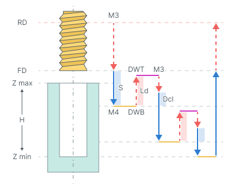
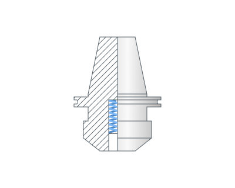
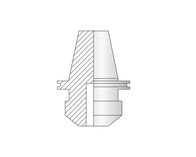
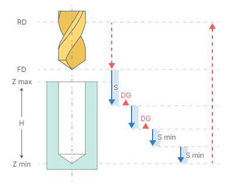

# チップ切断を伴うタッピング

## 適用分野：

このサイクルは、切りくずを分断するために**退出(Ld)**の距離だけ工具を退避させながら、段階的にタップ加工を行います。

## サイクルの手順：

このサイクルは次のように構成されています。

- **リンク**タブで設定した**早送り距離(RD)**の高さまで早送りで穴の中心へ移動します。
- **リンク**タブで設定した**送りの距離(FD)**の高さまで早送りで下降します。
- 切削送り速度で**ステップ(S)**まで移動します。
- スピンドルの回転方向と回転速度を元に戻します(**M4**)。
- この高さで**ボトムドウェル(DWB)**を行います。
- **退出(Ld)**の距離だけ早送りで工具を引き上げます。
- **トップドウェル(DWT)**時間のドウェルを行います。
- スピンドルの回転方向と回転速度を元に戻します(**M3**)。
- **減速(Dcl)**を伴い、前の深さまで早送りで移動します。
- **ステップ(S)**を用いて**減速(Dcl)**の位置まで切削送りで移動します。
- スピンドルの回転方向と回転速度を元に戻します**(M4)**。
- この高さで**ボトムドウェル(DWB)**を行います。
- 穴の全深さに到達するまで、前の7つの動作を繰り返します。
- **送りの距離(FD)**の高さまで切削送りで工具が退避します。
- **早送り距離(RD)**の高さまで早送りで工具が退避します。

## パラメータ：

**ねじピッチ** 現在の測定単位に応じて、ねじピッチをミリメートルまたはインチで設定します。

**主軸位置(初期角度位置)** 多条ねじ用に、主軸の初期角度位置を度単位で設定します。

**ソケットタイプ** タッピングホルダーのタイプとして、**フローティング**または**固定**を選択します。

詳細を表示

**フローティング**

**固定**

**トップドウェル(DWT)** 穴の上部高さでの停止時間を設定します。

**ボトムドウェル(DWB)** 穴の底部高さでの停止時間を設定します。

**ステップ(S)** 連続するタッピングパス間の深さの増分を設定します。

**減速(Dcl)** 次のタッピングパスで早送りから加工送りに切り替わる位置を、前回の切削深さの手前の距離として設定します。

**減少(DG)** 連続するタッピングパスの深さの減少を制御します。

- **有効の場合：** 以降の各パスの深さは、**最小ピッチ**に達するまで設定された値だけ減少します。以降のパスは最小ステップで行われます。
- **無効の場合：** ステップは一定です。最後のパスで穴の残りの深さを加工します。

**最小ピッチ(Smin)** 最小ステップを、最初のステップ値に対する割合（％）で設定します。

**退出(Ld)** 切りくずを分断するために、前の切削ステップから工具を退避させる距離を設定します。
