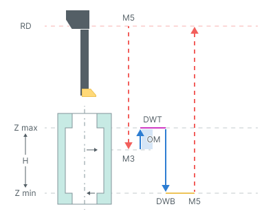
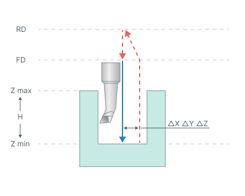

# 溝ボーリング加工

## 適用分野：

このオペレーションでは、**規定方向工具退避**パラメータを使用することを推奨します。

## サイクルの手順：

**M3** - スピンドル回転(M3)

このサイクルは次のように構成されています。

- **リンク**タブで設定した**早送り距離(RD)**の高さまで早送りで移動します。
- **Z最大-反対方向への移動長(OM)**へ早送りで移動します。
- スピンドルを回転させます**(M3)**。
- **Z最大+反対方向への移動長(OM)**まで切削送りで移動します。
- **トップドウェル(DWT)**時間のドウェルを行います。
- 穴の**プロパティ**内の**ジョブ割り当て**タブで設定した**Z最小**深さまで、切削送りで移動します。値は絶対値で指定します。相対値を使用する場合は、**H=Z最大-Z最小**パラメータを使用します。
- この高さで**ボトムドウェル(DWB)**を行います。
- **スピンドル停止(M5)**を行います。
- **早送り距離(RD)**の高さまで早送りで工具が退避します。

## パラメータ：

**トップドウェル(DWT)** 穴の上部高さでの停止時間を設定します。

**ボトムドウェル(DWB)** 穴の底部高さでの停止時間を設定します。

**規定方向工具退避** 加工面に工具を接触させずに退避させることができます。穴の最終深さに到達した後、スピンドルは指定されたオリエンテーション角度で停止し、工具は指定されたオフセット量だけ移動します。その後、スピンドルを停止したまま工具が上部高さに戻ります。

詳細を表示

**主軸オリエンテーション角度** 工具が退避する前の主軸オリエンテーション角度を度単位で設定します。

**ΔX, ΔY, ΔZ** 対応する軸に沿った、穴の中心からの工具のオフセット量を設定します。

**方向** 穴の軸に沿った加工の順序として、**上から下**または**下から上**を設定します。

詳細を表示

**上から下** 上から下へ加工します。

**下から上** 下から上へ加工します。

**反対方向への移動長(OM)** 反対方向への加工移動の長さを設定します。
