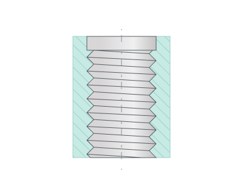
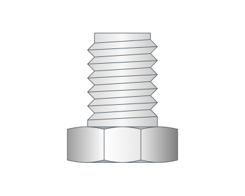
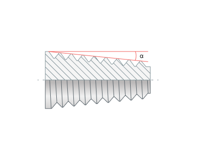
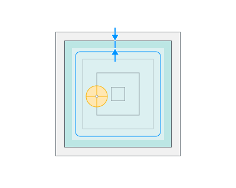

# ねじ切りフライス加工

## 適用分野：

このサイクルは、ねじ切りフライスでめねじまたはおねじをミーリング加工します。工具は穴の軸を中心にねじのらせんに沿って移動すると同時に、軸に沿って移動します。ねじのデータ（タイプ、ピッチ、条数、直径、方向、テーパー）は、ジョブ割り当てで穴ごとに設定します。[詳細を見る](706.md) 加工ストラテジは、オペレーションのすべての穴に共通です。

## サイクルの手順：

.png)

このサイクルは次のように構成されています。

- **リンク**タブで設定した**早送り距離(RD)**の高さまで早送りで穴の中心へ移動します。
- **リンク**タブで設定した**送りの距離(FD)**の高さまで早送りで下降します。
- **リンク／リード**タブの**Engage/Retract**（進入／退出）パラメータで設定した直線または円弧に沿って、ねじのらせんへ進入します。
- 加工送りで、ねじのらせんに沿って、穴の**プロパティ**内の**ジョブ割り当て**タブで設定した**Z最小**深さまで移動します。値は絶対値で指定します。相対値を使用する場合は、**H=Z最大-Z最小**パラメータを使用します。らせんのリードは、穴のねじの**ねじピッチ(TS)**に条数を乗じた値です。
- 同じ方法でらせんから退出し、穴の軸に戻ります。
- 各荒加工パスと仕上げパスについて、前の3つの手順を繰り返します。多条ねじの場合は、条ごとにパスを繰り返します。パス間では、工具は穴の軸に沿って移動します。
- 穴の軸に沿って**送りの距離(FD)**の高さまで工具が戻ります。
- **早送り距離(RD)**の高さまで早送りで移動します。

**加工順序**が**下から上**の場合、工具はまず穴の軸に沿って**Z最小**高さまで移動し、らせんは**送りの距離(FD)**の高さまで上昇します。**軸方向分割**のツールパスでは、らせんは複数の区間に分割され、区間ごとに進入と退出が行われます。おねじの場合、工具は穴の軸ではなく、**Radial safe distance**（径方向の安全距離）だけ離れたねじの外側を移動します。

## パラメータ：

**ねじ** ジョブ割り当て内の穴のねじデータを設定します。このグループには選択した穴が表示され、何も選択されていない場合はすべての穴が表示されます。値が異なるパラメータは紫色で強調表示されます。入力した値はこれらの穴に適用されます。パラメータは、**Hole editing**（穴の編集）ウィンドウの**ねじ**グループと同じです。[詳細を見る](706.md)

詳細を表示

**ねじ** この行には、ねじの呼びとねじデータのソースが表示されます。

- **custom**（カスタム） – ねじデータを手動で入力します。
- **from CAD model**（CADモデルから） – ねじはCADモデルから取得され、ねじデータは読み取り専用です。もう一度選択すると、モデル内の検索が再実行されます。モデルにこの穴のねじが含まれている場合に使用できます。
- **from library**（ライブラリから） – ねじライブラリからねじを選択します。その後で呼びを変更すると、ソースは**custom**になります。

**ねじタイプ** ねじがめねじ(**ID**)かおねじ(**OD**)かを指定します。

 

**ねじピッチ** 隣接するねじ山の間の距離です。長さ、単位長さあたりのねじ山数で設定するか、工具から取得します(**From tool**)。オペレーションのねじ切りフライスが複数列の刃を持ち、その刃のピッチがねじピッチと異なる場合、値は赤色で強調表示されます。このようなフライスは自身のピッチしか加工できません。ねじの条数は関係ありません。オペレーションの計算でも同じエラーが報告されます。

**開始数** ねじの条数です。括弧内にリードが表示されます。多条ねじの場合、リードはピッチに条数を乗じた値になります。

**Minor diameter**（最小径） ねじの内側（最小）の直径です。

**Major diameter**（最大径） ねじの外側（最大）の直径です。ねじの深さは、最大径と最小径の差の半分です。

**ねじの方向** ねじの種類：**右**または**左**。

_(1).png) _(1).png)

**テーパー** テーパーねじを有効にし、テーパー角度を設定します。

**補正モード** **2D輪郭加工**の**出力**グループと同様に補正を設定します。[詳細を見る](404.md)

**加工順序** 穴の軸に沿った加工の順序を設定します。

詳細を表示

**上から下** 上から下へ加工します。

**下から上** 下から上へ加工します。

**初期角度位置** ねじの各条の初期角度位置を度単位で設定します。

### 追加パス：

**Rough passes step**（荒加工パスのステップ） 加工平面内での荒加工ツールパス間のオフセットを設定します。

**仕上げパス** 最後のパスを仕上げパスにし、そこから指定された距離に荒加工パスを追加します。

