# Entradas e saídas para operações de contorno

<strong>Sl</strong> - Nível seguro

<strong>LD</strong> - Leads

## Área de aplicação:

Permite adicionar movimentos adicionais de entrada e saída aos movimentos de trabalho, usando o avanço desses movimentos.

<strong>Engage.</strong>

Clique aqui para expandir..

<strong>OFF.</strong> Os trechos <strong>Engage</strong> e <strong>Retract</strong> do percurso da ferramenta não são gerados.

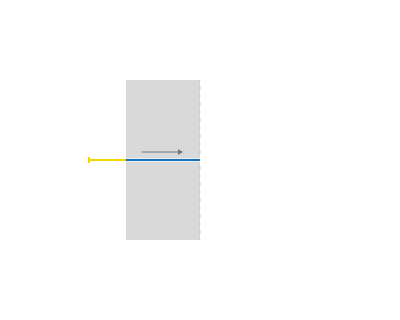

<strong>By Line.</strong>

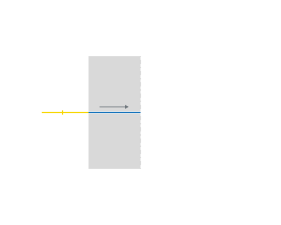

<strong>Length.</strong>

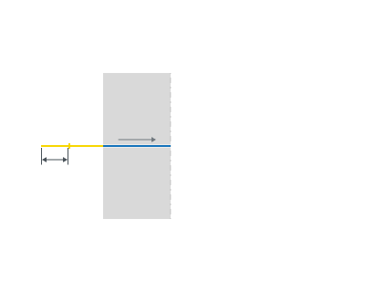

<strong>Angle.</strong>

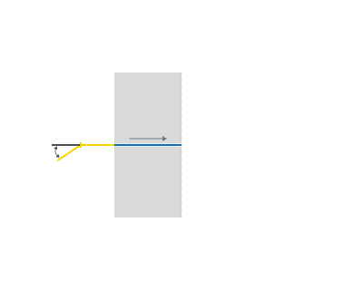

<strong>By Arc.</strong>

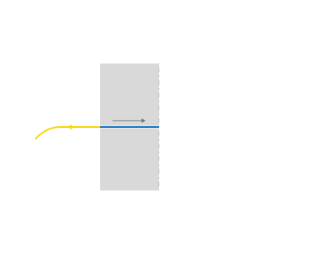

<strong>Radius.</strong>

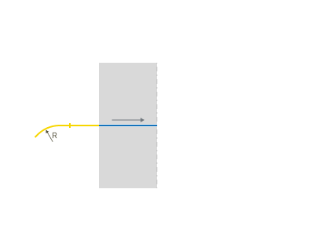

<strong>Angle.</strong>

<strong>Retract.</strong>

Clique aqui para expandir..

<strong>OFF.</strong> Os trechos <strong>Engage</strong> e <strong>Retract</strong> do percurso da ferramenta não são gerados.

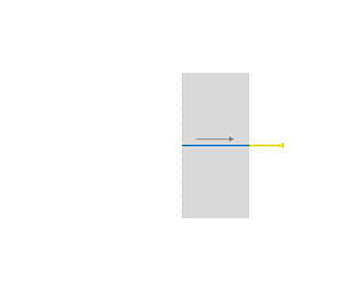

<strong>By Line</strong>

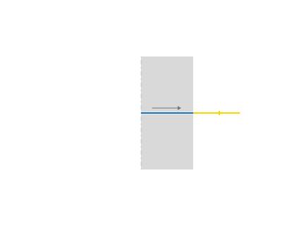

<strong>Length.</strong>

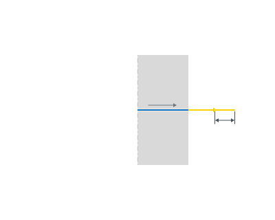

<strong>Angle.</strong>

<strong>By Arc.</strong>

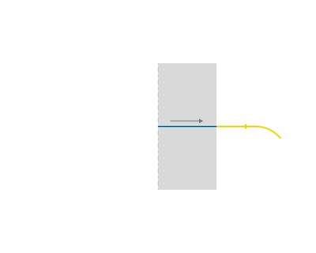

<strong>Radius.</strong>

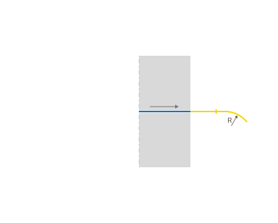

<strong>Angle.</strong>

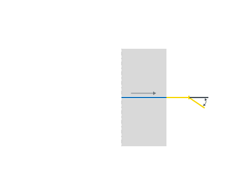

<strong>Exit overlap.</strong> A sobreposição é usada para estender o percurso da ferramenta além do próprio contorno. Para alterar o valor da sobreposição, arraste o marcador amarelo com o mouse ou clique nele e edite o valor da cota exibida.

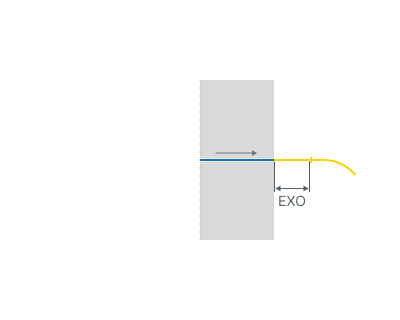

<strong>EXO</strong> - Sobreposição de saída

<strong>Entry overlap.</strong> A sobreposição é usada para estender o percurso da ferramenta além do próprio contorno. Para alterar o valor da sobreposição, arraste o marcador amarelo com o mouse ou clique nele e edite o valor da cota exibida.

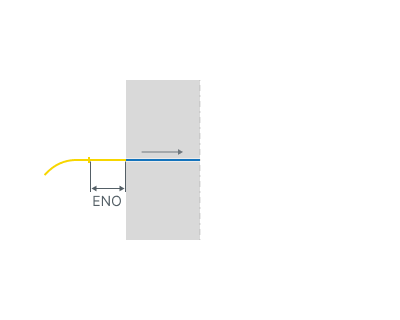

<strong>ENO</strong> - Sobreposição de entrada

<strong>Compensation on cut.</strong> Os <strong>segmentos de entrada</strong> são adicionados automaticamente aos percursos principais de aproximação do contorno compensado quando o <strong>Compensation type</strong> não está definido como <strong>Computer</strong>. Por padrão, os segmentos de entrada/saída não são adicionados diretamente aos percursos retos em avanço, pois isso seria tecnicamente inviável.

Clique aqui para expandir..

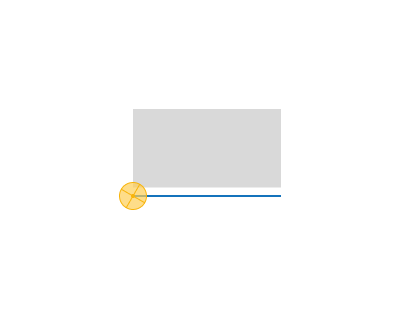 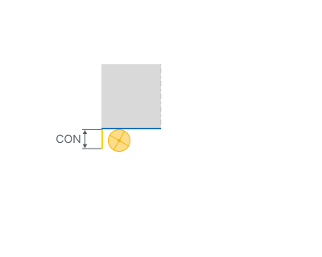

<strong>CON -</strong> Compensação no corte.

<strong>Length.</strong> Permite aumentar o comprimento do segmento de entrada.

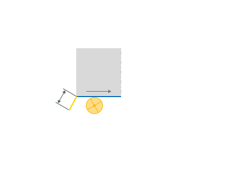

<strong>Angle.</strong> Permite aumentar o ângulo do segmento de entrada.

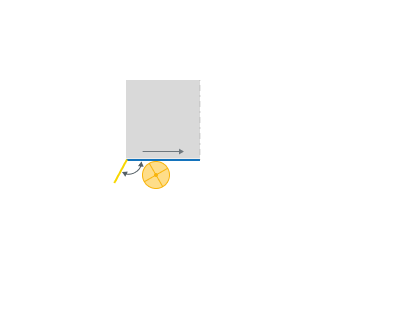

<strong>Compensation off cut.</strong> Os <strong>segmentos de saída</strong> são adicionados automaticamente aos percursos principais de aproximação do contorno compensado quando o <strong>Compensation type</strong> não está definido como <strong>Computer</strong>. Por padrão, os segmentos de entrada/saída não são adicionados diretamente aos percursos retos em avanço, pois isso seria tecnicamente inviável.

Clique aqui para expandir..

 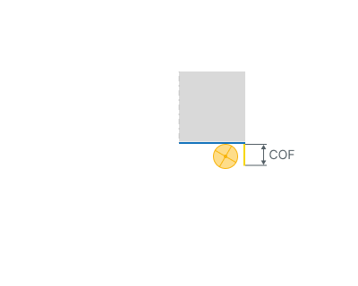

<strong>COF</strong> - Compensação no corte.

<strong>Length.</strong> Permite aumentar o comprimento do segmento de saída.

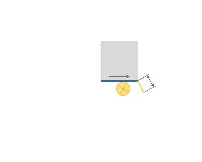

<strong>Angle.</strong> Permite aumentar o ângulo do segmento de saída.

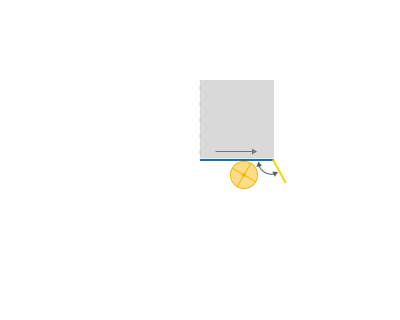

