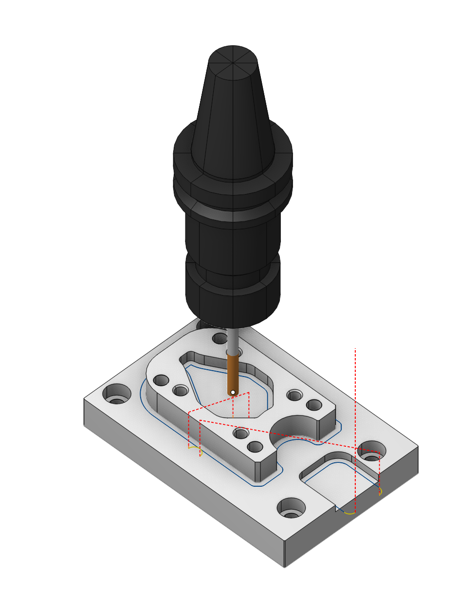

# 2,5D-Konturieren

## Anwendungsbereich:

Diese Operation erweitert das 2D-Konturieren um die Bearbeitung von Bauteilkonturen auf mehreren Höhen. Die grundlegenden Funktionen des 2D-Konturierens bleiben erhalten.

### Einrichtung:

Auf **Setup** werden grundlegende Projektparameter wie Bauteillage und Werkstückkoordinatensystem festgelegt. [Details](1022.md)

### Auftragszuweisung:

**Curve (Kurve).** Definiert die Bearbeitung entlang einer Kurve. [Details](707.md)

**Pocket (Tasche).** Erkennt einfache Geometrieelemente im 3D-Modell und übernimmt sie als Bearbeitungsbereiche und -ebenen. [Details](10154.md)

**Properties (Eigenschaften).** Öffnet die Elementeigenschaften, beispielsweise zur Eingabe eines Aufmaßes. Auch durch Doppelklick auf einen Listeneintrag erreichbar.

**Add tabs (Haltestege hinzufügen).** Fügt Haltestege entlang der Kontur hinzu. [Details](102012.md)

**Delete (Löschen).** Entfernt ein Element aus der Liste.

**Restrictions (Begrenzungen).** Definiert nicht zu bearbeitende Bereiche. [Details](101231.md)

### Strategie:

Die grundlegenden Strategieparameter entsprechen denen beim 2D-Konturieren. [Details](404.md)

### Parameter:

Diese Registerkarte enthält die grundlegenden Einstellungen für Bauteil, Rohteil, Spannmittel und weitere Elemente, die die Werkzeugbahn beeinflussen. [Details](100112.md)

### Verbindungen und An-/Abfahrbewegungen:

Auf der Registerkarte **Links/Leads** werden die Verbindungsbewegungen festgelegt: Anfahren von der Werkzeugwechselposition, Einfahren zum Beginn der Arbeitsbahn, Abfahren nach dem letzten Arbeitsgang, Verbindungen zwischen den Bahnen und Rückkehr zur Werkzeugwechselposition. Einstellbar sind die Reihenfolge der Achsbewegungen, der Bahnverlauf und die Abstände.

Weitere Informationen anzeigen

**Parametergruppen:**

**Approach/Return (Anfahren/Rückkehr).** Steuert die Bewegung von der Werkzeugwechselposition zum Beginn der Werkzeugbahn und zurück. [Details](100116.md).

**Safe motions (Sichere Bewegungen).** Legt die Art der Sicherheitsfläche und ihren Abstand zum Rohteil fest. Die Fläche dient für Verbindungen zwischen bearbeiteten Flächen oder Werkzeugbahnen sowie für die erste Phase des Anfahrens bzw. der Rückkehr. [Details](100117.md).

**Advanced links settings (Erweiterte Verbindungseinstellungen).** Steuert die Bahnerzeugung insbesondere bei 5-Achsen-Operationen unter Berücksichtigung günstiger Drehachsbewegungen. [Details](100118.md).

**Links (Verbindungen).** Legt die Regeln für Ein- und Ausfahrverbindungen sowie Verbindungen zwischen Arbeitsbewegungen fest. [Details](100132.md).

**Leads (An-/Abfahrbewegungen).** Ergänzt zusätzliche Ein- und Ausfahrbewegungen an den Arbeitsbahnen mit den dafür vorgesehenen Vorschüben. [Details](101147.md).

**Distances (Abstände).** Abstände für das Umschalten der Vorschubart. [Details](100138.md).

### Bauteil:

Geometrische Elemente zur Prüfung auf unerwünschte Einschnitte. [Details](330.md)

### Rohteil:

Modell des zu bearbeitenden Materials. [Details](738.md)

### Spannmittel:

Hier werden Spannmittel wie Spannfutter, Greifer und Spannpratzen sowie weitere Sperrbereiche angegeben. [Details](10283.md)
