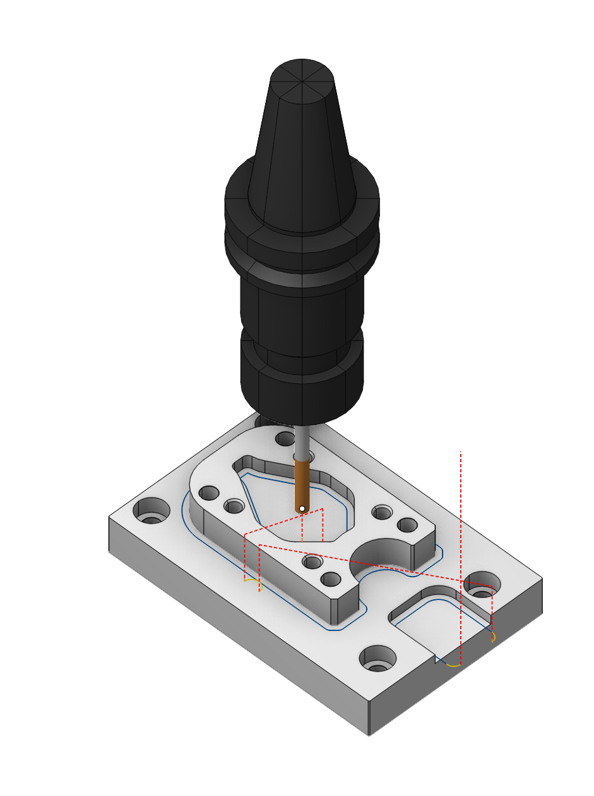

# 2.5D輪郭

## 適用分野：

このオペレーションは、 複数の高さにあるパーツの輪郭の加工に関して、<strong>2D輪郭</strong>オペレーションの機能を拡張したものです。 <strong>2D輪郭</strong>オペレーションの主な機能は維持されています。

## セットアップ：

<strong>セットアップ</strong>タブはプロジェクトの主要なパラメータを設定するために使用します。これには、装置上の部品の位置決め、部品の座標系などが含まれます。[詳細を見る](https://confluence.encycam.com/display/SC1/.Setup+v19)

## ジョブ割り当て:

<strong>カーブ</strong> 曲線に沿った加工順序を設定します <strong>。</strong>[詳細を見る](707.md)

<strong>ポケット</strong> 一般的な角柱状の部品やターンミリング部品は、多くの単純形状で構成されています。この作業を簡略化するために、3D内モデル内の部品の要素を認識し、加工領域や加工高さなどの基本的なジョブ割り当て項目に自動変換できます。[詳細を見る](10154.md)

<strong>プロパティ</strong> 要素のプロパティを表示します。残し代を追加することもできます。リストの項目をダブルクリックしても、このメニューを呼び出すことができます。

<strong>タブを追加</strong> 輪郭に沿ってタブを追加します。[詳細を見る](102012.md)

<strong>削除</strong> リストから項目を削除します。

<strong>制限</strong> 加工してはいけない領域を制限できます。[詳細を見る](101231.md)

## 加工設定：

<strong>加工設定</strong>の主なパラメータは <strong>2D輪郭の項目</strong>に記述されています。[詳細を見る](https://confluence.encycam.com/display/SC1/.2D+contouring+v19)

## パラメータ:

このタブには、パーツ、ワーク、治具、およびその他の要素を制御するための主要なパラメータが含まれており、これらを調整することでツールパスを変更できます。 [詳細を見る](100112.md)

## リンク／リード

リンク／リードタブでは、早送り動作のパラメータを設定します。これには、工具交換位置からの工具アプローチ、切削パス開始点までの位置決め、最終切削後の退避、加工パス間の移動、および工具交換位置への復帰が含まれます。座標軸に沿った移動順序、移動軌跡、および移動量を設定することができます。

拡大

<strong>次の項目で構成されます。</strong>

<strong>アプローチ／リターン</strong> このパラメータグループは、工具交換位置から進入動作開始位置への工具の移動、および復帰の動作を制御します。[詳細を見る](100116.md)

<strong>安全な動作</strong> 安全サーフェスのタイプとワークから安全サーフェスまでの距離を定義します。加工面またはツールパス間の移行を円滑にし、アプローチまたはリターンの最初の段階はこの面に向かって行われます。[詳細を見る](100117.md)

<strong>高度なリンク設定</strong> このパラメータグループは、主に5軸加工において、回転軸の最適な動きを考慮した軌道形成方法を設定します。[詳細を見る](100118.md)

<strong>リンク</strong> 進入／退出リンクおよび加工動作間のリンクに関するルールを設定します。[詳細を見る](100132.md)

<strong>リード</strong> 加工動作に対して、送り速度を使用して追加の進入および退避の動作を設定できます。

<strong>距離</strong> リンクのルールで使用される距離です。 [詳細を見る](100138.md)

## パーツ：

パーツは、干渉をチェックする対象空間を定義する幾何要素のグループです。[詳細を見る](330.md)

## ワーク：

オペレーションのワークモデルは、加工対象の素材を定義します。[詳細を見る](738.md)

## 治具：

治具とには、通常、チャック、グリップ、クランプなどの固定補助具、およびその他の性質の制限領域が指定されます。[詳細を見る](10283.md)
