# フェイス加工

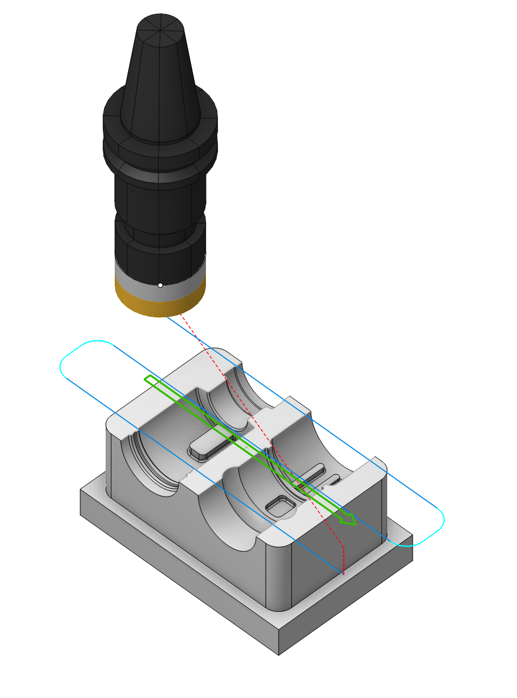

## 適用分野：

フェイシング加工は、以下のいずれかの加工設定を使用し、指定された水平面上のワーク材を除去する加工です。

- ワンパス
- 平行
- ジグザグ
- ジグザグの最適化
- 渦巻き

<strong>加工計算では部品形状は無視され、ワーク形状のみが考慮されます。</strong>部品はアンダーカットの有無を確認しません。

素材は複数回のパスで除去できます。この場合、下限加工高さは部品の最も高い点で自動的に決定され、上限高さはワークの最も高い点で決定されます。パスの本数は、上限・下限加工高さ間の距離、仕上げパスの幅、および荒取りパスの深さに応じて自動的に計算されます。手動でパス回数を設定することも可能です。この場合、ピッチ処理は再計算されます。

## セットアップ：

<strong>セットアップ</strong> タブはプロジェクトの主要なパラメータを設定するために使用されます。これには、装置上の部品の位置や、部品の座標系などが含まれます。 [詳細を見る](1022.md)

<strong>加工設定：</strong>

<strong>加工設定</strong>

このグループでは、平行パス 加工設定 の主要パラメータを変更できます。

拡大

<strong>加工方法の種類：</strong>

拡大

<strong>渦巻き</strong> 工具は、「ロールイン技法」を用いてワークに接近し、その後、未加工領域の境界に沿って移動し、円形芝刈り機のように素材を除去します。最大許容切削幅および工具の切込み角度を超えることはありません。この方法は、短時間で大量の素材を除去するのに非常に適しています。

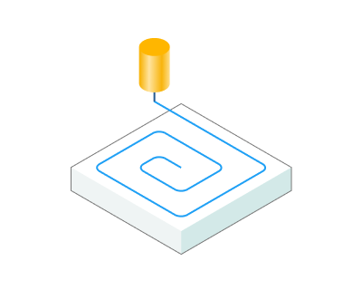

<strong>ジグザグ最適化</strong> 工具はジグザグの軌跡に沿って移動します。ジグ（往路）パスとザグ（復路）パス間のリンク移動も、加工時間短縮のためワーク内部で送りながら行われます。この方法は、荒取りと中仕上げに適しています。

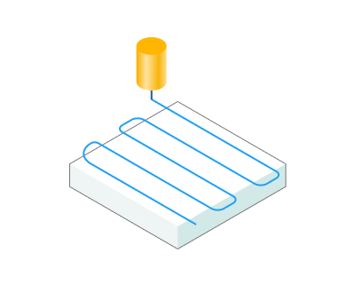

<strong>ジグザグ</strong> 工具はジグザグの軌跡に沿って移動します。ジグ（往路）パスとザグ（復路）パス間のリンク移動も、加工送りのまま素材上で行われるため、加工時間を短縮できます。この方法は、荒取りと中仕上げに適しています。

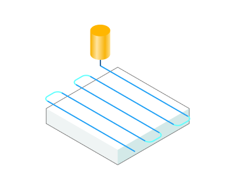

<strong>一方向</strong> 工具は、フライス加工の種類（ダウンカット／アップカット）に応じて、常に一方向へ平行パスで移動します。加工パスはワークの境界の外側から開始し、外側で終了します。リンクの移動は安全平面上で行われます。この方法では、最良の表面仕上げ品質が得られます。

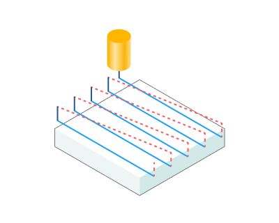

<strong>ワンパス</strong> 工具はワークの中心を正確に1回通過します。加工パスはワーク境界の外側から開始し、外側で終了します。この方法は、工具の直径がワークの幅より大きい場合に使用します。

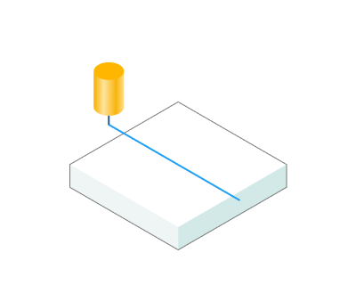

以下は主要なパラメータです。これらの構成は <strong>加工設定</strong>セクションで<strong>選択した方法によって</strong>異なる場合があります。

<strong>ステップ</strong> 許容される最大切削幅を設定します。

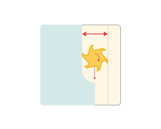

<strong>コーナーの円滑化</strong> ツールパス上の鋭角なコーナーを、指定した半径で滑らかにします。

 

<strong>角度</strong> 平面加工における切削方向の角度を設定します。

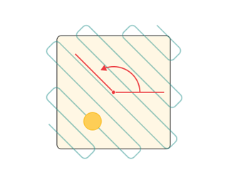

<strong>最後パスオーバーラップ</strong> 最終加工パスにおいて、工具の外周部がワークにどの程度重なるかを設定します。

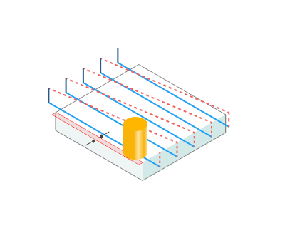

<strong>ミーリングタイプ：</strong>

曲線加工オペレーションを除き、ほとんどすべての加工で設定可能です。この設定により、ツールパスの計算プロセス中に、必要なフライス加工タイプ（ダウンカットまたはアップカット）を設定できます。このパラメーターグループは <strong>ウォーターライン荒加工オペレーションと同様に機能します。</strong> [詳細を見る](736.md)

<strong>並べ替え</strong>

面加工中のツールパスの順序を設定します 。

拡大

<strong>開始点</strong> プランジの開始を定義する点を設定します。

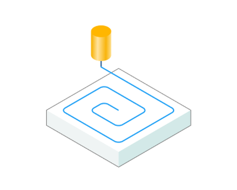 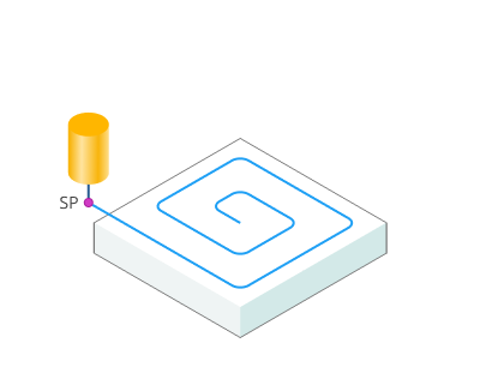

<strong>加工深さ：</strong>

工具軸方向の加工範囲を設定します。 このパラメーターグループは<strong>ウォーターライン荒加工オペレーションと同様に機能します</strong><strong>。</strong> [詳細を見る](736.md)

拡大

<strong>軸方向残し代</strong> 最終高さに残すストックを設定します。後工程の加工のために素材を残す場合は正の値を、部品から素材を削り取る（食い込む）場合には負の値を指定します。

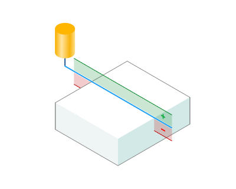

<strong>パス回数</strong>

加工パスの本数を設定します。デフォルトでは、加工の開始高さと最終深さ、仕上げ高さ、および深さステップに基づいて自動的に計算されます。

拡大

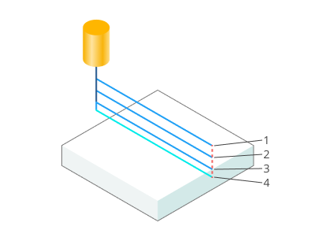

<strong>仕上げ高さ</strong> 最終パスの深さを設定できます。最終パス量を小さく設定すると、通常はより良好な仕上げ面が得られます。

 

<strong>深さステップ</strong> 荒取りパスにおける許容される最大ステップを設定します。

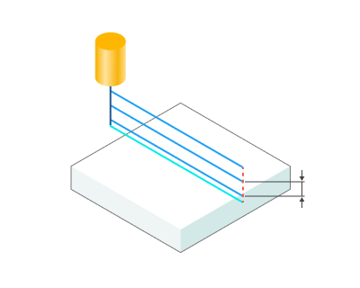

## 送り速度設定

このダイアログを使用して、主軸回転速度、早送り値、ツールパスの各領域の送り値を設定できます。主軸回転速度は、毎分回転数または切削速度のいずれかで設定できます。設定値には下線が表示されます。もう一方の値は、工具径を考慮し、設定値に基づいて再計算されます。[詳細を見る](https://confluence.encycam.com/pages/viewpage.action?pageId=137012551)

## 変換：

オペレーション内で計算された工具の軌跡に対して座標変換行うためのパラメータグループです。[詳細を見る](10168.md)

## パーツ：

パーツは、干渉をチェックする空間を定義する幾何要素のグループです。[詳細を見る](330.md)

## ワーク：

加工のワークモデルは、加工する素材を定義します。[詳細を見る](738.md)

## 治具：

治具には通常、チャック、グリップ、クランプなどの固定補助具と、その他の種類の制限領域を指定します。[詳細を見る](10283.md)
