# Planfräsen

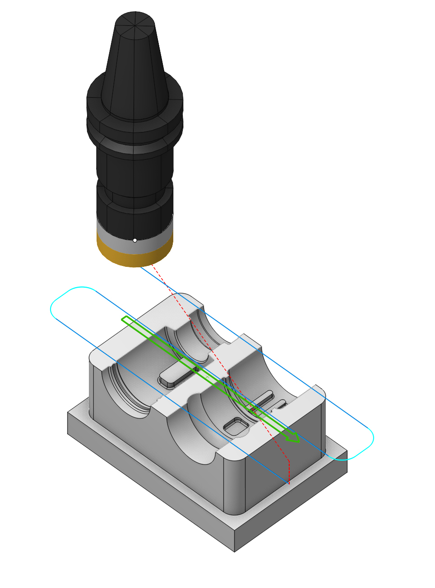

## Anwendungsbereich:

Beim Planfräsen wird Rohteilmaterial auf einer horizontalen Ebene mit einer der folgenden Strategien entfernt:

- Ein Durchgang.
- Parallele Bahnen.
- Zickzack.
- Optimiertes Zickzack.
- Spirale.

**Bei der Bahnberechnung wird nur die Rohteilform berücksichtigt. Die Bauteilgeometrie wird nicht auf unerwünschte Einschnitte geprüft.**

Der Materialabtrag kann in mehreren Tiefenstufen erfolgen. Standardmäßig liegt die untere Ebene am höchsten Bauteilpunkt und die obere am höchsten Rohteilpunkt. Die Anzahl der Durchgänge ergibt sich aus dem Abstand der Ebenen, der Tiefe des letzten Schlichtdurchgangs und der Schruppzustellung. Wird die Anzahl manuell vorgegeben, wird die Zustellung entsprechend neu berechnet.

### Einrichtung:

Auf **Setup** werden grundlegende Projektparameter wie Bauteillage und Werkstückkoordinatensystem festgelegt. [Details](1022.md)

### Strategie:

**Strategy (Strategie).**

Diese Gruppe enthält die grundlegenden Einstellungen für die Bearbeitungsbahnen.

Weitere Informationen anzeigen

**Bearbeitungsstrategie:**

Weitere Informationen anzeigen

**Spiral (Spirale).** Das Werkzeug fährt mit einer Einrollbewegung in das Material ein und folgt anschließend der Grenze des noch unbearbeiteten Rohteils. Maximale Schnittbreite und Eingriffswinkel werden begrenzt. Die Strategie eignet sich zum effizienten Abtragen großer Materialmengen.

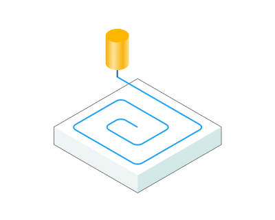

**Optimized zigzag (Optimiertes Zickzack).** Erzeugt Zickzackbahnen. Die Verbindungen zwischen gegenläufigen Durchgängen erfolgen ebenfalls im Material mit Arbeitsvorschub, um die Bearbeitungszeit zu verringern. Geeignet zum Schruppen und Vorschlichten.

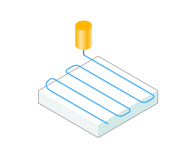

**Zigzag (Zickzack).** Erzeugt Bahnen mit wechselnder Richtung. Verbindungen zwischen den Durchgängen erfolgen im Material mit Arbeitsvorschub. Geeignet zum Schruppen und Vorschlichten.

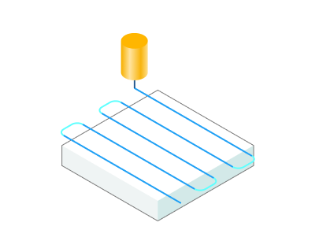

**One way (Eine Richtung).** Parallele Arbeitsbahnen verlaufen entsprechend Gleich- oder Gegenlauf stets in derselben Richtung. Sie beginnen und enden außerhalb des Rohteils; die Rückverbindungen erfolgen auf der Sicherheitsebene. Die Strategie eignet sich für eine hohe Oberflächengüte.

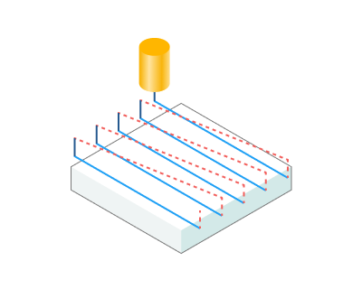

**One pass (Ein Durchgang).** Erzeugt einen einzigen Durchgang durch die Rohteilmitte mit Start und Ende außerhalb des Rohteils. Verwenden Sie dies, wenn der Werkzeugdurchmesser größer als die Rohteilbreite ist.

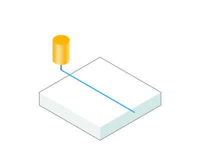

Je nach Strategie stehen folgende Parameter zur Verfügung:

**Step (Bahnabstand).** Maximal zulässige Schnittbreite.

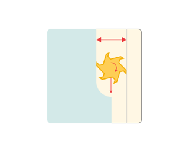

**Smooth corners (Ecken glätten).** Verrundet scharfe Bahnecken mit dem angegebenen Radius.

.png) .png)

**Angle (Winkel).** Legt die Bahnrichtung fest.

**Final pass overlap (Überdeckung im letzten Durchgang).** Bestimmt, wie weit der Werkzeugumfang das Rohteil beim letzten Durchgang überdeckt.

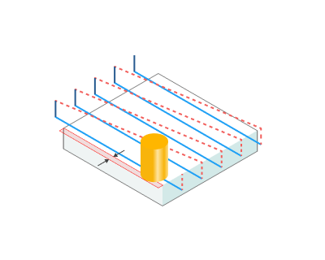

**Milling type (Fräsart).**

Legt Gleich- oder Gegenlauf für die Bahnberechnung fest. Diese Einstellung steht in den meisten Operationen außer der Kurvenbearbeitung zur Verfügung. Die Parameter entsprechen denen beim Wasserlinien-Schruppen. [Details](736.md)

**Sorting (Sortierung).**

Steuert die Reihenfolge der Bearbeitungsbahnen.

Weitere Informationen anzeigen

**Start point (Startpunkt).** Legt den Beginn der Einfahrbewegung fest.

 

**Machining levels (Bearbeitungsebenen).**

Legt den Bereich entlang der Werkzeugachse fest. Die Parameter entsprechen denen beim Wasserlinien-Schruppen. [Details](736.md)

Weitere Informationen anzeigen

**Axial stock (Axiales Aufmaß).** Aufmaß auf der Endebene. Positive Werte lassen Material für eine spätere Bearbeitung stehen. Negative Werte führen zu Materialabtrag unterhalb der Bauteilfläche.

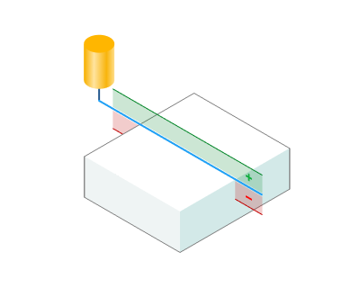

**Nb. of passes (Anzahl der Durchgänge).**

Die Anzahl wird standardmäßig aus oberer und unterer Bearbeitungsebene, der Tiefe des letzten Durchgangs und der Tiefenzustellung berechnet.

Weitere Informationen anzeigen

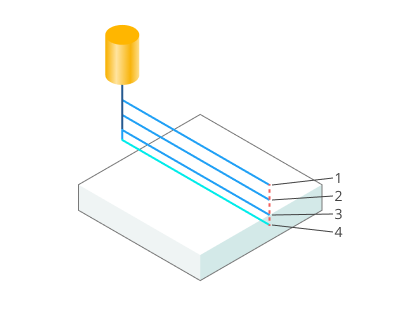

**Cleanup height (Tiefe des letzten Durchgangs).** Legt den Materialabtrag des letzten Durchgangs fest. Eine geringere Zustellung verbessert normalerweise die Oberflächengüte.

.png) .png)

**Depth step (Tiefenzustellung).** Maximal zulässige Zustellung der Schruppdurchgänge.

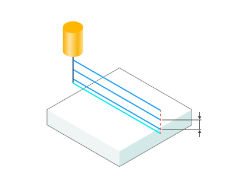

### Parameter:

Diese Registerkarte enthält die grundlegenden Einstellungen für Bauteil, Rohteil, Spannmittel und weitere Elemente, die die Werkzeugbahn beeinflussen. [Details](100112.md)

### Verbindungen und An-/Abfahrbewegungen:

Auf der Registerkarte **Links/Leads** werden die Verbindungsbewegungen festgelegt: Anfahren von der Werkzeugwechselposition, Einfahren zum Beginn der Arbeitsbahn, Abfahren nach dem letzten Arbeitsgang, Verbindungen zwischen den Bahnen und Rückkehr zur Werkzeugwechselposition. Einstellbar sind die Reihenfolge der Achsbewegungen, der Bahnverlauf und die Abstände.

Weitere Informationen anzeigen

**Parametergruppen:**

**Approach/Return (Anfahren/Rückkehr).** Steuert die Bewegung von der Werkzeugwechselposition zum Beginn der Werkzeugbahn und zurück. [Details](100116.md).

**Safe motions (Sichere Bewegungen).** Legt die Art der Sicherheitsfläche und ihren Abstand zum Rohteil fest. Die Fläche dient für Verbindungen zwischen bearbeiteten Flächen oder Werkzeugbahnen sowie für die erste Phase des Anfahrens bzw. der Rückkehr. [Details](100117.md).

**Advanced links settings (Erweiterte Verbindungseinstellungen).** Steuert die Bahnerzeugung insbesondere bei 5-Achsen-Operationen unter Berücksichtigung günstiger Drehachsbewegungen. [Details](100118.md).

**Leads (An-/Abfahrbewegungen).** Ergänzt zusätzliche Ein- und Ausfahrbewegungen an den Arbeitsbahnen mit den dafür vorgesehenen Vorschüben. [Details](100148.md).

**Distances (Abstände).** Abstände für das Umschalten der Vorschubart. [Details](100146.md).

### Vorschübe und Drehzahlen:

Legt Spindeldrehzahl, Eilgang und Vorschübe für die verschiedenen Bahnabschnitte fest. Die Drehzahl kann direkt in Umdrehungen pro Minute oder über die Schnittgeschwindigkeit vorgegeben werden. Der vorgegebene Wert wird unterstrichen; der andere wird anhand des Werkzeugdurchmessers berechnet. [Details](100142.md)

### Transformationen:

Koordinatentransformationen des berechneten Werkzeugwegs. [Details](10168.md).

### Bauteil:

Geometrische Elemente zur Prüfung auf unerwünschte Einschnitte. [Details](330.md)

### Rohteil:

Modell des zu bearbeitenden Materials. [Details](738.md)

### Spannmittel:

Hier werden Spannmittel wie Spannfutter, Greifer und Spannpratzen sowie weitere Sperrbereiche angegeben. [Details](10283.md)
