# ペンシル

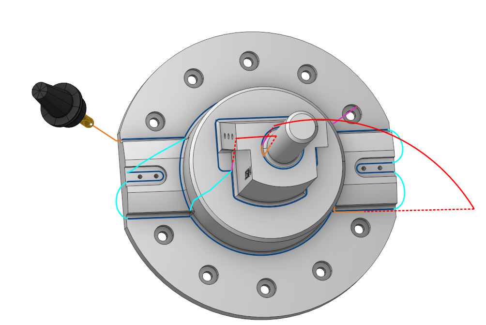

## 適用分野：

この取り残し加工は、部品の内側コーナーに沿ってパスを生成します。

## ジョブ割り当て：

<strong>加工面</strong> パスは、工具が加工面と接触する箇所のみに生成されます。加工面が存在しない場合、ツールパスは部品全体に対して生成されます。

<strong>ジョブゾーン</strong>（加工領域） ジョブゾーンは、荒加工および仕上げ加工で加工される部品領域を定義するために使用します。[詳細を見る](10151.md)

<strong>制限領域</strong> システム内の<strong>ジョブゾーン</strong> に加えて、 <strong>制限領域</strong> を使用して、現在のオペレーションでは加工しないワーク領域を指定できます。[詳細を見る](10152.md)

<strong>チルトカーブ</strong> <strong>5軸変換</strong><strong>を</strong><strong>通過カーブ</strong>に設定した際に、工具軸ベクトルが向かう曲線です。

<strong>プロパティ</strong> 選択した要素のプロパティを表示します。ストックを追加することも可能です。リスト内の項目をダブルクリックすることでも、このメニューを表示できます。

<strong>削除</strong> リストから項目を削除します。

<strong>制限</strong> 加工してはならない領域を制限することができます。[詳細を見る](101231.md)

## 加工設定：

### 加工設定：

このパラメータグループでは、目的とするツールパスを生成するための設定を行います。

拡大

<strong>角度加工法：</strong>

<strong>ワンパス</strong> すべての内側コーナーに沿ってシングルパスを生成します。

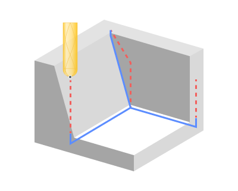

<strong>平行パス</strong> 単一の内側コーナーを加工する際に、複数のパスを生成します。 追加される各 パスは、 ワンパス方式のツールパスを加工面上で<strong>ステップ</strong> 値分だけ横方向にずらしたものです。

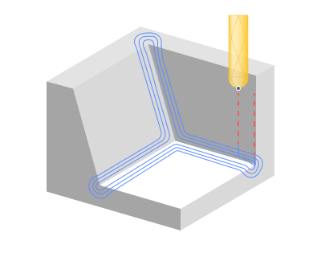

<strong>両角角度</strong> オペレーションで検出するエッジを制限するために使用します。これは、 パーツのサーフェスと工具の切削刃が同時に接触する2点間の間の角度です。工具はこの角度の内側の領域を加工します。

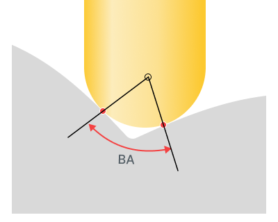

<strong>ステップ</strong> 許容される最大切削幅を設定します。

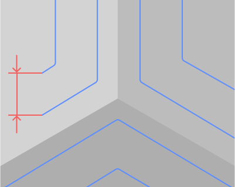

<strong>パス回数</strong> コーナーに沿ったパスの回数を設定します。 このパス回数は、コーナーの中央から両側に展開されます。

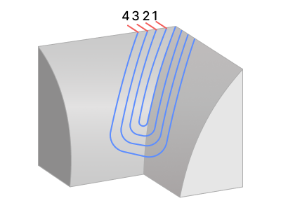

ストロークによる加工 このオプションを無効にすると、CAMシステムは、滑らかに移行できる領域において、複数のコーナーの加工を１つに統合しようとします。

このオプションを有効にすると、 ツールパスが領域ごとに分割され、コーナー間を滑らかに移行できる場合でも、 それぞれの内側コーナーを個別に加工できるようになります。

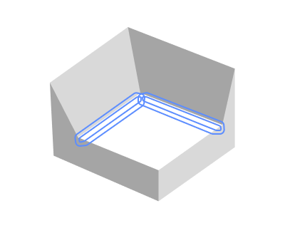

<strong>接続角度</strong> 接続されたパス間で最も鋭い角度です。加工対象のコーナー間の角度がこの値より大きい場合、これらのコーナーのツールパスはh分割されます。

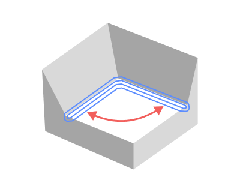

### ミーリングタイプ：

曲線加工オペレーションを除き、ほとんどすべてのオペレーションで設定できます。この設定により、ツールパスの計算プロセス中に、必要なフライス加工タイプ（ダウンカットまたはアップカット）を設定できます。 このパラメーターグループは<strong>ウォーターライン荒加工オペレーションと同様に機能します。</strong>[詳細を見る](736.md)

### 並べ替え

サーフェス加工中のツールパス順序を設定します 。

### 傾斜面の加工：

内側コーナーの母線勾配に基づいて、加工対象領域を決定します。

拡大

<strong>全て</strong> 緩傾斜 領域 と急傾斜領域の両方を加工します。

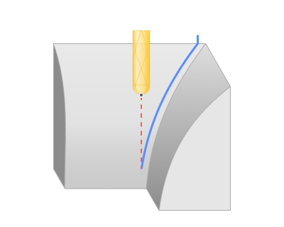

<strong>傾斜面</strong> 緩傾斜領域のみを加工します。

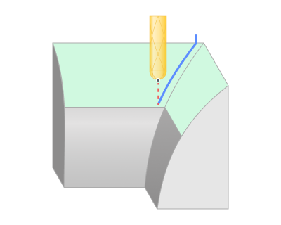

<strong>急斜面</strong> 急傾斜領域のみを加工します。

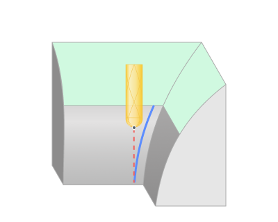

<strong>急斜面／緩斜面分割角度</strong> 緩傾斜領域と急傾斜領域を分ける境界角度です。

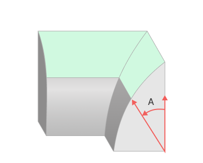

### 加工深さ：

工具軸方向の加工範囲を設定します。[詳細を見る](10153.md)<strong>ウォータライン荒加工オペレーション</strong>と同様に<strong>底部高さ</strong>を設定します。[詳細を見る](736.md)

### 5軸変換：

工具軸の向きを設定します。[詳細を見る](10141.md) この機能の主要パラメータは、<strong>5Dサーフェシングオペレーション</strong>と同様です。[詳細を見る](10135.md)

### トリミング

加工対象ではないサーフェスをスキップしたり、ツールパスを延長したりできます。<strong>トリミング</strong>のパラメータは、<strong>ウォータライン荒加工オペレーション</strong>と同様です。[詳細を見る](736.md)

## パラメータ:

このタブには、部品、ワーク、治具、およびその他の軌跡に影響を与える要素を制御するための主要なパラメータが含まれており、ツールパスを変更できます。 [詳細を見る](100112.md)

<strong>リンク／リード:</strong>

リンク／リードタブでは、早送り動作のパラメータを定義します。これらの移動には、工具交換位置からのアプローチ、切削パス開始点までの位置決め、最終切削後の退避動作、各パス間の移行移動、そして工具交換位置への復帰が含まれます。座標軸ごとの動作順序、各移動の軌跡、および移動量を設定できます。

拡大

<strong>次の項目で構成されます。</strong>

<strong>アプローチ／リターン</strong> このパラメータグループでは、工具交換位置から切込み開始パスへの工具の移動、そして戻りの動作を設定します。[詳細を見る](https://confluence.encycam.com/pages/viewpage.action?pageId=131904799)

<strong>リンク</strong> 進入／退出リンクおよび加工パス間のリンクに関するルールを設定します。[詳細を見る](https://confluence.encycam.com/pages/viewpage.action?pageId=137006979)

<strong>リード</strong> 移動動作に対して、送り速度を使用して追加の突き込みおよび退避を追加できます。 [詳細を見る](https://confluence.encycam.com/display/SC1/.Leads+for+5-axis+operation+v19)

<strong>安全動作</strong> <strong>安全サーフェス</strong>のタイプとワークから安全サーフェスまでの距離を設定します。加工サーフェスまたはツールパス間の移行を円滑にし、アプローチまたはリターンの最初の段階は、この面に向かって行います。[詳細を見る](100117.md)

<strong>高度なリンク設定</strong> このパラメータグループでは、主に5軸加工において、回転軸の最適な動きを考慮した軌道形成の特性を指定します。[詳細を見る](100118.md)

<strong>距離</strong> リンクのルールで使われる距離です。 [詳細を見る](https://confluence.encycam.com/pages/viewpage.action?pageId=137012802)

## 送り速度設定

このダイアログを使用して、主軸回転速度、早送り値、ツールパスの各領域の送り値を設定できます。主軸回転速度は、毎分回転数または切削速度のいずれかで設定できます。設定値には下線が表示されます。もう一方の値は、工具径を考慮し、設定値に基づいて再計算されます。[詳細を見る](100142.md)

## 変換：

オペレーション内で計算された工具の軌跡に対して座標変換を行うためのパラメータグループです。 [詳細を見る](10168.md)

## パーツ：

パーツは、干渉をチェックする空間を定義する幾何要素のグループです。[詳細を見る](330.md)

## ワーク：

加工のワークモデルは、加工する素材を定義します。[詳細を見る](738.md)

## 治具：

[治具には通常、チャック、グリップ、クランプなどの固定補助具と、その他の種類の制限領域を指定します。 詳細を見る](10283.md)
