# Pencil (ripresa negli angoli)

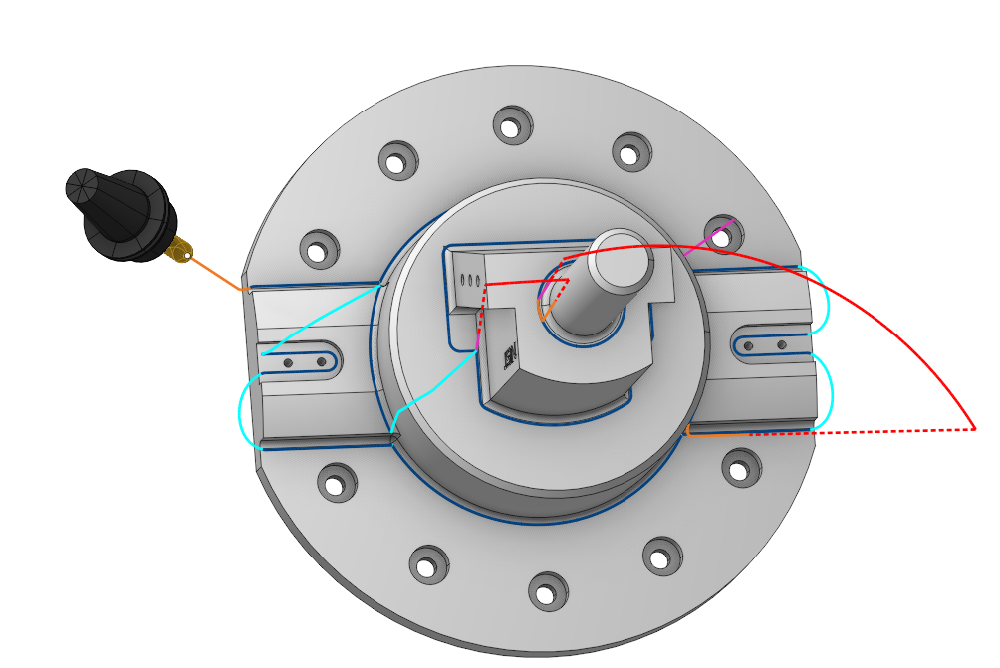

## Ambito di applicazione:

L'operazione di ripresa genera passate lungo gli angoli interni del pezzo.

### Assegnazione del lavoro:

<strong>Machining Surfaces.</strong> (superfici da lavorare) Le passate vengono generate solo nei punti in cui l'utensile è a contatto con le superfici da lavorare. Se le superfici da lavorare non sono definite, il percorso utensile viene generato sull'intero pezzo.

<strong>Job Zone.</strong> (zona di lavoro) Le zone di lavoro servono a definire le aree del pezzo da lavorare con le operazioni di fresatura di sgrossatura e di finitura. [Dettagli](10151.md)

<strong>Restrict Zone.</strong> (zona di esclusione) Oltre alle <strong>Job Zones</strong>, nel sistema è possibile utilizzare le <strong>Restrict Zones</strong> per specificare le aree del grezzo che non devono essere lavorate nell'operazione corrente. [Dettagli](10152.md).

<strong><strong><strong>Tilt Curve.</strong></strong></strong> (curva di inclinazione) È la curva verso cui punta il vettore dell'asse utensile quando nella specifica <strong><strong><strong>5 Axis Conversion</strong></strong></strong> (conversione a 5 assi) si imposta <strong><strong>Through Curve.</strong></strong> (attraverso la curva)

<strong>Properties.</strong> (proprietà) Visualizza le proprietà di un elemento. È possibile aggiungere il sovrametallo. Questo menu può essere richiamato anche facendo doppio clic su un elemento dell'elenco.

<strong>Delete.</strong> (elimina) Rimuove un elemento dall'elenco.

<strong>Restrictions.</strong> (restrizioni) Consente di delimitare le aree che non devono essere lavorate. [Dettagli](101231.md)

### Strategia:

#### Strategia:

Questo gruppo di parametri consente all'utente di ottenere il percorso utensile richiesto:

Fare clic qui per espandere..

<strong>Angle Processing Method:</strong> (metodo di lavorazione degli angoli)

<strong>One pass.</strong> (passata singola) Il sistema genera una sola passata lungo ogni angolo interno.

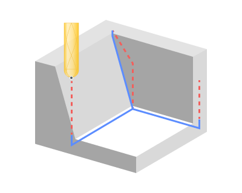

<strong>Parallel passes.</strong> (passate parallele) Il sistema genera più passate durante la lavorazione di un singolo angolo interno. Ogni passata aggiuntiva corrisponde a uno spostamento laterale del percorso utensile della strategia a passata singola sulla superficie da lavorare, pari al valore di <strong>Step</strong>. La larghezza di taglio massima consentita

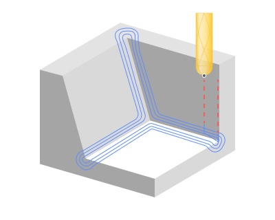

<strong>Bitagency Angle.</strong> (angolo di bitangenza) Questo parametro serve a limitare gli spigoli rilevati dall'operazione. È l'angolo tra i due punti in cui le superfici del pezzo e i taglienti dell'utensile sono contemporaneamente a contatto. L'utensile lavora nella zona interna a questo angolo.

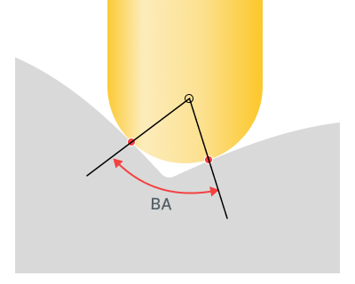

<strong>Step.</strong> (passo laterale) La larghezza di taglio massima consentita.

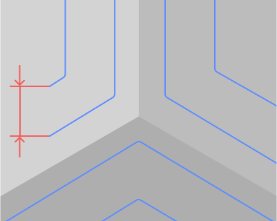

<strong>Nb. of passes.</strong> (numero di passate) Il numero di passate lungo l'angolo. Questo numero di passate si estende su ciascun lato a partire dalla mezzeria dell'angolo.

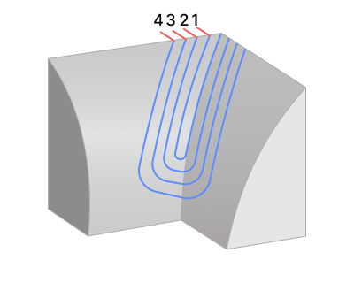

Machine by strokes (lavorazione per tratti). Quando l'opzione è disattivata, il sistema CAM cerca di unificare la lavorazione di più angoli nelle aree che consentono una transizione fluida.

L'attivazione dell'opzione suddivide il percorso utensile in regioni, consentendo la lavorazione indipendente dei diversi angoli ovunque possa verificarsi una transizione fluida tra gli angoli.

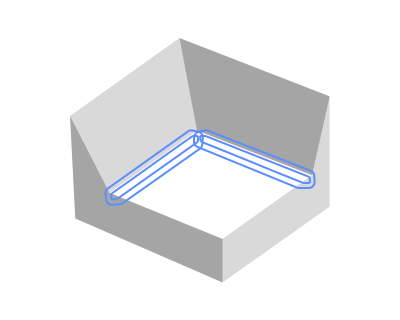

<strong>Connection angle.</strong> (angolo di collegamento) È l'angolo più acuto tra passate collegate. Se l'angolo tra gli angoli in lavorazione è maggiore di questo valore, il percorso utensile per tali angoli verrà separato.

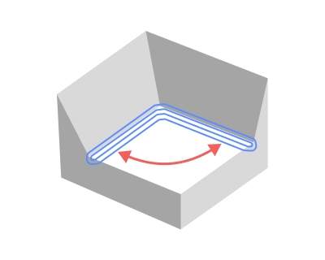

#### Tipo di fresatura:

Può essere assegnato in quasi tutte le operazioni, tranne quelle di lavorazione delle curve. Consente all'utente di controllare il tipo di fresatura richiesto (concorde o discorde) durante il calcolo del percorso utensile. Questo gruppo di parametri funziona in modo analogo all'operazione <strong>Waterline roughing operation.</strong> [Dettagli](736.md)

#### Ordinamento:

Controlla la sequenza delle passate del percorso utensile durante la lavorazione delle superfici.

#### Pendenze da lavorare:

Determina le aree da lavorare in base all'inclinazione delle linee generatrici degli angoli.

Fare clic qui per espandere..

<strong>All.</strong> (tutte) Il sistema lavora sia le aree poco inclinate sia quelle ripide.

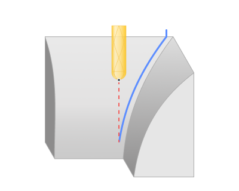

<strong>Shallow.</strong> (poco inclinate) Il sistema lavora solo le aree poco inclinate.

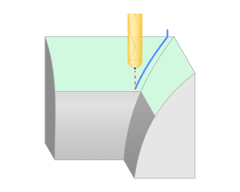

<strong>Steep.</strong> (ripide) Il sistema lavora solo le aree ripide.

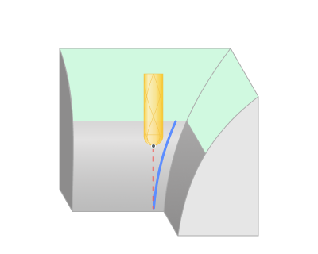

<strong>Steep/shallow split angle.</strong> (angolo di separazione ripide/poco inclinate) L'angolo che separa le aree poco inclinate da quelle ripide.

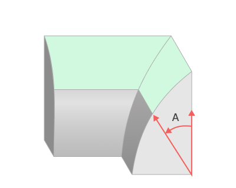

#### Livelli di lavorazione:

Definisce l'intervallo di lavorazione lungo l'asse dell'utensile. [Dettagli](10153.md). Specificare il <strong>Bottom Level</strong> (livello inferiore) come nell'operazione <strong>Waterline Roughing operation</strong>. [Dettagli](736.md)

#### Conversione a 5 assi:

Controlla l'orientamento dell'asse utensile. [Dettagli](10141.md). I parametri principali di questa funzione sono gli stessi dell'operazione <strong>5D Surfacing operation</strong>. [Dettagli](10135.md)

#### Rifilatura:

Consente di saltare le superfici non destinate alla lavorazione e di estendere il percorso utensile. I parametri di <strong>Trimming</strong> sono gli stessi dell'operazione <strong>Waterline Roughing operation</strong>. [Dettagli](736.md)

### Parametri:

Questa scheda contiene i parametri principali per il controllo del pezzo, del grezzo, delle attrezzature di bloccaggio e di altri elementi, che consentono di modificare il percorso utensile. [Dettagli](100112.md)

### Collegamenti/Attacchi:

Nella scheda Links/Leads si definiscono i parametri dei movimenti rapidi. Questi movimenti comprendono l'avvicinamento dell'utensile dalla posizione di cambio utensile, l'attacco all'inizio della corsa di lavoro, la retrazione dopo l'ultimo movimento di taglio, i collegamenti tra le passate di lavoro e il ritorno al punto di cambio utensile. È possibile configurare la sequenza dei movimenti lungo le coordinate, la traiettoria di questi movimenti e l'entità degli spostamenti.

Fare clic qui per espandere..

<strong>Comprende:</strong>

<strong>Approach/Return.</strong> (avvicinamento/ritorno) Questo gruppo di parametri gestisce i movimenti dell'utensile dalla posizione di cambio utensile all'inizio dei percorsi di attacco e viceversa. [Dettagli](100116.md).

<strong>Links.</strong> (collegamenti) Definisce le regole che governano i collegamenti di entrata/uscita e i collegamenti tra i movimenti di lavoro. [Dettagli](100130.md).

<strong>Leads.</strong> (attacchi) Consente di aggiungere ai movimenti di lavoro ulteriori attacchi e retrazioni eseguiti con il relativo avanzamento. [Dettagli](100136.md).

<strong>Safe motions.</strong> (movimenti di sicurezza) Definisce il tipo di <strong>Safety Surface</strong> (superficie di sicurezza) e la sua distanza dal grezzo. Questa superficie agevola i collegamenti tra le superfici lavorate o tra i percorsi utensile, e la prima fase dell'avvicinamento o del ritorno avviene verso di essa. [Dettagli](100117.md).

<strong>Advanced links settings.</strong> (impostazioni avanzate dei collegamenti) Questo gruppo di parametri specifica le caratteristiche della generazione del percorso utensile soprattutto per le operazioni a cinque assi, tenendo conto dei movimenti ottimali degli assi rotativi. [Dettagli](100118.md).

<strong>Distances.</strong> (distanze) Distanze utilizzate nelle regole dei collegamenti (Links) [Dettagli](100140.md).

### Avanzamenti/Velocità:

In questa finestra di dialogo l'utente può definire la velocità di rotazione del mandrino, la velocità del movimento rapido e i valori di avanzamento per le diverse parti del percorso utensile. La velocità di rotazione del mandrino può essere definita come numero di giri al minuto oppure come velocità di taglio. Il valore determinante viene sottolineato. Il secondo valore viene ricalcolato in base al valore determinante, tenendo conto del diametro dell'utensile. [Dettagli](100142.md)

### Trasformazioni:

Insieme di parametri dell'operazione che consentono di eseguire trasformazioni di coordinate sul percorso utensile calcolato nell'ambito dell'operazione. [Dettagli](10168.md).

### Pezzo:

Il pezzo (Part) è un gruppo di elementi geometrici che definisce lo spazio in cui controllare le intaccature. [Dettagli](330.md)

### Grezzo:

Il modello del grezzo (Workpiece) di un'operazione definisce il materiale da lavorare. [Dettagli](738.md)

### Attrezzature:

Come attrezzature (Fixtures) si specificano di solito i dispositivi di bloccaggio, come mandrini autocentranti, griffe, staffe, ecc., e le aree di esclusione di qualsiasi altra natura. [Dettagli](10283.md)
