# コーナー仕上げ

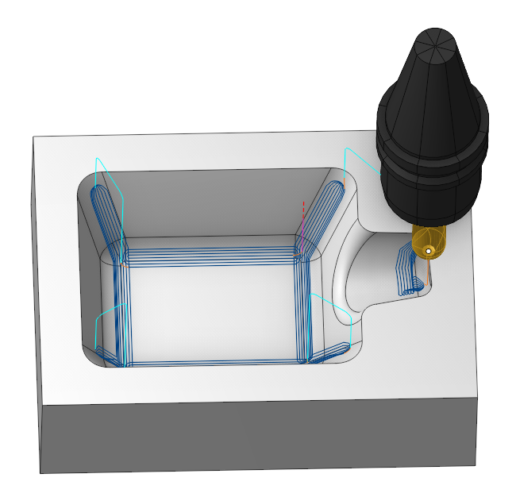

## 適用分野：

このオペレーションは、取り残し加工グループのオペレーションです。 <strong>前工程で使用した工具径</strong>をパラメータとして使用し、その工具では未加工のまま残る材料の領域にパスを生成します。

### ジョブ割り当て：

<strong>加工面</strong> 工具が加工面に接触する場所にのみパスを生成します。加工サーフェスが指定されていない場合は、ツールパスはパーツ全体に対して生成されます。

<strong>ジョブゾーン</strong>（加工領域） ジョブゾーンは、荒加工および仕上げ加工で加工するパーツ領域を定義するために使用します。[詳細を見る](10151.md)

<strong>制限領域</strong> システム内の <strong>ジョブゾーン</strong> に加えて、 <strong>制限領域</strong>を使用して、現在のオペレーションでは加工しないワーク領域を指定できます。[詳細を見る](10152.md)

<strong>チルトカーブ</strong> <strong>5軸変換</strong> を 通過カーブに設定した際に、工具軸ベクトルが向かう曲線です。

<strong>プロパティ</strong> 要素のプロパティを表示します。ストックを追加することも可能です。リスト内の項目をダブルクリックすることでも、このメニューを表示できます。

<strong>削除</strong> リストから項目を削除します。

<strong>制限</strong> 加工してはならない領域を制限することができます。[詳細を見る](101231.md)

### 加工設定：

#### 加工設定：

このパラメータグループでは、目的とするツールパスを生成するための設定を行います。

詳細を表示

<strong>ツールパスの方向</strong>

詳細を表示

<strong>たて</strong> 内側コーナーに沿ってパスを生成します。

<strong>よこ</strong> 内側コーナーを横切る方向にパスを生成します。

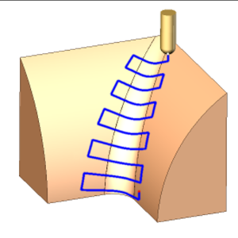

<strong>統合</strong> 傾斜の緩やかな領域では内側コーナーに沿った加工パスを生成し、傾斜の急な領域では内側コーナーを横切る方向のパスを生成します。

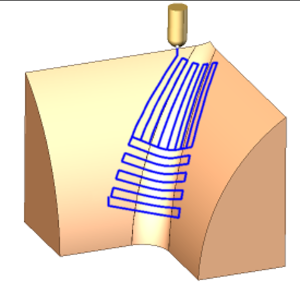

<strong>ステップ</strong> 許容される最大切削幅を設定します。

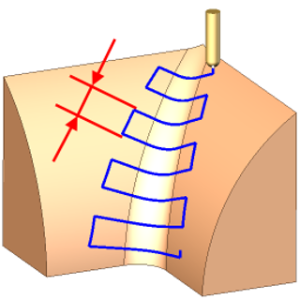

<strong>両角角度</strong> オペレーションで検出するエッジを制限するために使用します。これは、 パーツのサーフェスと工具の切削刃が同時に 接触する2点間の角度です。工具はこの角度の内側の領域を加工します。

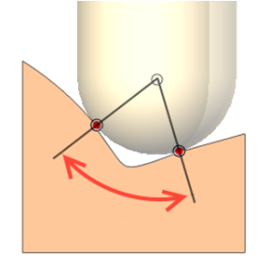

<strong>前工程の工具直径</strong> 取り残しの計算に使用するボールエンドミルの直径を設定します。

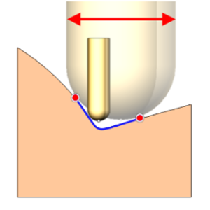

<strong>最大切削深さ</strong> 許容される最大切込み深さを設定します。

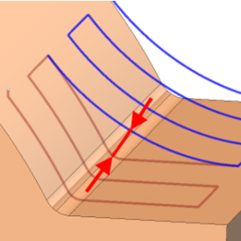

<strong>最小切削深さ</strong> 許容される最小切込み深さを設定します。

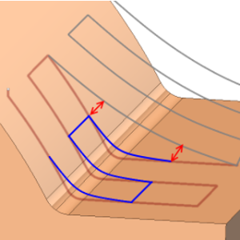

<strong>荒取り</strong> 荒取りパスを有効にするには、チェックボックスをオンにします。

詳細を表示

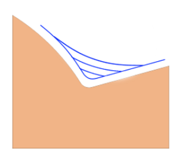

<strong>荒取りステップ</strong> 荒加工パス間の距離を設定します。

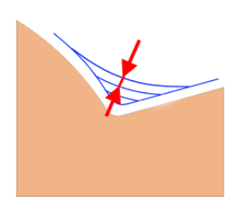

<strong>結合タイプ</strong> 荒加工時におけるツールパスの順序を設定します 。

<strong>高さ</strong> 各高さにおいてすべての領域の加工を行ってから、次の高さに進みます。

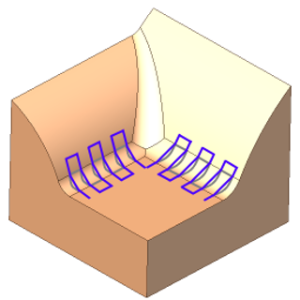

<strong>領域</strong> 1つの領域の加工を完全に行ってから、次の領域の加工に進みます。

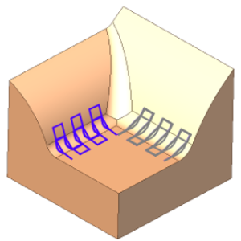

<strong>ストリング</strong> 1つのストリングに含まれるすべての高さを加工してから、次のストリングの加工に進みます。

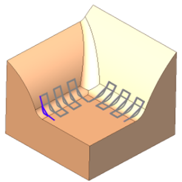

<strong>リンクタイプに沿って</strong> 加工方法に「沿いパス」が含まれている場合に表示されます。

詳細を表示

<strong>渦巻き</strong> 工具は、連続したスパイラル状のツールパスに沿って、単一の領域を加工します。

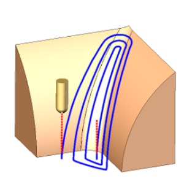

<strong>直線</strong> 工具は、コーナーラインに沿った複数のパスを作成し、各パス間をリンクしながら単一の領域を加工します。

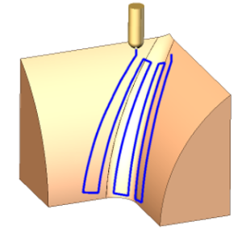

<strong>急斜面／緩斜面分割角度</strong> 組み合わせパスの加工方法を選択した場合に表示され、 急傾面領域と緩傾面領域の境界となる角度を設定します。

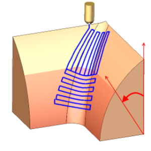

#### ミーリングタイプ：

曲線加工オペレーションを除き、すべてのオペレーションで設定可能です。これにより、ユーザーはツールパスの計算プロセス中に必要なフライス加工タイプ（ダウンカットまたはアップカット）を設定できます。 このパラメーターグループは <strong>ウォーターライン荒加工オペレーションと同様に機能します。</strong> [詳細を見る](736.md)

#### 並べ替え：

面加工中におけるツールパスの順序を設定します 。

#### 接続：

このパラメータは、可能な場合に複数の領域のツールパスを統合する方法を設定します。

詳細を表示

<strong>Z一定</strong> パスは、可能な限り平面上で接続されます。

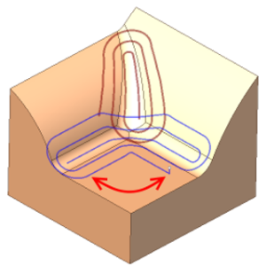

<strong>角度</strong> パスは、可能な限り最も滑らかな角度で接続されます。

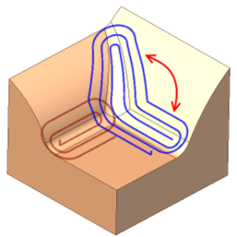

<strong>オフ</strong> 各領域は個別に加工されます。

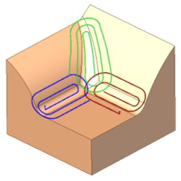

#### 加工高さ：

工具軸に沿った加工範囲を設定します。[詳細を見る](10153.md) <strong>ウォータライン荒加工オペレーション</strong>と同様に<strong>底部高さ</strong>を設定します。[詳細を見る](736.md)

#### 5軸変換：

工具軸の向きを設定します。[詳細を見る](10141.md) 工具方向の主要なパラメータは、 <strong>5Dサーフェシングオペレーション</strong>と同様です。[詳細を見る](10135.md)

#### トリミング：

加工対象ではないサーフェスをスキップしたり、ツールパスを延長したりできます。<strong>トリミング</strong>のパラメータは、<strong>ウォータライン荒加工オペレーション</strong>と同様です。[詳細を見る](736.md)

### パラメータ：

このタブには、部品、ワーク、治具、およびその他の軌跡に影響を与える要素を制御するための主要なパラメータが含まれており、ツールパスを変更できます。 [詳細を見る](100112.md)

### リンク／リード：

リンク／リードタブでは、早送り動作に関するパラメータを設定します。これらの移動には、工具交換位置からのアプローチ、切削パス開始点までの位置決め、最終切削後の退避動作、各パス間の移行移動、および工具交換位置への復帰が含まれます。座標軸ごとの動作順序、各移動の軌跡、および移動量を設定できます。

詳細を表示

<strong>次の項目で構成されます。</strong>

<strong>アプローチ／リターン。</strong> このパラメータグループは、工具交換位置から進入動作の開始位置までの工具移動と、その復帰動作を管理します。[詳細](100116.md)。

<strong>リンク。</strong> 進入／退出リンクと加工動作間のリンクのルールを設定します。[詳細](100130.md)。

<strong>リード。</strong> 加工動作に、その送り速度を使用した追加の進入・退避動作を設定できます。[詳細](100136.md)。

<strong>安全動作</strong> <strong>安全サーフェス</strong>のタイプとワークから安全サーフェスまでの距離を設定します。加工面またはツールパス間の移行を円滑にし、アプローチまたはリターンの最初の段階は、この面に向かって行います。[詳細を見る](100117.md)

<strong>高度なリンク設定</strong> このパラメータグループでは、回転軸の最適な動きを考慮した、主に5軸加工において、回転軸の最適な動きを考慮した軌道形成の特性を指定します。[詳細を見る](100118.md)

<strong>距離。</strong> リンクのルールで使用する距離です。[詳細](100140.md)。

### 送り速度設定：

このダイアログでは、主軸回転速度、早送り速度、およびツールパスの各領域の送り速度を設定できます。主軸回転速度は、毎分回転数または切削速度のいずれかで指定できます。基準となる値には下線が表示されます。もう一方の値は、工具径を考慮して基準値から再計算されます。[詳細](100142.md)

### 変換：

オペレーション内で計算された工具の軌跡に対して座標変換を行うためのパラメータグループです。 [詳細を見る](10168.md)

### パーツ：

パーツは、干渉をチェックする空間を定義する幾何要素のグループです。[詳細を見る](330.md)

### ワーク：

加工のワークモデルは、加工する素材を定義します。[詳細を見る](738.md)

### 治具：

治具には通常、チャック、グリップ、クランプなどの保持具や、その他の種類の制限領域を指定します。[詳細を見る](10283.md)
