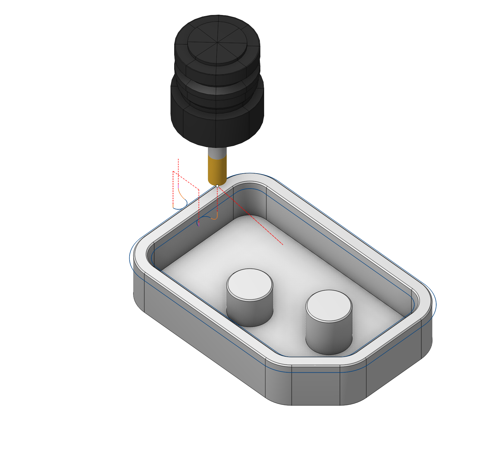
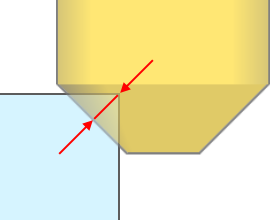
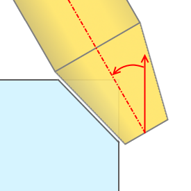
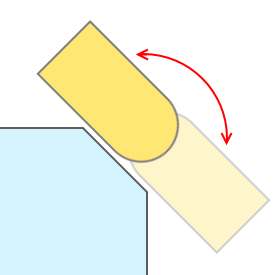
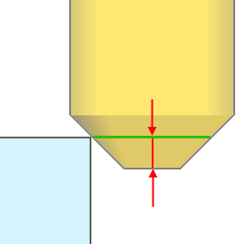
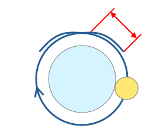
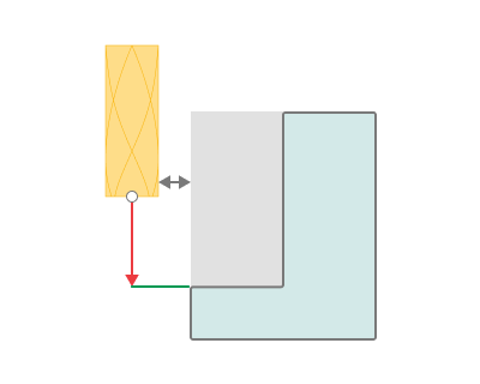
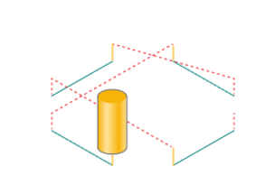
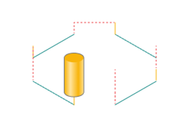

# Chanframento

## Área de aplicação:

A operação gera um percurso da ferramenta para a remoção de chanfros usando fresas de topo cilíndricas, cônicas e esféricas. É mais comumente usada como etapa final para formar os chanfros e filetes especificados no modelo 3D, para quebrar arestas vivas ou para remover rebarbas ao longo das arestas da peça.

### Setup:

A aba <strong>Setup</strong> é usada para configurar os parâmetros primários do projeto. Isso pode envolver o posicionamento da peça no equipamento, o sistema de coordenadas da peça, entre outros. [Detalhes](1022.md)

### Definição da tarefa:

<strong>Add sharp edge.</strong> Permite criar um percurso da ferramenta de remoção de chanfro com base nas arestas do modelo 3D. Ao selecionar uma superfície em vez de arestas, todas as arestas vivas da superfície são adicionadas imediatamente à <strong>definição da tarefa</strong>.

<strong>Add face.</strong> Permite usinar chanfros existentes em um modelo 3D, selecionando as superfícies projetadas como chanfros.

<strong>Recognize.</strong> Permite reconhecer chanfros automaticamente e adicioná-los à <strong>definição da tarefa</strong>. O sistema classifica os elementos reconhecidos em quatro tipos: <strong>arestas vivas, chanfros CAD, filetes e chanfros de furos.</strong>

<strong>Properties.</strong> Exibe as propriedades de um elemento. É possível adicionar sobremetal. Esse menu também pode ser aberto com um clique duplo em um item da lista.

<strong>Delete.</strong> Remove um item da lista.

<strong>Restrictions.</strong> Permite definir as regiões que não devem ser usinadas. [Detalhes](101231.md)

### Estratégia:

#### Estratégia.

Esse é o conjunto de parâmetros que definem as características geométricas do processo de usinagem.

Clique aqui para expandir...

<strong>Chamfer depth.</strong> Especifica a profundidade de quebra das arestas vivas. Se um "chanfro CAD" estiver sendo usinado, a ferramenta segue a superfície do chanfro.

<strong>Incline tool.</strong> Permite inclinar a ferramenta para remover o chanfro com a aresta lateral da ferramenta.

<strong>Inverse tool axis direction.</strong> Inverte a direção do vetor do eixo da ferramenta. O mesmo resultado pode ser obtido alterando o lado pela seta de direção na janela gráfica; assim, a direção do eixo da ferramenta muda separadamente para cada curva.

<strong>Tool contact point.</strong> É o ponto da ferramenta que deve entrar em contato principalmente com os elementos geométricos especificados na <strong>definição da tarefa</strong> da operação. O ponto de contato é determinado pela distância a partir da ponta da ferramenta. Ele também pode ser ajustado interativamente na janela gráfica.

<strong>Overlap.</strong> Permite estender o percurso da ferramenta em chanfros fechados para evitar rebarbas na junção.

<strong>Safe distance.</strong> Especifica a distância mínima aceitável entre a parte não cortante da ferramenta e o bruto, para evitar contato acidental com os elementos do bruto. É importante no chanframento dentro de rebaixos, bolsões e áreas semelhantes.

#### Tipo de fresamento.

Pode ser definido em quase todas as operações, exceto nas operações de usinagem de curvas. Permite controlar o tipo de fresamento necessário (concordante ou discordante) durante o cálculo do percurso da ferramenta. Esse grupo de parâmetros funciona de forma semelhante ao da <strong>operação de desbaste Waterline.</strong> [Detalhes](736.md)

Clique aqui para expandir...

<strong>Curve direction.</strong> A direção de avanço da ferramenta coincide com a direção do vetor da <strong>definição da tarefa</strong>.

#### Ordenação.

Controla a sequência das passadas do percurso da ferramenta durante a usinagem da superfície.

Clique aqui para expandir...

<strong>Idle moves minimization.</strong> A ordem de usinagem dos perfis é definida de modo a minimizar os movimentos em vazio.

 

### Parâmetros:

Esta aba contém os principais parâmetros de controle da peça, do bruto, dos dispositivos de fixação e de outros elementos que permitem modificar o percurso da ferramenta. [Detalhes](100112.md)

### Ligações e entradas/saídas:

Na aba **Links/Leads**, são definidos os parâmetros dos movimentos rápidos: aproximação a partir da posição de troca da ferramenta, entrada no início do movimento de trabalho, saída após o último corte, transições entre passadas e retorno ao ponto de troca. É possível configurar a sequência dos movimentos ao longo das coordenadas, seus percursos e as distâncias dos deslocamentos.

Clique aqui para expandir...

**Componentes:**

**Aproximação/retorno.** Controla os movimentos da ferramenta entre a posição de troca e o início do percurso de entrada, nos dois sentidos. [Detalhes](100116.md)

**Ligações.** Define as regras das ligações de entrada e saída e das ligações entre movimentos de trabalho. [Detalhes](100130.md)

**Entradas e saídas.** Acrescenta movimentos de entrada e saída aos movimentos de trabalho, usando os avanços correspondentes. [Detalhes](100136.md)

**Movimentos seguros.** Define o tipo de superfície de segurança e sua distância ao bruto. Essa superfície permite as transições entre superfícies ou percursos usinados; a primeira etapa da aproximação ou do retorno é realizada em direção a ela. [Detalhes](100117.md)

**Configurações avançadas de ligações.** Define as características de formação do percurso, principalmente para operações de cinco eixos, considerando os movimentos ideais dos eixos rotativos. [Detalhes](100118.md)

**Distâncias.** Define as distâncias usadas nas regras de ligação. [Detalhes](100140.md)

### Avanços e velocidades:

Esta janela permite definir a rotação do fuso, o avanço rápido e os avanços dos diferentes trechos do percurso. A rotação do fuso pode ser definida em rotações por minuto ou pela velocidade de corte. O valor de referência fica sublinhado; o outro valor é recalculado a partir dele, considerando o diâmetro da ferramenta. [Detalhes](100142.md)

### Transformações:

Conjunto de parâmetros da operação que permite transformar as coordenadas do percurso da ferramenta calculado na operação. [Detalhes](10168.md)

### Peça:

A peça é um grupo de elementos geométricos que define a região a ser verificada quanto a cortes indevidos. [Detalhes](330.md)

### Bruto:

O modelo do bruto de uma operação define o material a ser usinado. [Detalhes](738.md)

### Dispositivos de fixação:

Os dispositivos de fixação normalmente incluem mandris, garras, grampos e outros elementos de fixação, além de áreas de restrição de qualquer natureza. [Detalhes](10283.md)
