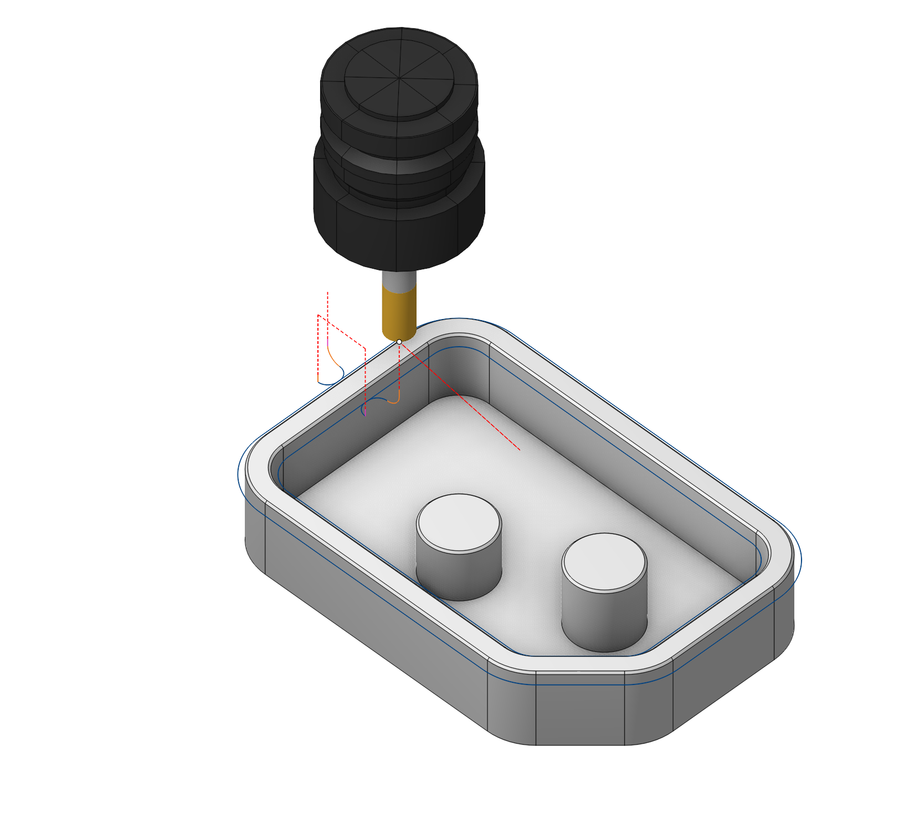
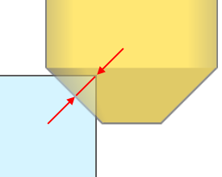
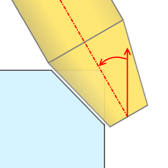
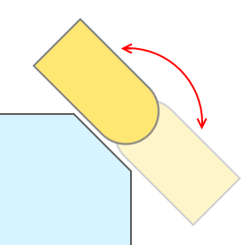
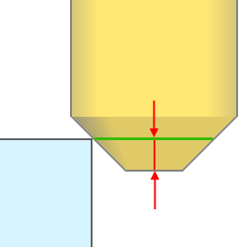
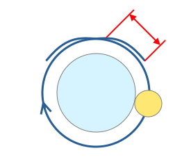
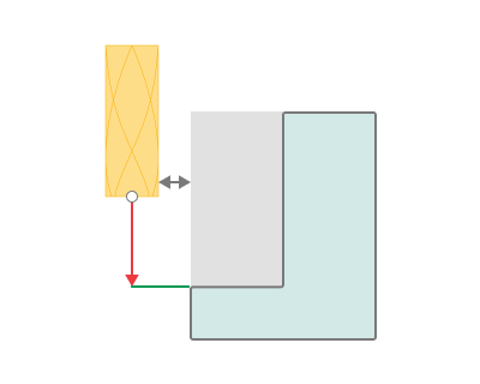
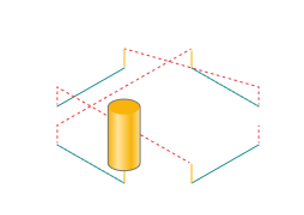
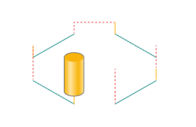

# 面取り

## 適用分野：

このオペレーションは、フラットエンドミル、円錐ミル、ボールミルを使用して、面取り加工用のツールパスを生成します。これは、主に3Dモデルで指定された面取りやフィレットを形成したり、鋭いエッジを丸めたり、パーツのエッジに沿ったバリ取りを行ったりする最終工程として使用されます。

## セットアップ：

<strong>セットアップ</strong>タブは、プロジェクトの主要なパラメータを設定するために使用されます。これには、装置上の部品の位置、部品の座標系などが含まれます。[詳細を見る](1022.md)

## ジョブ割り当て:

<strong>シャープ</strong> <strong>エッジ</strong><strong>を追加</strong> 3Dモデルのエッジに基づく面取り加工のツールパスを作成できます。エッジではなくサーフェスを選択すると、そのサーフェスのすべての鋭利なエッジが即座に<strong>ジョブ割り当て</strong>に追加されます。

<strong>フェイス</strong><strong>を追加</strong> 面取りとして設計されたサーフェスを選択することで、3Dモデル上の既存の面取り加工ができます。

<strong>検出</strong> 面取りを自動的に検出して<strong>ジョブ割り当て</strong>に追加できます。このシステムは、認識された要素を、<strong>シャープエッジ、CAD面取り、フィレット、穴面取り</strong>の4つのタイプに分類します。

<strong>プロパティ</strong> 選択した要素のプロパティを表示します。ストックを追加することも可能です。リスト内の項目をダブルクリックすることでも、このメニューを表示できます。

<strong>削除</strong> リストから項目を削除します。

<strong>制限</strong> 加工してはならない領域を制限することができます。[詳細を見る](101231.md)

## 加工設定：

### 加工設定

加工プロセスにおける加工形状を設定するパラメータのセットです。

拡大

<strong>面取り深さ</strong> 鋭利なエッジに対する面取りの深さを指定します。「CAD面取り」を加工する場合は、工具は面取りサーフェスに沿って移動します。

<strong>傾斜工具</strong> 工具を傾けて工具のサイドエッジで面取りを行うことができます。

<strong>工具</strong><strong>軸</strong><strong>方向</strong><strong>反転</strong> このパラメータでは、工具軸ベクトルの方向を反転できます。また、グラフィックウィンドウの方向矢印を使って側（サイド）を変更することでも同様の操作が可能で、その場合は、各曲線ごとに工具軸の方向が切り替わります。

<strong>工具接触点</strong> オペレーションの<strong>ジョブ割り当て</strong>で指定した幾何要素と主に接触する工具上の点です。接触点は、工具先端からの距離によって決まります。また、グラフィカルウィンドウでインタラクティブに調整することもできます。

<strong>オーバーラップ</strong> 閉じた面取りにおいてツールパスを延長そ、接合部でのバリの発生を防ぐことができます。

<strong>安全距離</strong> 工具の非切削部とワーク間との間に許容最小距離を設定し、工具がワークの要素に意図せず接触することを防ぎます。これは、凹部やポケットなどの面取り加工において重要です。

### ミーリングタイプ：

曲線加工オペレーションを除き、ほぼすべての加工で設定可能です。これにより、ツールパスの計算プロセス中に、必要なフライス加工タイプ（ダウンカットまたはアップカット）を設定できます。このパラメーターグループは <strong>ウォーターライン荒加工オペレーションと同様に機能します。</strong> [詳細を見る](736.md)

拡大

<strong>カーブ方向</strong> 工具の送り方向は、<strong>ジョブ割り当て</strong>のベクトル方向と一致します。

### 加工順序

サーフェス加工中におけるツールパスの順序を設定します 。

拡大

<strong>空送り移動の最小化</strong> 空送り動作を最小限に抑えるように、輪郭の加工順序を並べ替えます。

 

## パラメータ:

このタブには、部品、ワーク、治具、およびその他の軌跡に影響を与える要素を制御するための主要なパラメータが含まれており、ツールパスを変更できます。 [詳細を見る](100112.md)

## リンク／リード

リンク／リードタブでは、早送り動作のパラメータを設定します。これらの移動には、工具交換位置からのアプローチ、切削パス開始点までの位置決め、最終切削後の退避動作、各パス間の移行移動、および工具交換位置への復帰が含まれます。座標軸ごとの動作順序、各移動の軌跡、および移動量を設定できます。

拡大

<strong>次の項目で構成されます。</strong>

<strong>アプローチ／リターン</strong> このパラメータグループは、工具交換位置から切込み開始パスへの工具の移動、および戻りの動作を設定します。[詳細を見る](https://confluence.encycam.com/pages/viewpage.action?pageId=131904799)

<strong>リンク</strong> 進入／退出リンクおよび加工パス間のリンクに関するルールを設定します。[詳細を見る](https://confluence.encycam.com/pages/viewpage.action?pageId=137006979)

<strong>リード</strong> 移動動作に対して、送り速度を使用して追加の突き込みおよび退避を追加できます。 [詳細を見る](https://confluence.encycam.com/display/SC1/.Leads+for+5-axis+operation+v19)

<strong>安全動作</strong> <strong>安全サーフェス</strong>のタイプとワークから安全サーフェスまでの距離を設定します。加工面またはツールパス間の移行を円滑にし、アプローチまたはリターンの最初の段階は、この面に向かって行います。[詳細を見る](100117.md)

<strong>高度なリンク設定</strong> このパラメータグループでは、主に5軸加工において、回転軸の最適な動きを考慮した軌道形成の特性を指定します。[詳細を見る](100118.md)

<strong>距離</strong> リンクのルールで使われる距離です。 [詳細を見る](https://confluence.encycam.com/pages/viewpage.action?pageId=137012802)

## 送り速度設定

このダイアログを使用して、主軸回転速度、早送り値、ツールパスの各領域の送り値を設定できます。主軸回転速度は、毎分回転数または切削速度のいずれかで設定できます。設定値には下線が表示されます。もう一方の値は、工具径を考慮し、設定値に基づいて再計算されます。[詳細を見る](100142.md)

## 変換：

オペレーション内で計算された工具の軌跡に対して座標変換を行うためのパラメータグループです。[詳細を見る](10168.md)

## パーツ：

パーツは、干渉をチェックする空間を定義する幾何要素のグループです。[詳細を見る](330.md)

## ワーク：

加工のワークモデルは、加工する素材を定義します。[詳細を見る](738.md)

## 治具：

治具には通常、チャック、グリップ、クランプなどの固定補助具と、その他の種類の制限領域を指定します。[詳細を見る](10283.md)
