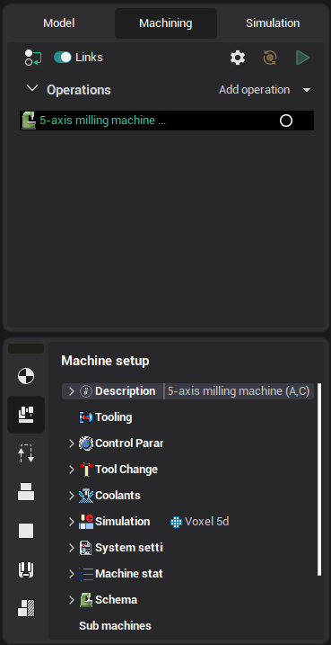
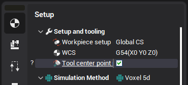

# 5-Achsen-Bearbeitung

Das CAM-System erzeugt Werkzeugbahnen für 5-Achsen-Fräsmaschinen unter Berücksichtigung von Maschinenkinematik und Steuerungsparametern. Es unterstützt zahlreiche Steuerungskonfigurationen. Die Bahn enthält Befehle zur Positionierung der XYZ-Achsen wie **GOTO** und **CIRCLE** sowie der Drehachsen über **MULTIGOTO**. Bei den meisten Steuerungen beschreiben Drehkoordinaten die tatsächlichen Achsstellungen, während XYZ-Koordinaten den Werkzeugbezugspunkt relativ zum Werkstückkoordinatensystem angeben. Steuerungen unterscheiden sich insbesondere darin, wie sie Werkzeugbezugspunkt und Werkstückkoordinatensystem nach dem Verstellen der Drehachsen behandeln.

Viele Steuerungen bieten einen normalen 3-Achsen-Modus und **Tool Center Point Management (TCPM)**. Ihr Verhalten in diesen Modi wird durch drei Eigenschaften beschrieben:

1. Ob sich der Werkzeugbezugspunkt mit dem Schwenkkopf dreht oder unverändert bleibt.

2. Ob sich der Werkstücknullpunkt, beispielsweise G54, mit dem Rundtisch dreht oder unverändert bleibt.

3. Ob sich die Achsrichtungen des Werkstückkoordinatensystems mit dem Rundtisch drehen oder unverändert bleiben.

Die zugehörigen Einstellungen befinden sich in der Maschinenkonfigurationsdatei unter **ControlData** sowie im Maschineneigenschaften-Inspektor unter **Control parameters**.

Folgende Optionen stehen zur Verfügung:

1. **TCPM mode is available.** Gibt TCPM für die kontinuierliche 5-Achsen-Fräsbearbeitung frei.

Bei aktivierter Option werden die Arbeitsbahnen durch **INTERP 5AXIS ON** und **INTERP 5AXIS OFF** eingerahmt. Die CLData-Ausgabe berücksichtigt die Einstellungen unter **TCPM 5Axis compensation mode**.

2. **TCPM mode default state.** Legt fest, ob TCPM bei neuen 5-Achsen-Fräsoperationen standardmäßig aktiviert ist.

3. **Indexed 5Axis compensation mode.** Enthält die Kompensationseinstellungen für den normalen 3-Achsen-Modus der Steuerung bei indexierter Bearbeitung.

4. **TCPM 5Axis compensation mode.** Enthält die entsprechenden Einstellungen für den TCPM-Modus.

5. **5 Axis tooling point compensation.** Bestimmt die Berücksichtigung der Werkzeugbezugspunktbewegung beim Drehen des Schwenkkopfs.

6. **5 Axis workpiece zero point compensation.** Bestimmt die Berücksichtigung des mit dem Rundtisch gedrehten Werkstücknullpunkts.

7. **5 Axis coordinate system compensation.** Bestimmt die Berücksichtigung der mit dem Rundtisch gedrehten Achsrichtungen des Werkstückkoordinatensystems.

Bei vielen modernen Steuerungen sind im TCPM-Modus alle drei Kompensationsfunktionen aktiviert. Dadurch kann die 5-Achsen-Bahn unabhängig von Maschinenkinematik, Werkstückaufspannung und Werkzeuglänge beschrieben werden.

Im normalen 3-Achsen-Modus sind diese Funktionen bei vielen Steuerungen deaktiviert. Sie verhalten sich dann wie gewöhnliche 3-Achsen-Steuerungen ohne Berücksichtigung der Maschinenkinematik. Für indexierte 3+2-Bahnen sind in diesem Fall lokale Koordinatensysteme erforderlich, beispielsweise mit der Heidenhain-Funktion **PLANE** oder **CYCLE 19**. Weitere Informationen finden Sie unter [Werkzeugausrichtung](260.md).

Für mehrachsige Operationen steht außerdem **Advanced axes limits control** zur erweiterten Überwachung der Achsgrenzen zur Verfügung.
